## 강의 순서 {#order}

```{=html}
<div class="order-grid">
  <div class="order-card ic-green">
    <svg viewBox="0 0 100 100" aria-hidden="true"><circle cx="30" cy="34" r="11" fill="#81C784"/><path d="M12,72 a18,18 0 0 1 36,0 z" fill="#81C784"/><circle cx="70" cy="34" r="11" fill="#81C784"/><path d="M52,72 a18,18 0 0 1 36,0 z" fill="#81C784"/><circle cx="50" cy="46" r="13" fill="#2E7D32"/><path d="M28,90 a22,22 0 0 1 44,0 z" fill="#2E7D32"/></svg>
    <div><span class="t">1. 임상시험</span>정의·설계·단계</div>
  </div>
  <div class="order-card ic-blue">
    <svg viewBox="0 0 100 100" aria-hidden="true"><path d="M22,10 H62 L78,26 V90 H22 Z" fill="#ffffff" stroke="#1565C0" stroke-width="5" stroke-linejoin="round"/><path d="M62,10 V26 H78" fill="none" stroke="#1565C0" stroke-width="5" stroke-linejoin="round"/><line x1="32" y1="40" x2="66" y2="40" stroke="#90CAF9" stroke-width="5"/><line x1="32" y1="52" x2="58" y2="52" stroke="#90CAF9" stroke-width="5"/><circle cx="64" cy="72" r="15" fill="#1565C0"/><path d="M57,72 l5,5 l9,-10" fill="none" stroke="#ffffff" stroke-width="4.5" stroke-linecap="round" stroke-linejoin="round"/></svg>
    <div><span class="t">2. 인허가 과정</span>식약처·FDA, 허가와 급여</div>
  </div>
  <div class="order-card ic-teal">
    <svg viewBox="0 0 100 100" aria-hidden="true"><g transform="rotate(-35 28 50)"><rect x="8" y="40" width="40" height="20" rx="10" fill="#ffffff" stroke="#00838F" stroke-width="4"/><path d="M28,40 h10 a10,10 0 0 1 0,20 h-10 z" fill="#00838F"/></g><rect x="66" y="18" width="12" height="11" fill="#00838F"/><path d="M62,29 H82 L79,70 L72,80 L65,70 Z" fill="#B2DFDB" stroke="#00838F" stroke-width="4" stroke-linejoin="round"/><g stroke="#00838F" stroke-width="3"><line x1="63" y1="40" x2="81" y2="37"/><line x1="64" y1="50" x2="80" y2="47"/><line x1="65" y1="60" x2="79" y2="57"/></g></svg>
    <div><span class="t">3. 신약 vs 의료기기</span>임상 설계 차이</div>
  </div>
  <div class="order-card ic-purple">
    <svg viewBox="0 0 100 100" aria-hidden="true"><polyline points="14,12 14,86 90,86" fill="none" stroke="#7B1FA2" stroke-width="5"/><path d="M18,22 H34 V32 H50 V42 H64 V54 H86" fill="none" stroke="#7B1FA2" stroke-width="5"/><path d="M18,22 H28 V38 H42 V54 H56 V66 H86" fill="none" stroke="#CE93D8" stroke-width="5"/></svg>
    <div><span class="t">4. RACING</span>비열등성 RCT, Lancet 2022</div>
  </div>
  <div class="order-card ic-gray">
    <svg viewBox="0 0 100 100" aria-hidden="true"><rect x="12" y="30" width="76" height="54" rx="8" fill="#ffffff" stroke="#37474F" stroke-width="5"/><path d="M38,30 V20 H62 V30" fill="none" stroke="#37474F" stroke-width="5"/><line x1="12" y1="52" x2="88" y2="52" stroke="#37474F" stroke-width="4"/><rect x="44" y="46" width="12" height="12" rx="2" fill="#37474F"/></svg>
    <div><span class="t">5. 실제 사례</span>루닛 (AI 의료기기)<br>신라젠 (항암 신약)</div>
  </div>
  <div class="order-card ic-orange">
    <svg viewBox="0 0 100 100" aria-hidden="true"><path d="M14,20 H86 V66 H44 L28,82 V66 H14 Z" fill="#ffffff" stroke="#EF6C00" stroke-width="5" stroke-linejoin="round"/><path d="M50,28 L54,39 L65,43 L54,47 L50,58 L46,47 L35,43 L46,39 Z" fill="#EF6C00"/><circle cx="70" cy="31" r="4" fill="#FFB74D"/><circle cx="30" cy="55" r="3.5" fill="#FFB74D"/></svg>
    <div><span class="t">6. 생성형 AI</span>의료기기 허가<br>의료데이터 활용 기준</div>
  </div>
</div>
```

::: highlight-box
질문: **이 약, 이 임플란트는 어떻게 환자에게 쓰일 수 있게 됐을까?**
:::

# 임상시험이란

## 임상시험 {#trial-def}

::: definition-box
사람을 대상으로 의약품·의료기기의 **안전성**과 **유효성**을 증명하기 위한 시험
:::

:::: columns
::: {.column width="58%"}
```{=html}
<svg class="diagram" viewBox="0 0 900 330" role="img" aria-label="무작위배정 임상시험 흐름">
  <defs><marker id="arA" viewBox="0 0 10 10" refX="8" refY="5" markerWidth="6" markerHeight="6" orient="auto"><path d="M0,0 L10,5 L0,10 z" fill="#78909C"/></marker></defs>
  <rect x="4" y="115" width="176" height="100" rx="14" fill="#ffffff" stroke="#90A4AE" stroke-width="3"/>
  <text x="92" y="160" text-anchor="middle" font-size="28" font-weight="800" fill="#263238">대상자</text>
  <text x="92" y="194" text-anchor="middle" font-size="20" fill="#455A64">선정·제외 기준</text>
  <line x1="182" y1="165" x2="220" y2="165" stroke="#78909C" stroke-width="4" marker-end="url(#arA)"/>
  <circle cx="290" cy="165" r="64" fill="#1565C0"/>
  <text x="290" y="158" text-anchor="middle" font-size="24" font-weight="800" fill="#ffffff">무작위</text>
  <text x="290" y="190" text-anchor="middle" font-size="24" font-weight="800" fill="#ffffff">배정</text>
  <line x1="345" y1="132" x2="424" y2="86" stroke="#78909C" stroke-width="4" marker-end="url(#arA)"/>
  <line x1="345" y1="198" x2="424" y2="244" stroke="#78909C" stroke-width="4" marker-end="url(#arA)"/>
  <rect x="432" y="22" width="236" height="112" rx="14" fill="#E8F5E9" stroke="#2E7D32" stroke-width="3"/>
  <text x="550" y="70" text-anchor="middle" font-size="28" font-weight="800" fill="#1B5E20">시험군</text>
  <text x="550" y="106" text-anchor="middle" font-size="21" fill="#1B5E20">새 치료</text>
  <rect x="432" y="196" width="236" height="112" rx="14" fill="#ECEFF1" stroke="#78909C" stroke-width="3"/>
  <text x="550" y="244" text-anchor="middle" font-size="28" font-weight="800" fill="#37474F">대조군</text>
  <text x="550" y="280" text-anchor="middle" font-size="21" fill="#37474F">위약·표준치료</text>
  <rect x="490" y="147" width="120" height="36" rx="18" fill="#F3E5F5" stroke="#7B1FA2" stroke-width="2"/>
  <text x="550" y="172" text-anchor="middle" font-size="19" font-weight="800" fill="#4A148C">눈가림</text>
  <line x1="670" y1="78" x2="728" y2="140" stroke="#78909C" stroke-width="4" marker-end="url(#arA)"/>
  <line x1="670" y1="252" x2="728" y2="190" stroke="#78909C" stroke-width="4" marker-end="url(#arA)"/>
  <rect x="736" y="110" width="160" height="110" rx="14" fill="#FFF3E0" stroke="#EF6C00" stroke-width="3"/>
  <text x="816" y="158" text-anchor="middle" font-size="26" font-weight="800" fill="#8a4b12">결과 비교</text>
  <text x="816" y="192" text-anchor="middle" font-size="19" fill="#8a4b12">1차 평가변수</text>
</svg>
```

::: fig-cap
무작위배정 임상시험 (RCT)의 기본 구조
:::
:::

::: {.column width="42%"}
| 구분 | 관찰연구 | 무작위배정 임상시험 |
|------------|---------------------------|---------------------------|
| 치료 결정 | 진료 그대로 관찰 | 계획서대로 배정 |
| 예 | 코호트, 환자-대조군 | 무작위배정 임상시험 (RCT) |
| 두 군 비교 | 통계적 보정 필요 | 무작위배정으로 평균적으로 비슷하게 |
:::
::::

::: highlight-box-gray
동물·세포 실험 = 비임상시험 · 사람 대상 연구 = 임상연구 ⊃ 임상시험
:::

## 좋은 비교 임상시험의 조건 {#conditions}

```{=html}
<div class="icon-grid-4">
  <div class="icon-card ic-green">
    <svg viewBox="0 0 100 100" aria-hidden="true"><circle cx="30" cy="32" r="12" fill="#2E7D32"/><path d="M10,76 a20,20 0 0 1 40,0 z" fill="#2E7D32"/><circle cx="70" cy="32" r="12" fill="#90A4AE"/><path d="M50,76 a20,20 0 0 1 40,0 z" fill="#90A4AE"/><text x="50" y="97" text-anchor="middle" font-size="15" font-weight="800" fill="#455A64">vs</text></svg>
    <span class="t">대조군</span>위약·표준치료와 비교<span class="s">자연 회복·위약 효과 분리</span>
  </div>
  <div class="icon-card ic-blue">
    <svg viewBox="0 0 100 100" aria-hidden="true"><rect x="16" y="16" width="68" height="68" rx="14" fill="#ffffff" stroke="#1565C0" stroke-width="5"/><g fill="#1565C0"><circle cx="34" cy="34" r="6"/><circle cx="66" cy="34" r="6"/><circle cx="50" cy="50" r="6"/><circle cx="34" cy="66" r="6"/><circle cx="66" cy="66" r="6"/></g></svg>
    <span class="t">무작위배정</span>두 군을 평균적으로 비슷하게<span class="s">차이를 치료 효과로 해석</span>
  </div>
  <div class="icon-card ic-teal">
    <svg viewBox="0 0 100 100" aria-hidden="true"><path d="M8,50 C24,24 76,24 92,50 C76,76 24,76 8,50 Z" fill="#ffffff" stroke="#00838F" stroke-width="5"/><circle cx="50" cy="50" r="13" fill="#00838F"/><line x1="18" y1="84" x2="82" y2="16" stroke="#00838F" stroke-width="6" stroke-linecap="round"/></svg>
    <span class="t">눈가림</span>환자·의사·평가자가 모르게<span class="s">기대·평가 편향 줄이기</span>
  </div>
  <div class="icon-card ic-purple">
    <svg viewBox="0 0 100 100" aria-hidden="true"><rect x="22" y="16" width="56" height="72" rx="8" fill="#ffffff" stroke="#7B1FA2" stroke-width="5"/><rect x="38" y="9" width="24" height="14" rx="4" fill="#7B1FA2"/><path d="M34,54 l11,11 l21,-22" fill="none" stroke="#7B1FA2" stroke-width="6" stroke-linecap="round" stroke-linejoin="round"/></svg>
    <span class="t">사전 계획·등록</span>계획서·분석계획서 먼저<span class="s">ClinicalTrials.gov, CRIS</span>
  </div>
</div>
```

::: highlight-box
결과를 보기 전에 **방법을 먼저 정한다**: 평가변수, 대상자 수, 분석 방법
:::

## 연구 윤리와 규정 {#ethics}

:::::: flow-4
::: flow-step
[1947]{.yr} **뉘른베르크 강령**<br>자발적 동의
:::

::: flow-step
[1964]{.yr} **헬싱키 선언**<br>세계의사회 윤리 원칙
:::

::: flow-step
[1979]{.yr} **벨몬트 보고서**<br>터스키기 연구 이후
:::

::: flow-step
[1996]{.yr} **ICH E6 GCP**<br>임상시험 국제 기준
:::
::::::

| 지금 지키는 것 | 내용 |
|----------------------------------|------------------------------------------------------|
| IRB (임상시험심사위원회) | 계획서·설명문·동의서 심의 |
| 동의서 | 충분한 설명 후 서면 동의, 언제든 철회 가능 |
| GCP | 국내: 의약품·의료기기 임상시험 관리기준 |

::: highlight-box-gray
터스키기 매독 연구 (1932–1972): 페니실린이 표준치료가 된 뒤에도 치료하지 않고 관찰
:::

## 임상시험에 참여하는 사람들 {#people}

```{=html}
<svg class="diagram" style="width:88%; margin:0 auto;" viewBox="0 0 1400 600" role="img" aria-label="임상시험 참여자 관계도">
  <g stroke="#B0BEC5" stroke-width="4">
    <line x1="700" y1="300" x2="700" y2="60"/><line x1="700" y1="300" x2="1185" y2="120"/>
    <line x1="700" y1="300" x2="1235" y2="300"/><line x1="700" y1="300" x2="1185" y2="480"/>
    <line x1="700" y1="300" x2="700" y2="540"/><line x1="700" y1="300" x2="215" y2="480"/>
    <line x1="700" y1="300" x2="165" y2="300"/><line x1="700" y1="300" x2="215" y2="120"/>
  </g>
  <circle cx="700" cy="300" r="105" fill="#2A3D21"/>
  <text x="700" y="296" text-anchor="middle" font-size="36" font-weight="900" fill="#ffffff">임상시험</text>
  <text x="700" y="336" text-anchor="middle" font-size="23" fill="#C8E6C9">대상자</text>
  <g text-anchor="middle">
    <rect x="550" y="12" width="300" height="96" rx="16" fill="#E3F2FD" stroke="#1565C0" stroke-width="3"/>
    <text x="700" y="54" font-size="27" font-weight="800" fill="#0D47A1">의뢰자 (Sponsor)</text>
    <text x="700" y="88" font-size="21" fill="#0D47A1">책임 주체: 회사·연구기관</text>
    <rect x="1035" y="72" width="300" height="96" rx="16" fill="#ECEFF1" stroke="#78909C" stroke-width="3"/>
    <text x="1185" y="114" font-size="27" font-weight="800" fill="#263238">CRO</text>
    <text x="1185" y="148" font-size="21" fill="#37474F">임상 업무 대행</text>
    <rect x="1085" y="252" width="300" height="96" rx="16" fill="#E8F5E9" stroke="#2E7D32" stroke-width="3"/>
    <text x="1235" y="294" font-size="27" font-weight="800" fill="#1B5E20">시험책임자 (PI)</text>
    <text x="1235" y="328" font-size="21" fill="#1B5E20">의사·치과의사: 진료·평가</text>
    <rect x="1035" y="432" width="300" height="96" rx="16" fill="#F3E5F5" stroke="#7B1FA2" stroke-width="3"/>
    <text x="1185" y="474" font-size="27" font-weight="800" fill="#4A148C">IRB</text>
    <text x="1185" y="508" font-size="21" fill="#4A148C">기관 윤리 심의</text>
    <rect x="550" y="492" width="300" height="96" rx="16" fill="#FFF3E0" stroke="#EF6C00" stroke-width="3"/>
    <text x="700" y="534" font-size="27" font-weight="800" fill="#8a4b12">규제기관</text>
    <text x="700" y="568" font-size="21" fill="#8a4b12">식약처·FDA·PMDA·EMA</text>
    <rect x="65" y="432" width="300" height="96" rx="16" fill="#F3E5F5" stroke="#7B1FA2" stroke-width="3"/>
    <text x="215" y="474" font-size="27" font-weight="800" fill="#4A148C">DSMB</text>
    <text x="215" y="508" font-size="21" fill="#4A148C">독립 안전성 모니터링</text>
    <rect x="15" y="252" width="300" height="96" rx="16" fill="#2E7D32"/>
    <text x="165" y="294" font-size="27" font-weight="800" fill="#ffffff">통계 담당자</text>
    <text x="165" y="328" font-size="21" fill="#E8F5E9">대상자 수·분석계획서·분석</text>
    <rect x="65" y="72" width="300" height="96" rx="16" fill="#ECEFF1" stroke="#78909C" stroke-width="3"/>
    <text x="215" y="114" font-size="27" font-weight="800" fill="#263238">CRA · CRC</text>
    <text x="215" y="148" font-size="21" fill="#37474F">자료 확인·방문 관리</text>
  </g>
</svg>
```

::: highlight-box
오늘 사례에서 차라투의 역할 = **통계 담당자**: 설계부터 허가 서류까지
:::

## 신약 임상시험 단계 {#phases}

```{=html}
<div class="stairs">
  <div class="stair p1"><span class="ph">1상</span><span class="q">안전한가?<br>몸에서 어떻게 움직이나?</span><span class="n">건강인 (항암제는 환자)<br><b>수십 명</b></span></div>
  <div class="stair p2"><span class="ph">2상</span><span class="q">효과가 보이나?<br>어느 용량이 좋은가?</span><span class="n">환자<br><b>수십–수백 명</b></span></div>
  <div class="stair p3"><span class="ph">3상</span><span class="q">기존 치료보다<br>낫거나 비슷한가?</span><span class="n">환자, 대조군과 비교<br><b>수백–수천 명</b></span></div>
  <div class="stair p4"><span class="ph">4상</span><span class="q">실제 진료에서도<br>안전한가?</span><span class="n">처방받은 환자<br><b>허가 후 추가 연구</b></span></div>
</div>
<div class="stair-band"><div class="pre">허가 전: 인허가 임상 (1–3상)</div><div class="post">허가 후</div></div>
```

## 허가까지 갈 확률 {#success}

:::: columns
::: {.column width="62%"}
```{=html}
<div class="funnel">
  <div class="f-row"><span class="f-label">1상 → 2상</span><span class="f-track"><span class="f-bar" style="width:52.0%">52.0%</span></span></div>
  <div class="f-row"><span class="f-label">2상 → 3상</span><span class="f-track"><span class="f-bar low" style="width:28.9%">28.9%</span></span></div>
  <div class="f-row"><span class="f-label">3상 → 허가 신청</span><span class="f-track"><span class="f-bar" style="width:57.8%">57.8%</span></span></div>
  <div class="f-row"><span class="f-label">허가 신청 → 허가</span><span class="f-track"><span class="f-bar" style="width:90.6%">90.6%</span></span></div>
  <div class="f-row total"><span class="f-label">1상 → 허가</span><span class="f-track"><span class="f-bar" style="width:7.9%"></span><span class="f-out">7.9%</span></span></div>
</div>
```

::: small-source
BIO, Informa, QLS. Clinical Development Success Rates 2011–2020 (2021) · 기간: PhRMA Industry Profile
:::
:::

::: {.column width="38%"}
:::::: stat-stack
::: stat-card
[10–15년]{.num} 후보물질부터 허가까지 (PhRMA)
:::

::: stat-card
[7.9%]{.num} 1상 진입 후 허가 도달 확률 (2011–2020 단계별 통과율로 추정)
:::

::: {.stat-card .red}
[5.3%]{.num} 항암제
:::
::::::
:::
::::

::: highlight-box
가장 큰 벽은 **2상**: 2상 약물 10개 중 7개는 3상으로 가지 못함
:::

# 인허가 과정

## 신약: 실험실에서 환자까지 {#drug-path}

:::::: flow-6
::: flow-step
**후보물질**<br>발굴·최적화
:::

::: flow-step
**비임상**<br>동물 독성·약리<br>(GLP)
:::

::: {.flow-step .hl}
**임상시험 승인**<br>식약처 + IRB<br>(IND)
:::

::: {.flow-step .hl}
**임상 1·2·3상**<br>GCP 준수
:::

::: {.flow-step .hl}
**품목허가**<br>식약처 심사<br>(NDA)
:::

::: {.flow-step .hl2}
**시판 후**<br>안전성 감시<br>추가 연구 (4상)
:::
::::::

```{=html}
<div class="span-row"><div class="sp-pre" style="grid-column: 1 / 3">허가 전 준비</div><div class="sp-main" style="grid-column: 3 / 6">인허가 임상: 식약처 승인 → 허가</div><div class="sp-post">허가 후</div></div>
```

::: chain
[보험 급여]{.lbl} [심평원 급여 평가]{.node} [→]{.arr} [건보공단 약가 협상]{.node} [→]{.arr} [복지부 고시]{.node}
:::

::: highlight-box
전형적인 흐름 (제품·경로마다 다름) · 허가 = **팔 수 있다** · 급여 = **건강보험으로 쓸 수 있다**
:::

## 나라별 규제기관 {#regulators}

```{=html}
<div class="country-grid">
  <div class="country"><div class="cc" style="background:#1565C0">KR</div><div><span class="ag">식품의약품안전처 (MFDS)</span><span class="row"><span class="lb">의약품</span>품목허가</span><span class="row"><span class="lb">의료기기</span>1등급 신고 · 2등급 인증 (일부 허가) · 3·4등급 허가</span></div></div>
  <div class="country"><div class="cc" style="background:#C62828">US</div><div><span class="ag">FDA</span><span class="row"><span class="lb">의약품</span>NDA (합성), BLA (바이오)</span><span class="row"><span class="lb">의료기기</span>510(k), De Novo, PMA</span></div></div>
  <div class="country"><div class="cc" style="background:#283593">EU</div><div><span class="ag">EMA (의약품) · 인증기관 (의료기기)</span><span class="row"><span class="lb">의약품</span>중앙절차: EMA 평가 → 유럽위원회 허가</span><span class="row"><span class="lb">의료기기</span>적합성 평가 후 제조자 CE 표시 (등급에 따라 인증기관 참여)</span></div></div>
  <div class="country"><div class="cc" style="background:#AD1457">JP</div><div><span class="ag">PMDA · 후생노동성</span><span class="row"><span class="lb">의약품</span>승인</span><span class="row"><span class="lb">의료기기</span>승인·인증</span></div></div>
</div>
```

::: highlight-box
같은 임상 자료를 여러 나라에 제출 → 국제 조화 지침 **ICH** (의약품)·**IMDRF** (의료기기) · 나라별 추가 요구는 따로
:::

## 임상시험 문서와 통계 {#documents}

:::::: flow-5
::: flow-step
**계획서**<br>Protocol
:::

::: {.flow-step .hl}
**분석계획서**<br>SAP
:::

::: flow-step
**데이터 잠금**<br>DB lock
:::

::: flow-step
**분석**<br>표·목록·그림
:::

::: flow-step
**결과보고서**<br>CSR
:::
::::::

| 단계 | 통계 담당자가 함께 설계하는 것 |
|------------------------|------------------------------------------------------------------|
| 계획서 | 가설, 1차 평가변수, 대상자 수, 무작위배정 방법 |
| 분석계획서 | 분석 대상군 (ITT: 배정대로, PP: 계획서 준수자), 결측 처리, 하위군, 다중성 |
| 진행 중 | 중간분석, 자료안전성모니터링위원회 (DSMB) 보고 |
| 허가 신청 | 결과보고서, 규제기관 질의 답변 |

::: highlight-box
주요 분석 방법은 **결과를 보기 전에 확정** · 바꾸면 시점·이유를 기록하고 사전 계획 분석과 구분해 보고
:::

## 의료기기 등급: 치과 품목 {#device-class}

```{=html}
<svg class="diagram" style="width:94%; margin:0 auto;" viewBox="0 20 1460 550" role="img" aria-label="의료기기 등급 피라미드와 치과 임플란트 품목별 등급">
  <polygon points="10,560 650,560 587.5,435 72.5,435" fill="#C8E6C9"/>
  <polygon points="75,430 585,430 522.5,305 137.5,305" fill="#81C784"/>
  <polygon points="140,300 520,300 457.5,175 202.5,175" fill="#43A047"/>
  <polygon points="205,170 455,170 392.5,45 267.5,45" fill="#1B5E20"/>
  <g text-anchor="middle">
    <text x="330" y="497" font-size="32" font-weight="900" fill="#1B5E20">1등급 · 신고</text>
    <text x="330" y="535" font-size="22" fill="#1B5E20">위해도 거의 없음</text>
    <text x="330" y="367" font-size="32" font-weight="900" fill="#0f3d12">2등급 · 인증</text>
    <text x="330" y="405" font-size="22" fill="#0f3d12">낮음 · 일부는 허가</text>
    <text x="330" y="237" font-size="30" font-weight="900" fill="#ffffff">3등급 · 허가</text>
    <text x="330" y="275" font-size="22" fill="#ffffff">중증도</text>
    <text x="330" y="112" font-size="24" font-weight="900" fill="#ffffff">4등급 · 허가</text>
    <text x="330" y="146" font-size="21" fill="#ffffff">고도</text>
  </g>
  <rect x="760" y="330" width="380" height="230" rx="10" fill="#F5E6C8"/>
  <g fill="#E8D3A8"><circle cx="800" cy="400" r="9"/><circle cx="850" cy="470" r="12"/><circle cx="1080" cy="430" r="10"/><circle cx="1100" cy="520" r="13"/><circle cx="820" cy="535" r="8"/><circle cx="1040" cy="540" r="9"/></g>
  <path d="M760,345 L760,322 Q850,290 950,296 Q1050,290 1140,322 L1140,345 Z" fill="#F48FB1"/>
  <path d="M915,300 L985,300 L978,515 L950,548 L922,515 Z" fill="#B0BEC5" stroke="#546E7A" stroke-width="3"/>
  <g stroke="#546E7A" stroke-width="3">
    <line x1="916" y1="330" x2="984" y2="318"/><line x1="917" y1="362" x2="983" y2="350"/><line x1="918" y1="394" x2="982" y2="382"/>
    <line x1="919" y1="426" x2="981" y2="414"/><line x1="920" y1="458" x2="980" y2="446"/><line x1="921" y1="490" x2="979" y2="478"/>
  </g>
  <path d="M926,300 L974,300 L966,232 L934,232 Z" fill="#CFD8DC" stroke="#546E7A" stroke-width="3"/>
  <path d="M888,238 C878,200 876,150 893,124 C908,103 930,116 950,110 C970,116 992,103 1007,124 C1024,150 1022,200 1012,238 Z" fill="#ffffff" stroke="#90A4AE" stroke-width="3"/>
  <g fill="#FFB74D" stroke="#EF6C00" stroke-width="2"><circle cx="1000" cy="345" r="9"/><circle cx="1018" cy="362" r="8"/><circle cx="996" cy="372" r="7"/><circle cx="1022" cy="388" r="9"/><circle cx="1004" cy="398" r="7"/></g>
  <rect x="800" y="128" width="40" height="86" rx="12" fill="#B39DDB" stroke="#5E35B1" stroke-width="3"/>
  <rect x="815" y="214" width="10" height="70" fill="#78909C"/>
  <text x="788" y="160" text-anchor="end" font-size="26" font-weight="800" fill="#263238">시술기구</text>
  <text x="788" y="194" text-anchor="end" font-size="26" font-weight="800" fill="#66BB6A">1등급</text>
  <g stroke="#455A64" stroke-width="2"><line x1="972" y1="266" x2="1128" y2="250"/><line x1="1030" y1="372" x2="1128" y2="356"/><line x1="984" y1="452" x2="1128" y2="462"/></g>
  <text x="1135" y="258" font-size="27" font-weight="800" fill="#263238">상부구조물 <tspan fill="#43A047">2등급</tspan></text>
  <text x="1135" y="364" font-size="27" font-weight="800" fill="#263238">골 이식재 <tspan fill="#1B5E20">4등급</tspan></text>
  <text x="1135" y="470" font-size="27" font-weight="800" fill="#263238">고정체 <tspan fill="#2E7D32">3등급</tspan></text>
</svg>
```

::: small-source
식약처 고시 「의료기기 품목 및 품목별 등급에 관한 규정」 제2023-41호 (2023.6.12) 기준
:::

::: highlight-box
등급은 사용목적·침습성·접촉 기간 등 위해도로 결정 · 임상시험 자료 필요 여부는 **기존 제품과의 동등성**·변경 내용으로 판단
:::

## 의료기기: 허가에서 진료까지 {#device-path}

:::::: flow-6
::: flow-step
**등급 분류**<br>품목·위해도
:::

::: flow-step
**임상시험 승인**<br>필요할 때<br>식약처 + IRB
:::

::: {.flow-step .hl}
**탐색 임상**<br>pilot<br>필요에 따라
:::

::: {.flow-step .hl}
**확증 임상**<br>pivotal<br>허가 근거
:::

::: flow-step
**허가·인증**<br>식약처
:::

::: {.flow-step .hl2}
**진료 도입·급여**<br>기존 기술 확인<br>필요시 신의료기술 평가
:::
::::::

::: highlight-box-blue
**디지털의료제품법** (2025.1 시행): AI·소프트웨어 의료기기 별도 체계, 요건을 갖춘 비접촉·저위험 임상은 실시기관 승인으로 진행 가능
:::

::: highlight-box-gray
미국 FDA: 510(k) 기존 제품과 동등성 · De Novo 새로운 저·중위험 · PMA 고위험
:::

# 신약 vs 의료기기

## 임상 설계 비교: 대표적인 경향 {#compare}

```{=html}
<table class="cmp-table">
<colgroup><col style="width:17%"><col style="width:38%"><col style="width:45%"></colgroup>
<thead><tr><th>항목</th><th><svg class="th-ic" viewBox="0 0 100 100" aria-hidden="true"><g transform="rotate(-35 50 50)"><rect x="16" y="36" width="68" height="28" rx="14" fill="#ffffff" stroke="#A5D6A7" stroke-width="6"/><path d="M50,36 h20 a14,14 0 0 1 0,28 h-20 z" fill="#A5D6A7"/></g></svg>신약</th><th><svg class="th-ic" viewBox="0 0 100 100" aria-hidden="true"><path d="M30,38 C27,24 33,12 42,14 C46,15 48,18 50,18 C52,18 54,15 58,14 C67,12 73,24 70,38 Z" fill="#ffffff" stroke="#90CAF9" stroke-width="5"/><rect x="43" y="38" width="14" height="10" fill="#CFD8DC"/><path d="M40,48 H60 L57,84 L50,92 L43,84 Z" fill="#CFD8DC" stroke="#90CAF9" stroke-width="4"/></svg>의료기기</th></tr></thead>
<tbody>
<tr><td>단계</td><td>1·2·3·4상</td><td>탐색 (pilot) → 확증 (pivotal)</td></tr>
<tr><td>핵심 질문</td><td>어느 용량에서 얼마나 효과가 있나</td><td>성능, 사용법, 시술 결과</td></tr>
<tr><td>첫 대상</td><td>건강인 (항암제는 환자)</td><td>주로 환자</td></tr>
<tr><td>눈가림</td><td>위약 이중눈가림이 흔함</td><td>수술·시술은 어려움 → 평가자 눈가림</td></tr>
<tr><td>시술자 영향</td><td>적음</td><td>숙련도·학습곡선</td></tr>
<tr><td>제품 변경</td><td>성분 고정 (제형·공정 변경은 평가)</td><td>버전 개선이 잦음</td></tr>
<tr><td>대상자 수</td><td>3상 수백–수천 명</td><td>보통 수십–수백 명</td></tr>
<tr><td>임상 필요</td><td>신약은 필수</td><td>등급·동등성에 따라 면제되기도 함</td></tr>
</tbody>
</table>
```

## 항암 1상: 용량 찾기 {#dose}

:::: columns
::: {.column width="60%"}
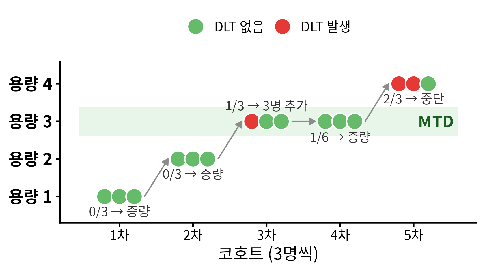{width="100%"}
:::

::: {.column width="40%"}
:::::: stat-stack
::: stat-card
**DLT** (용량제한독성)<br>미리 정한 기간 (보통 첫 주기)의 기준 이상 독성
:::

::: stat-card
**MTD** (최대내약용량)<br>미리 정한 독성 기준으로 고른 가장 높은 용량
:::

::: {.stat-card .blue}
**RP2D** (Recommended Phase 2 Dose)<br>독성·약동학·약력학·효과 종합, MTD와 다를 수 있음
:::
::::::
:::
::::

::: highlight-box
모형 기반 방법도 씀: **BLRM** (Bayesian)은 모든 용량의 DLT 자료로 다음 용량 결정을 돕는다
:::

## 항암 2상: Simon 2단계 설계 {#simon}

:::: columns
::: {.column width="47%"}
```{=html}
<div class="vstage">
  <div class="stage-box"><strong>1단계</strong>: 10명 투여</div>
  <div class="v-arrow">↓</div>
  <div class="v-split">
    <div class="stage-box stop">반응 <strong>1명 이하</strong><br>→ 중단</div>
    <div class="stage-box go">반응 <strong>2명 이상</strong><br>→ 19명 추가</div>
  </div>
  <div class="v-arrow right">↓</div>
  <div class="stage-box go"><strong>2단계</strong>: 총 29명 중<br>반응 <strong>6명 이상</strong> → 유망 기준 충족</div>
</div>
```

::: muted-note
가정: 반응률 10%는 더 개발할 가치가 없는 수준, 30%는 유망한 수준 · 단측 α 0.05 · 검정력 80% (Simon 최적 설계) · 다음 개발은 안전성 등과 함께 판단
:::
:::

::: {.column width="53%"}
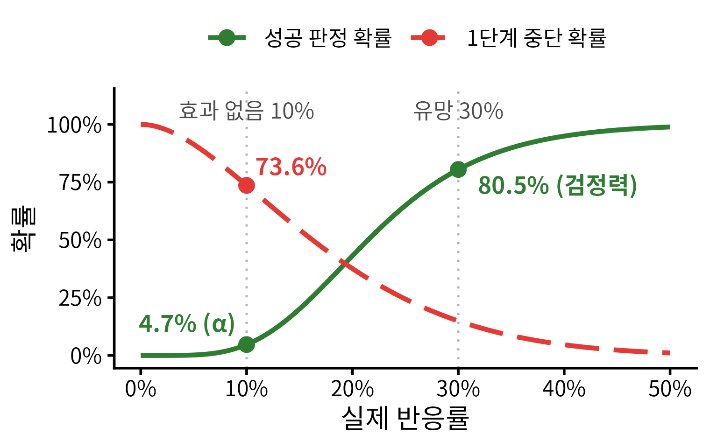{width="100%"}
:::
::::

::: highlight-box
기준에 못 미치는 약은 일찍 멈춘다: 실제 반응률이 10%면 1단계에서 멈출 확률 **74%**, 평균 **15명**만 투여
:::

## 치과에서 만나는 인허가 임상 {#dental}

```{=html}
<div class="icon-grid-3">
  <div class="icon-card ic-green">
    <svg viewBox="0 0 100 100" aria-hidden="true"><g transform="rotate(-35 50 50)"><rect x="16" y="36" width="68" height="28" rx="14" fill="#ffffff" stroke="#2E7D32" stroke-width="5"/><path d="M50,36 h20 a14,14 0 0 1 0,28 h-20 z" fill="#2E7D32"/></g></svg>
    <span class="t">의약품</span>국소마취제, 치주 국소 항생제<span class="s">대조약·위약 비교, 이상사례</span>
  </div>
  <div class="icon-card ic-blue">
    <svg viewBox="0 0 100 100" aria-hidden="true"><path d="M30,38 C27,24 33,12 42,14 C46,15 48,18 50,18 C52,18 54,15 58,14 C67,12 73,24 70,38 Z" fill="#ffffff" stroke="#1565C0" stroke-width="4"/><rect x="43" y="38" width="14" height="10" fill="#90A4AE"/><path d="M40,48 H60 L57,84 L50,92 L43,84 Z" fill="#B0BEC5" stroke="#546E7A" stroke-width="3"/><g stroke="#546E7A" stroke-width="3"><line x1="41" y1="56" x2="59" y2="53"/><line x1="41" y1="64" x2="58" y2="61"/><line x1="42" y1="72" x2="58" y2="69"/><line x1="43" y1="80" x2="57" y2="77"/></g></svg>
    <span class="t">의료기기</span>임플란트 고정체 (3등급)<br>골 이식재 (4등급)<span class="s">임플란트 생존율, 변연골 소실, 장기 추적</span>
  </div>
  <div class="icon-card ic-teal">
    <svg viewBox="0 0 100 100" aria-hidden="true"><rect x="12" y="18" width="76" height="52" rx="6" fill="#ffffff" stroke="#00838F" stroke-width="5"/><rect x="42" y="70" width="16" height="10" fill="#00838F"/><rect x="30" y="80" width="40" height="6" rx="3" fill="#00838F"/><text x="50" y="54" text-anchor="middle" font-size="26" font-weight="900" fill="#00838F">AI</text></svg>
    <span class="t">소프트웨어</span>치과영상 검출·진단보조 (2등급)<span class="s">단독 성능 + 판독자 연구</span>
  </div>
</div>
```

::: highlight-box
치과의사 = **시험책임자**로, 회사의 임상·인허가 담당으로, 규제기관 심사자로 참여
:::

## 치과 임상의 분석 단위 {#dental-unit}

```{=html}
<svg class="diagram" style="width:84%; margin:0 auto;" viewBox="0 0 1400 470" role="img" aria-label="한 환자 여러 임플란트와 split-mouth 설계">
  <text x="370" y="36" text-anchor="middle" font-size="28" font-weight="900" fill="#263238">한 환자, 여러 임플란트</text>
  <rect x="25" y="56" width="210" height="330" rx="18" fill="#E8F5E9" stroke="#2E7D32" stroke-width="2.5"/>
  <circle cx="130" cy="104" r="24" fill="#2E7D32"/>
  <path d="M90,176 a40,40 0 0 1 80,0 z" fill="#2E7D32"/>
  <text x="130" y="210" text-anchor="middle" font-size="24" font-weight="800" fill="#2E7D32">환자 A</text>
  <rect x="67.0" y="232" width="34" height="28" rx="9" fill="#ffffff" stroke="#2E7D32" stroke-width="2.5"/>
  <rect x="79.0" y="260" width="10" height="10" fill="#B0BEC5"/>
  <path d="M71.0,270 L97.0,270 L94.0,318 L84.0,330 L74.0,318 Z" fill="#CFD8DC" stroke="#546E7A" stroke-width="2"/>
  <line x1="72.0" y1="285" x2="96.0" y2="281" stroke="#546E7A" stroke-width="1.6"/>
  <line x1="72.0" y1="297" x2="96.0" y2="293" stroke="#546E7A" stroke-width="1.6"/>
  <line x1="72.0" y1="309" x2="96.0" y2="305" stroke="#546E7A" stroke-width="1.6"/>
  <rect x="113.0" y="232" width="34" height="28" rx="9" fill="#ffffff" stroke="#2E7D32" stroke-width="2.5"/>
  <rect x="125.0" y="260" width="10" height="10" fill="#B0BEC5"/>
  <path d="M117.0,270 L143.0,270 L140.0,318 L130.0,330 L120.0,318 Z" fill="#CFD8DC" stroke="#546E7A" stroke-width="2"/>
  <line x1="118.0" y1="285" x2="142.0" y2="281" stroke="#546E7A" stroke-width="1.6"/>
  <line x1="118.0" y1="297" x2="142.0" y2="293" stroke="#546E7A" stroke-width="1.6"/>
  <line x1="118.0" y1="309" x2="142.0" y2="305" stroke="#546E7A" stroke-width="1.6"/>
  <rect x="159.0" y="232" width="34" height="28" rx="9" fill="#ffffff" stroke="#2E7D32" stroke-width="2.5"/>
  <rect x="171.0" y="260" width="10" height="10" fill="#B0BEC5"/>
  <path d="M163.0,270 L189.0,270 L186.0,318 L176.0,330 L166.0,318 Z" fill="#CFD8DC" stroke="#546E7A" stroke-width="2"/>
  <line x1="164.0" y1="285" x2="188.0" y2="281" stroke="#546E7A" stroke-width="1.6"/>
  <line x1="164.0" y1="297" x2="188.0" y2="293" stroke="#546E7A" stroke-width="1.6"/>
  <line x1="164.0" y1="309" x2="188.0" y2="305" stroke="#546E7A" stroke-width="1.6"/>
  <text x="130" y="368" text-anchor="middle" font-size="21" fill="#37474F">임플란트 3개</text>
  <rect x="265" y="56" width="210" height="330" rx="18" fill="#E3F2FD" stroke="#1565C0" stroke-width="2.5"/>
  <circle cx="370" cy="104" r="24" fill="#1565C0"/>
  <path d="M330,176 a40,40 0 0 1 80,0 z" fill="#1565C0"/>
  <text x="370" y="210" text-anchor="middle" font-size="24" font-weight="800" fill="#1565C0">환자 B</text>
  <rect x="353.0" y="232" width="34" height="28" rx="9" fill="#ffffff" stroke="#1565C0" stroke-width="2.5"/>
  <rect x="365.0" y="260" width="10" height="10" fill="#B0BEC5"/>
  <path d="M357.0,270 L383.0,270 L380.0,318 L370.0,330 L360.0,318 Z" fill="#CFD8DC" stroke="#546E7A" stroke-width="2"/>
  <line x1="358.0" y1="285" x2="382.0" y2="281" stroke="#546E7A" stroke-width="1.6"/>
  <line x1="358.0" y1="297" x2="382.0" y2="293" stroke="#546E7A" stroke-width="1.6"/>
  <line x1="358.0" y1="309" x2="382.0" y2="305" stroke="#546E7A" stroke-width="1.6"/>
  <text x="370" y="368" text-anchor="middle" font-size="21" fill="#37474F">임플란트 1개</text>
  <rect x="505" y="56" width="210" height="330" rx="18" fill="#FFF3E0" stroke="#EF6C00" stroke-width="2.5"/>
  <circle cx="610" cy="104" r="24" fill="#EF6C00"/>
  <path d="M570,176 a40,40 0 0 1 80,0 z" fill="#EF6C00"/>
  <text x="610" y="210" text-anchor="middle" font-size="24" font-weight="800" fill="#EF6C00">환자 C</text>
  <rect x="524.0" y="232" width="34" height="28" rx="9" fill="#ffffff" stroke="#EF6C00" stroke-width="2.5"/>
  <rect x="536.0" y="260" width="10" height="10" fill="#B0BEC5"/>
  <path d="M528.0,270 L554.0,270 L551.0,318 L541.0,330 L531.0,318 Z" fill="#CFD8DC" stroke="#546E7A" stroke-width="2"/>
  <line x1="529.0" y1="285" x2="553.0" y2="281" stroke="#546E7A" stroke-width="1.6"/>
  <line x1="529.0" y1="297" x2="553.0" y2="293" stroke="#546E7A" stroke-width="1.6"/>
  <line x1="529.0" y1="309" x2="553.0" y2="305" stroke="#546E7A" stroke-width="1.6"/>
  <rect x="570.0" y="232" width="34" height="28" rx="9" fill="#ffffff" stroke="#EF6C00" stroke-width="2.5"/>
  <rect x="582.0" y="260" width="10" height="10" fill="#B0BEC5"/>
  <path d="M574.0,270 L600.0,270 L597.0,318 L587.0,330 L577.0,318 Z" fill="#CFD8DC" stroke="#546E7A" stroke-width="2"/>
  <line x1="575.0" y1="285" x2="599.0" y2="281" stroke="#546E7A" stroke-width="1.6"/>
  <line x1="575.0" y1="297" x2="599.0" y2="293" stroke="#546E7A" stroke-width="1.6"/>
  <line x1="575.0" y1="309" x2="599.0" y2="305" stroke="#546E7A" stroke-width="1.6"/>
  <rect x="616.0" y="232" width="34" height="28" rx="9" fill="#ffffff" stroke="#EF6C00" stroke-width="2.5"/>
  <rect x="628.0" y="260" width="10" height="10" fill="#B0BEC5"/>
  <path d="M620.0,270 L646.0,270 L643.0,318 L633.0,330 L623.0,318 Z" fill="#CFD8DC" stroke="#546E7A" stroke-width="2"/>
  <line x1="621.0" y1="285" x2="645.0" y2="281" stroke="#546E7A" stroke-width="1.6"/>
  <line x1="621.0" y1="297" x2="645.0" y2="293" stroke="#546E7A" stroke-width="1.6"/>
  <line x1="621.0" y1="309" x2="645.0" y2="305" stroke="#546E7A" stroke-width="1.6"/>
  <rect x="662.0" y="232" width="34" height="28" rx="9" fill="#ffffff" stroke="#EF6C00" stroke-width="2.5"/>
  <rect x="674.0" y="260" width="10" height="10" fill="#B0BEC5"/>
  <path d="M666.0,270 L692.0,270 L689.0,318 L679.0,330 L669.0,318 Z" fill="#CFD8DC" stroke="#546E7A" stroke-width="2"/>
  <line x1="667.0" y1="285" x2="691.0" y2="281" stroke="#546E7A" stroke-width="1.6"/>
  <line x1="667.0" y1="297" x2="691.0" y2="293" stroke="#546E7A" stroke-width="1.6"/>
  <line x1="667.0" y1="309" x2="691.0" y2="305" stroke="#546E7A" stroke-width="1.6"/>
  <text x="610" y="368" text-anchor="middle" font-size="21" fill="#37474F">임플란트 4개</text>
  <text x="370" y="440" text-anchor="middle" font-size="23" fill="#263238">임플란트 8개, 환자 3명: 같은 환자끼리 비슷함 (군집)</text>
  <text x="1100" y="36" text-anchor="middle" font-size="28" font-weight="900" fill="#263238">Split-mouth</text>
  <line x1="1100" y1="58" x2="1100" y2="400" stroke="#7B1FA2" stroke-width="3" stroke-dasharray="9 7"/>
  <circle cx="901.3" cy="347.5" r="24" fill="#A5D6A7" stroke="#2E7D32" stroke-width="2.5"/>
  <circle cx="911.2" cy="284.2" r="24" fill="#A5D6A7" stroke="#2E7D32" stroke-width="2.5"/>
  <circle cx="930.7" cy="225.7" r="24" fill="#A5D6A7" stroke="#2E7D32" stroke-width="2.5"/>
  <circle cx="958.6" cy="174.9" r="24" fill="#A5D6A7" stroke="#2E7D32" stroke-width="2.5"/>
  <circle cx="993.6" cy="134.4" r="24" fill="#A5D6A7" stroke="#2E7D32" stroke-width="2.5"/>
  <circle cx="1033.9" cy="106.3" r="24" fill="#A5D6A7" stroke="#2E7D32" stroke-width="2.5"/>
  <circle cx="1077.6" cy="91.8" r="24" fill="#A5D6A7" stroke="#2E7D32" stroke-width="2.5"/>
  <circle cx="1122.4" cy="91.8" r="24" fill="#ECEFF1" stroke="#78909C" stroke-width="2.5"/>
  <circle cx="1166.1" cy="106.3" r="24" fill="#ECEFF1" stroke="#78909C" stroke-width="2.5"/>
  <circle cx="1206.4" cy="134.4" r="24" fill="#ECEFF1" stroke="#78909C" stroke-width="2.5"/>
  <circle cx="1241.4" cy="174.9" r="24" fill="#ECEFF1" stroke="#78909C" stroke-width="2.5"/>
  <circle cx="1269.3" cy="225.7" r="24" fill="#ECEFF1" stroke="#78909C" stroke-width="2.5"/>
  <circle cx="1288.8" cy="284.2" r="24" fill="#ECEFF1" stroke="#78909C" stroke-width="2.5"/>
  <circle cx="1298.7" cy="347.5" r="24" fill="#ECEFF1" stroke="#78909C" stroke-width="2.5"/>
  <text x="960" y="428" text-anchor="middle" font-size="25" font-weight="800" fill="#1B5E20">시험 처치</text>
  <text x="1240" y="428" text-anchor="middle" font-size="25" font-weight="800" fill="#455A64">대조 처치</text>
  <text x="1100" y="464" text-anchor="middle" font-size="23" fill="#263238">같은 환자의 좌우를 비교 → 대응 분석</text>
</svg>
```

```{=html}
<div class="icon-grid-3 unit-cards">
  <div class="icon-card ic-green"><span class="t">군집</span>같은 환자의 치아·임플란트는 서로 비슷함 → 독립 관측 아님<span class="s">환자 단위 요약, GEE·혼합효과모형</span></div>
  <div class="icon-card ic-purple"><span class="t">Split-mouth</span>같은 환자 좌우 비교 → 대응 분석<span class="s">처치가 반대쪽에 영향을 주면 (carry-across) 쓰기 어려움</span></div>
  <div class="icon-card ic-blue"><span class="t">대상자 수</span>환자 수 기준 + 군집 효과 (ICC) 반영<span class="s">예: 환자 50명 × 3개 = 150개, ICC 0.3 → 실질 약 94개</span></div>
</div>
```

::: highlight-box
임플란트 150개 ≠ 환자 150명: **분석 단위부터 정한다**
:::

## 진단 성능 읽기: 2×2 표 {#diag}

:::: columns
::: {.column width="50%"}
```{=html}
<table class="tt">
  <thead><tr><th></th><th>질병 있음<br>100명</th><th>질병 없음<br>900명</th></tr></thead>
  <tbody>
    <tr><th>검사 양성</th><td class="ok">TP 90</td><td class="ng">FP 90</td></tr>
    <tr><th>검사 음성</th><td class="ng">FN 10</td><td class="ok">TN 810</td></tr>
  </tbody>
</table>
<div class="tt-metrics">
  <div><b>민감도</b> 90 / 100 = <b>90%</b><span>질병 있는 사람 중 양성</span></div>
  <div><b>특이도</b> 810 / 900 = <b>90%</b><span>질병 없는 사람 중 음성</span></div>
  <div><b>양성예측도 (PPV)</b> 90 / 180 = <b>50%</b><span>양성 중 실제 질병</span></div>
  <div><b>음성예측도 (NPV)</b> 810 / 820 = <b>98.8%</b><span>음성 중 실제 정상</span></div>
</div>
```

::: muted-note
가상 예: 1,000명, 유병률 10%
:::
:::

::: {.column width="50%"}
{width="100%"}
:::
::::

::: highlight-box
민감도·특이도는 질병 유무별로 계산 · **PPV는 유병률에 따라 달라짐** → 암 비율을 높인 판독자 연구의 PPV는 실제 검진과 다름
:::

## AI 의료기기 임상 {#ai-device}

:::: columns
::: {.column width="58%"}
| 시험 | 질문 | 지표 |
|--------------------|----------------------------|--------------------------|
| 단독 성능 | AI 혼자 얼마나 맞히나 | 민감도, 특이도, AUC |
| 판독자 연구 (MRMC) | 의사가 AI와 함께 보면 나은가 | 판독의·증례 변동을 반영한 평균 AUC 차이 |
| 실사용근거 연구 (RWE) | 실제 진료에서도 그런가 | 재검률, 암 발견율, 양성예측도 |

::: highlight-box
이미 찍힌 영상으로 **후향적 임상** 가능 · 참조표준 (정답)은 조직검사·추적관찰 등으로 미리 정의
:::

::: highlight-box-gray
검증 데이터는 학습에 쓰지 않은 독립 자료 · 같은 환자 영상이 학습·검증에 섞이지 않게 · 다른 기관·장비에서도 확인
:::
:::

::: {.column width="42%"}
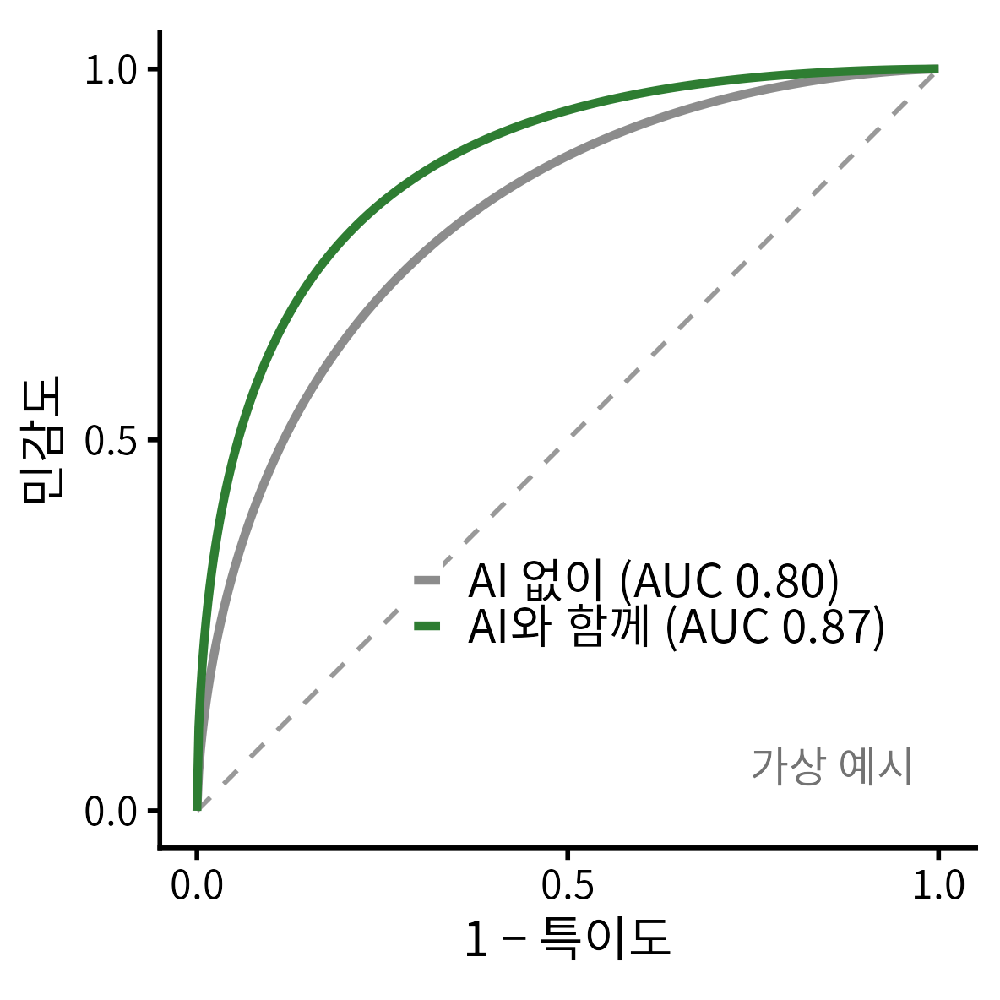{width="100%"}
:::
::::

## 판독자 연구 (MRMC) 설계 {#mrmc}

:::::: flow-5
::: flow-step
**판독의 여러 명**<br>× 케이스 수백 건
:::

::: flow-step
**세션 1**<br>AI 없이 또는 AI와 함께 (무작위)
:::

::: flow-step
**휴지기**<br>기억 효과 줄이기 (흔히 4주 이상)
:::

::: {.flow-step .hl}
**세션 2**<br>나머지 조건
:::

::: flow-step
**AUC 비교**<br>판독의·케이스 변동 반영
:::
::::::

:::: columns
::: {.column width="58%"}
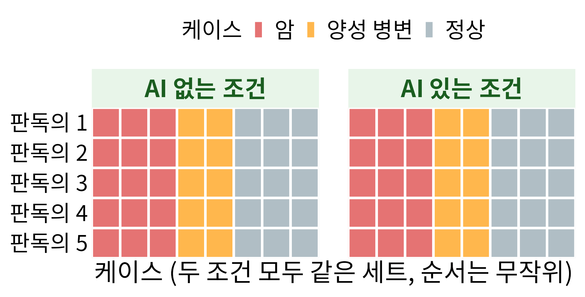{width="100%"}
:::

::: {.column width="42%"}
| 설계 요소 | 내용 |
|--------------|------------------------------------|
| 참조표준 | 조직검사 확진, 음성은 충분한 추적관찰 |
| 케이스 구성 | 암 비율을 높게 (enrichment), PPV는 실제 진료와 다름 |
| 판독 순서 | 조건 순서를 무작위·균형 있게 |
| 분석 | Obuchowski–Rockette, DBM |
:::
::::

# RACING (Lancet 2022)

## RACING 연구 {#racing}

```{=html}
<svg class="diagram" style="width:90%; margin:0 auto;" viewBox="0 0 1500 330" role="img" aria-label="RACING 연구 설계">
  <defs><marker id="arR" viewBox="0 0 10 10" refX="8" refY="5" markerWidth="6" markerHeight="6" orient="auto"><path d="M0,0 L10,5 L0,10 z" fill="#78909C"/></marker></defs>
  <rect x="4" y="105" width="260" height="120" rx="14" fill="#ffffff" stroke="#90A4AE" stroke-width="3"/>
  <text x="134" y="157" text-anchor="middle" font-size="30" font-weight="900" fill="#263238">ASCVD 3,780명</text>
  <text x="134" y="195" text-anchor="middle" font-size="22" fill="#455A64">국내 26개 기관</text>
  <line x1="266" y1="165" x2="285" y2="165" stroke="#78909C" stroke-width="4" marker-end="url(#arR)"/>
  <circle cx="365" cy="165" r="72" fill="#1565C0"/>
  <text x="365" y="157" text-anchor="middle" font-size="24" font-weight="800" fill="#ffffff">무작위배정</text>
  <text x="365" y="192" text-anchor="middle" font-size="27" font-weight="900" fill="#ffffff">1 : 1</text>
  <line x1="428" y1="130" x2="490" y2="88" stroke="#78909C" stroke-width="4" marker-end="url(#arR)"/>
  <line x1="428" y1="200" x2="490" y2="242" stroke="#78909C" stroke-width="4" marker-end="url(#arR)"/>
  <rect x="498" y="14" width="480" height="132" rx="14" fill="#E8F5E9" stroke="#2E7D32" stroke-width="3"/>
  <text x="738" y="64" text-anchor="middle" font-size="29" font-weight="900" fill="#1B5E20">병용 1,894명</text>
  <text x="738" y="106" text-anchor="middle" font-size="22" fill="#1B5E20">로수바스타틴 10 mg + 에제티미브 10 mg</text>
  <rect x="498" y="184" width="480" height="132" rx="14" fill="#ECEFF1" stroke="#78909C" stroke-width="3"/>
  <text x="738" y="234" text-anchor="middle" font-size="29" font-weight="900" fill="#37474F">고강도 단독 1,886명</text>
  <text x="738" y="276" text-anchor="middle" font-size="22" fill="#37474F">로수바스타틴 20 mg</text>
  <line x1="980" y1="80" x2="1078" y2="146" stroke="#78909C" stroke-width="4" marker-end="url(#arR)"/>
  <line x1="980" y1="250" x2="1078" y2="184" stroke="#78909C" stroke-width="4" marker-end="url(#arR)"/>
  <text x="1012" y="173" text-anchor="middle" font-size="23" font-weight="800" fill="#455A64">3년</text>
  <rect x="1086" y="90" width="410" height="150" rx="14" fill="#FFF3E0" stroke="#EF6C00" stroke-width="3"/>
  <text x="1291" y="138" text-anchor="middle" font-size="27" font-weight="900" fill="#8a4b12">1차 평가변수</text>
  <text x="1291" y="176" text-anchor="middle" font-size="21" fill="#8a4b12">심혈관 사망·주요 심혈관 사건</text>
  <text x="1291" y="208" text-anchor="middle" font-size="21" fill="#8a4b12">비치명적 뇌졸중</text>
</svg>
```

| 항목 | 내용 |
|--------------|----------------------------------------------------------------------------|
| 대상 | 죽상경화성 심혈관질환 (ASCVD) 환자 |
| 설계 | 무작위배정, 공개 (open-label), 비열등성, 사건은 눈가림 위원회가 판정 |
| 등록·후원 | 2017.2–2018.12 등록, 한미약품 연구비 (설계·분석 관여 없음) |

::: highlight-box
허가된 약끼리 비교한 **연구자 주도 임상** · 병용은 LDL을 더 낮추고 내약성이 좋을 것으로 기대 → 사건률 증가가 **정해 둔 한계 이내**인지 확인 (비열등성)
:::

## 비열등성 시험 {#ni}

:::: columns
::: {.column width="63%"}
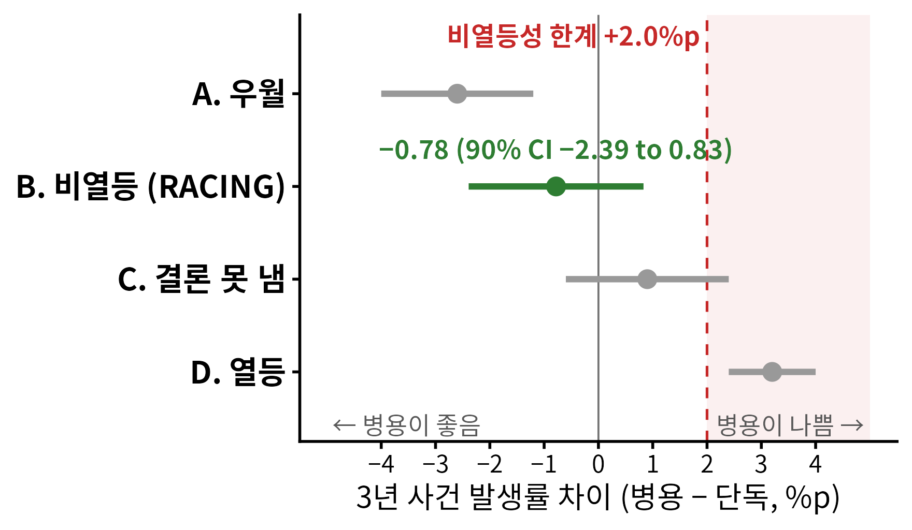{width="100%"}
:::

::: {.column width="37%"}
:::::: stat-stack
::: stat-card
**질문**<br>새 치료가 기존보다 **한계 이상 나쁘지 않은가**
:::

::: stat-card
**비열등성 한계** 2.0%p<br>미리 정한 허용 가능한 최대 증가폭 (3년 1,000명당 20명)
:::

::: {.stat-card .blue}
**판정**<br>90% CI 상한 0.83 < 2.0 → **비열등**
:::
::::::
:::
::::

::: highlight-box-gray
단측 α 0.05 검정 = 양측 90% CI의 상한으로 판정 · 비열등 ≠ 두 치료가 같다
:::

## 대상자 수 계산 {#sample-size}

:::: columns
::: {.column width="50%"}
::: check-list
::: check-item
[1]{.check-no}

예상 3년 사건률: 병용 13%, 단독 14%
:::

::: check-item
[2]{.check-no}

비열등성 한계 2.0%p
:::

::: check-item
[3]{.check-no}

단측 α 0.05, 검정력 80% → 군당 1,605명
:::

::: check-item
[4]{.check-no}

탈락 15% 고려 → **총 3,780명**
:::
:::
:::

::: {.column width="50%"}
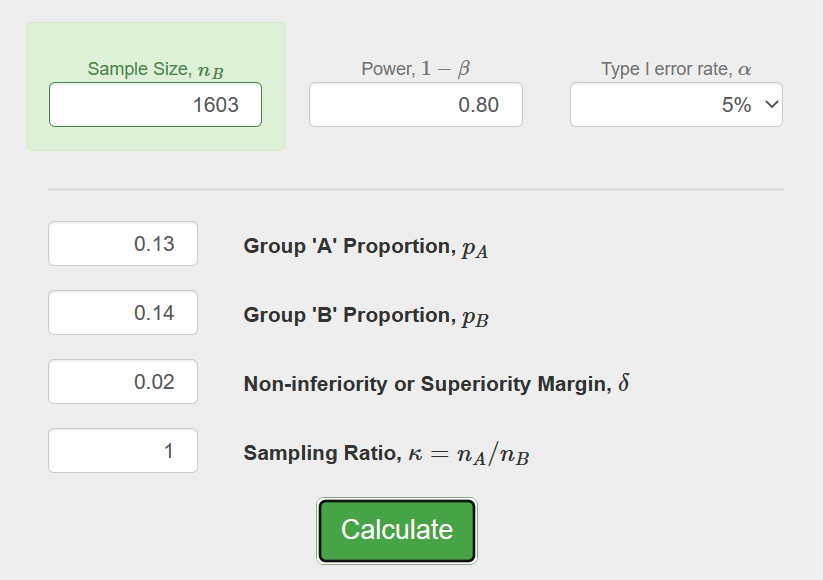{width="100%"}

::: fig-cap
비열등성 대상자 수 계산기 (군당 1,603명, 논문은 1,605명)
:::
:::
::::

::: highlight-box
가설·한계·대상자 수·판정을 같은 척도로: **3년 사건률 차이** (HR은 보조)
:::

## 결과 {#racing-result}

:::: columns
::: {.column width="56%"}
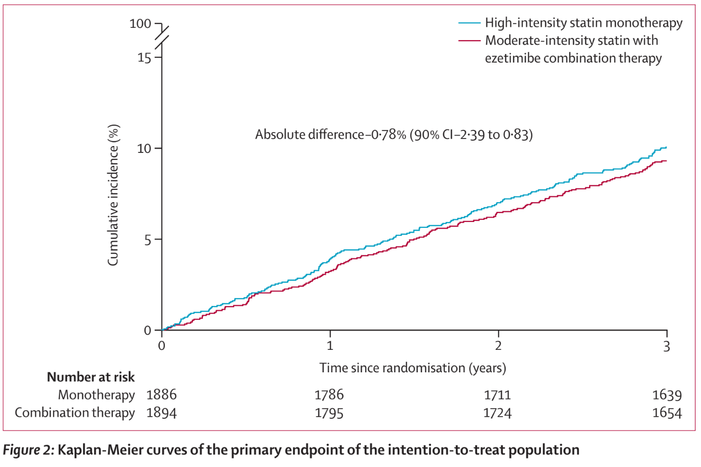{width="100%"}
:::

::: {.column width="44%"}
:::::: stat-stack
::: stat-card
[9.1% vs 9.9%]{.num} 1차 평가변수: 차이 −0.78%p (90% CI −2.39 to 0.83)
:::

::: {.stat-card .blue}
[73% vs 55%]{.num} 1년 LDL 70 mg/dL 미만 도달
:::

::: {.stat-card .red}
[4.8% vs 8.2%]{.num} 불내성으로 약 중단·감량 (안전성 분석군 1,846 vs 1,832명)
:::
::::::
:::
::::

::: highlight-box
병용요법: 효과는 **비열등**, LDL 목표 도달은 **더 많고**, 불내성으로 인한 중단·감량은 **더 적음**
:::

## RACING에서 통계가 한 일 {#racing-stat}

:::: columns
::: {.column width="55%"}
::: check-list
::: check-item
[1]{.check-no}

**설계**: 비열등성 한계 2.0%p와 대상자 수 (비율 차이 기반)
:::

::: check-item
[2]{.check-no}

**분석**: 미리 정한 척도 그대로: 사건률 차이 + 90% CI, HR은 보조
:::

::: check-item
[3]{.check-no}

**리비전**: 심사자 요청으로 Kaplan–Meier 추정치 대신 단순 비율
:::

::: check-item
[4]{.check-no}

**리비전**: 비율 차이의 신뢰구간은 Wilson 방법
:::
:::
:::

::: {.column width="45%"}
```{=html}
<div class="ba">
  <div class="ba-card before"><span class="ba-lb">처음 제출</span><span class="ba-v">9.3% vs 10.3%</span><span class="ba-s">Kaplan–Meier 3년 누적 발생률</span></div>
  <div class="ba-arrow">↓ 심사자 요청</div>
  <div class="ba-card after"><span class="ba-lb">리비전</span><span class="ba-v">9.1% vs 9.9%</span><span class="ba-s">172/1,894 vs 186/1,886 (단순 비율)<br>차이의 CI: Wilson 방법</span></div>
</div>
```
:::
::::

::: highlight-box-gray
차라투: 대상자 수 계산·통계 검토, 리비전 통계분석 지원 · KM과 단순 비율은 중도절단 처리가 달라 설계에 맞춰 선택
:::

# 사례 1: 루닛

## 루닛: AI 영상진단 소프트웨어 {#lunit}

:::: columns
::: {.column width="58%"}
| 제품 | 영상 |
|--------------------|------------------------------|
| INSIGHT CXR | 흉부 X선 |
| INSIGHT MMG | 유방촬영술 |
| INSIGHT DBT | 3D 유방단층촬영 |
| SCOPE | 병리 조직 슬라이드 |

::: col-head
차라투 지원
:::

- 허가용 임상: 단독 성능·판독자 연구 통계, 분석계획서·보고서
- 규제기관 질의 답변 · 허가 이후 실사용 연구, 메타분석
:::

::: {.column width="42%"}
```{=html}
<svg class="diagram" viewBox="0 0 520 470" role="img" aria-label="AI 판독 보조 화면 예시">
  <rect x="2" y="2" width="516" height="466" rx="16" fill="#1f2a30"/>
  <path d="M100,70 Q260,36 420,70 L452,450 L68,450 Z" fill="#56656d"/>
  <path d="M150,112 C118,200 124,330 150,402 C190,418 230,408 246,392 L246,122 C220,96 176,96 150,112 Z" fill="#1f2a30"/>
  <path d="M370,112 C402,200 396,330 370,402 C330,418 290,408 274,392 L274,122 C300,96 344,96 370,112 Z" fill="#1f2a30"/>
  <rect x="246" y="70" width="28" height="380" fill="#8a989f"/>
  <ellipse cx="334" cy="236" rx="64" ry="50" fill="#FFEB3B" opacity="0.35"/>
  <ellipse cx="334" cy="236" rx="42" ry="33" fill="#FF9800" opacity="0.6"/>
  <ellipse cx="334" cy="236" rx="21" ry="17" fill="#F44336" opacity="0.85"/>
  <rect x="262" y="18" width="240" height="46" rx="10" fill="#ffffff"/>
  <text x="382" y="49" text-anchor="middle" font-size="21" font-weight="800" fill="#C62828">이상 소견 점수 87</text>
  <text x="22" y="452" font-size="17" fill="#B0BEC5">예시 그림 (가상)</text>
</svg>
```
:::
::::

::: highlight-box
같은 제품도 **나라마다 허가**: 나라마다 요구하는 임상 설계·통계가 다름 · 예: INSIGHT DBT는 CE (2023.3), FDA 510(k) (2023.11)
:::

## 루닛 사례: AI 판독자 연구의 통계 질문 {#lunit-reader}

:::: columns
::: {.column width="50%"}
::: col-head
설계
:::

| 항목 | 내용 |
|--------------|------------------------------------------|
| 비교 | 같은 판독의: AI 없이 vs AI와 함께 |
| 케이스 | 암·양성 병변·정상 (암 비율 높게) |
| 1차 평가변수 | ROC AUC (환자 단위), 필요하면 병변 위치 지표 (wAFROC 등) |
| 추가 분석 | 유방 밀도·병변 종류·장비별 하위군 |
:::

::: {.column width="50%"}
::: col-head
심사에서 흔히 받는 통계 질문
:::

:::::: qa
::: qa-item
[Q. 대상자 수 근거는?]{.q} 이전 연구의 AUC 차이·분산으로 검정력 계산
:::

::: qa-item
[Q. 공동 1차 평가변수 2개를 모두 충족해야 성공이면 α 보정은?]{.q} 둘 다 유의해야 성공이므로 보정 불필요 (intersection–union)
:::

::: qa-item
[Q. 케이스 구성 비율의 근거는?]{.q} 암 비율을 높여 민감도 추정의 정밀도 확보
:::
::::::

::: muted-note
일반적인 설계와 질문의 예 (특정 심사 내용 아님)
:::
:::
::::

## 루닛 사례: 허가 이후 근거 {#lunit-rwe}

:::: columns
::: {.column width="52%"}
::: col-head
실사용근거 연구 (연구자 주도)
:::

```{=html}
<svg class="diagram" viewBox="0 0 700 330" role="img" aria-label="AI 도입 전후 비교 설계">
  <rect x="10" y="40" width="315" height="120" rx="14" fill="#ECEFF1" stroke="#78909C" stroke-width="3"/>
  <text x="167" y="92" text-anchor="middle" font-size="30" font-weight="900" fill="#37474F">AI 도입 전</text>
  <text x="167" y="130" text-anchor="middle" font-size="22" fill="#455A64">의사 판독</text>
  <rect x="375" y="40" width="315" height="120" rx="14" fill="#E8F5E9" stroke="#2E7D32" stroke-width="3"/>
  <text x="532" y="92" text-anchor="middle" font-size="30" font-weight="900" fill="#1B5E20">AI 도입 후</text>
  <text x="532" y="130" text-anchor="middle" font-size="22" fill="#1B5E20">의사 + AI 판독</text>
  <polygon points="350,32 338,10 362,10" fill="#EF6C00"/>
  <line x1="350" y1="32" x2="350" y2="172" stroke="#EF6C00" stroke-width="3" stroke-dasharray="7 5"/>
  <g font-size="23" font-weight="800" text-anchor="middle">
    <rect x="10" y="196" width="160" height="52" rx="26" fill="#F3E5F5"/><text x="90" y="230" fill="#4A148C">민감도</text>
    <rect x="186" y="196" width="160" height="52" rx="26" fill="#F3E5F5"/><text x="266" y="230" fill="#4A148C">특이도</text>
    <rect x="362" y="196" width="160" height="52" rx="26" fill="#F3E5F5"/><text x="442" y="230" fill="#4A148C">재검률</text>
    <rect x="538" y="196" width="152" height="52" rx="26" fill="#F3E5F5"/><text x="614" y="230" fill="#4A148C">PPV</text>
  </g>
  <text x="350" y="298" text-anchor="middle" font-size="22" fill="#455A64">참조표준: 일정 기간 안의 암 진단 · 한 환자 여러 검사는 군집으로</text>
</svg>
```
:::

::: {.column width="48%"}
::: col-head
메타분석: 기존 연구 성능 정리
:::

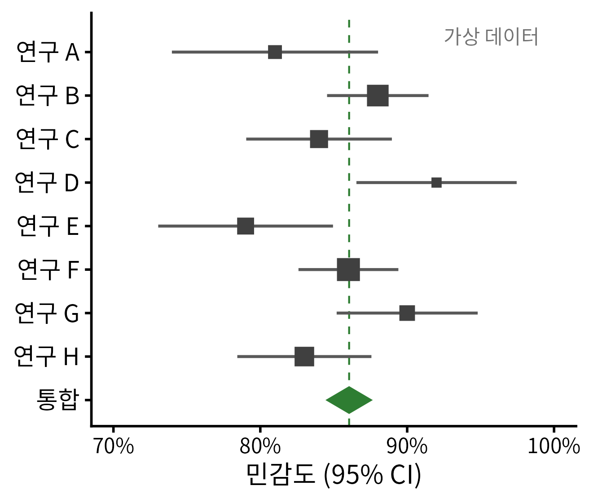{width="78%" fig-align="center"}
:::
::::

::: highlight-box
허가 후에도 **실제 진료 데이터**로 성능 확인 · 반복 검사 (GEE 등)·환자 구성 차이 (IPTW 등) 고려, 시기별 진료 변화는 남을 수 있음
:::

# 사례 2: 신라젠

## 신라젠: 항암 신약 개발 {#sillajen}

```{=html}
<div class="pipeline">
  <div class="hd">후보물질 · 임상</div><div class="hd">비임상</div><div class="hd">1상</div><div class="hd">2상</div><div class="hd">3상</div><div class="hd">허가</div>
  <div class="nm" style="grid-row: 2; grid-column: 1"><b>BAL0891</b><span>TTK·PLK1 이중 억제 · TTK-CS-101</span></div>
  <div class="bar b1" style="grid-row: 2; grid-column: 2 / 4">1상 · ESMO 2026 중간결과</div>
  <div class="nm" style="grid-row: 3; grid-column: 1"><b>Pexa-Vec (JX-594)</b><span>항암 바이러스 · REN026</span></div>
  <div class="bar b2" style="grid-row: 3; grid-column: 2 / 5">1b/2a상 신세포암 · ESMO 2023 발표</div>
</div>
```

```{=html}
<div class="icon-grid-4 sj-support">
  <div class="icon-card ic-green"><span class="t">모니터링 웹</span>1상 자료 실시간 확인</div>
  <div class="icon-card ic-blue"><span class="t">설계·대상자 수</span>분석계획서 검토, 2단계 설계</div>
  <div class="icon-card ic-purple"><span class="t">안전성 보고</span>IB·DSUR 표</div>
  <div class="icon-card ic-orange"><span class="t">학회·논문</span>ESMO 포스터, 논문 재분석</div>
</div>
```

::: highlight-box-gray
BAL0891: 단독·paclitaxel 병용 1상 · Pexa-Vec: cemiplimab (항 PD-1) 병용
:::

## 신라젠 사례: BAL0891 1상 {#bal0891}

:::: columns
::: {.column width="48%"}
::: col-head
설계
:::

- 용량 증량: 단독, paclitaxel 병용
- DLT → MTD → RP2D
- 확장 코호트: 특정 암종의 초기 항종양 활성 탐색
- 평가: 이상사례 (CTCAE), 약동학, 반응 (RECIST 1.1)

::: col-head
통계가 한 일
:::

- 데이터 갱신마다 표·그림 자동 갱신 (Shiny)
- RP2D 근거: 용량별 이익·위험 비교
- 확장 코호트 대상자 수 검토
:::

::: {.column width="52%"}
```{=html}
<svg class="diagram" viewBox="0 0 760 470" role="img" aria-label="1상 모니터링 웹 예시 화면">
  <rect x="2" y="2" width="756" height="466" rx="14" fill="#ffffff" stroke="#B0BEC5" stroke-width="3"/>
  <path d="M2,16 a14,14 0 0 1 14,-14 h728 a14,14 0 0 1 14,14 v30 h-756 z" fill="#ECEFF1"/>
  <circle cx="26" cy="25" r="7" fill="#EF5350"/><circle cx="48" cy="25" r="7" fill="#FFCA28"/><circle cx="70" cy="25" r="7" fill="#66BB6A"/>
  <text x="420" y="32" text-anchor="middle" font-size="18" fill="#607D8B">1상 모니터링 웹 (가상 화면)</text>
  <rect x="20" y="60" width="124" height="38" rx="8" fill="#2A3D21"/>
  <text x="82" y="86" text-anchor="middle" font-size="19" font-weight="800" fill="#ffffff">이상사례</text>
  <text x="202" y="86" text-anchor="middle" font-size="19" fill="#455A64">반응</text>
  <text x="292" y="86" text-anchor="middle" font-size="19" fill="#455A64">생존</text>
  <text x="392" y="86" text-anchor="middle" font-size="19" fill="#455A64">약동학</text>
  <rect x="20" y="110" width="350" height="222" rx="8" fill="#F7F9FA"/>
  <text x="32" y="134" font-size="17" fill="#607D8B">Waterfall</text>
  <line x1="35" y1="200" x2="355" y2="200" stroke="#90A4AE" stroke-width="2"/>
  <g>
    <rect x="40" y="146" width="18" height="54" fill="#E57373"/><rect x="62.5" y="159.5" width="18" height="40.5" fill="#E57373"/>
    <rect x="85" y="168.5" width="18" height="31.5" fill="#E57373"/><rect x="107.5" y="177.5" width="18" height="22.5" fill="#E57373"/>
    <rect x="130" y="183.8" width="18" height="16.2" fill="#B0BEC5"/><rect x="152.5" y="191" width="18" height="9" fill="#B0BEC5"/>
    <rect x="175" y="195.5" width="18" height="4.5" fill="#B0BEC5"/><rect x="197.5" y="200" width="18" height="4.5" fill="#B0BEC5"/>
    <rect x="220" y="200" width="18" height="10.8" fill="#B0BEC5"/><rect x="242.5" y="200" width="18" height="18" fill="#B0BEC5"/>
    <rect x="265" y="200" width="18" height="31.5" fill="#42A5F5"/><rect x="287.5" y="200" width="18" height="45" fill="#42A5F5"/>
    <rect x="310" y="200" width="18" height="63" fill="#42A5F5"/><rect x="332.5" y="200" width="18" height="90" fill="#0D47A1"/>
  </g>
  <rect x="390" y="110" width="350" height="222" rx="8" fill="#F7F9FA"/>
  <text x="728" y="134" text-anchor="end" font-size="17" fill="#607D8B">PFS</text>
  <polyline points="405,122 405,315 728,315" fill="none" stroke="#90A4AE" stroke-width="2"/>
  <path d="M405,140 H450 V160 H500 V185 H545 V215 H600 V240 H650 V262 H722" fill="none" stroke="#2E7D32" stroke-width="4"/>
  <rect x="20" y="348" width="720" height="34" rx="6" fill="#2A3D21"/>
  <g font-size="17" font-weight="800" fill="#ffffff" text-anchor="middle">
    <text x="90" y="371">용량</text><text x="230" y="371">환자</text><text x="370" y="371">TEAE</text><text x="510" y="371">3등급 이상</text><text x="650" y="371">DLT</text>
  </g>
  <g fill="#CFD8DC">
    <rect x="55" y="396" width="70" height="14" rx="7"/><rect x="195" y="396" width="70" height="14" rx="7"/><rect x="335" y="396" width="70" height="14" rx="7"/><rect x="475" y="396" width="70" height="14" rx="7"/><rect x="615" y="396" width="70" height="14" rx="7"/>
    <rect x="55" y="424" width="70" height="14" rx="7"/><rect x="195" y="424" width="70" height="14" rx="7"/><rect x="335" y="424" width="70" height="14" rx="7"/><rect x="475" y="424" width="70" height="14" rx="7"/><rect x="615" y="424" width="70" height="14" rx="7"/>
  </g>
</svg>
```
:::
::::

## 항암 1상 결과 그림 {#onc-fig}

:::: columns
::: {.column width="50%"}
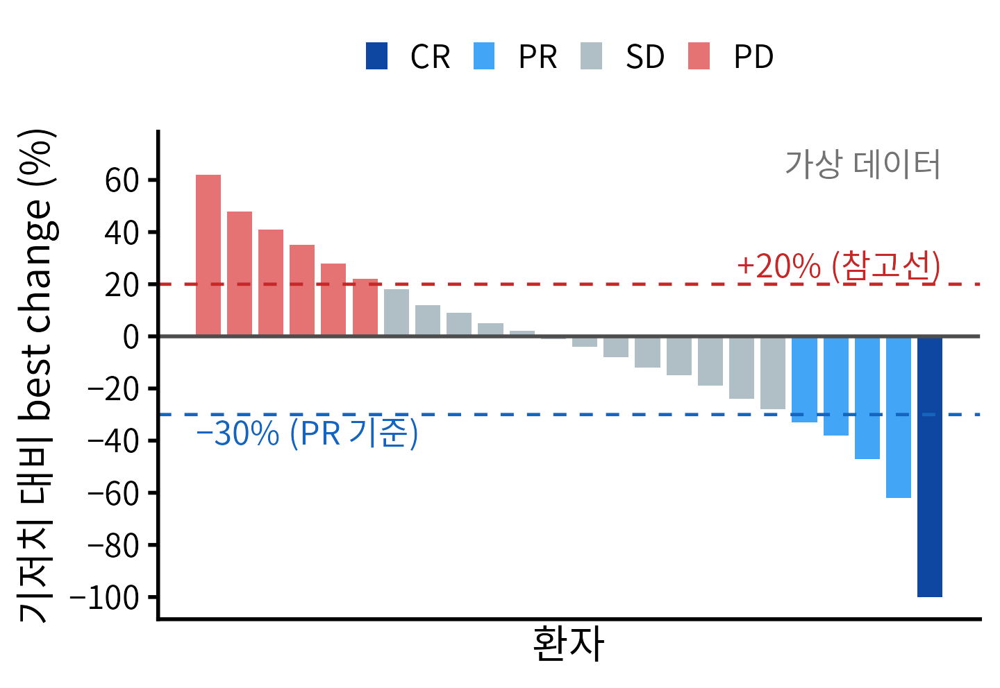{width="100%"}

::: fig-cap
**Waterfall**: 환자별 표적병변 크기 합의 best change (기저치 대비)
:::
:::

::: {.column width="50%"}
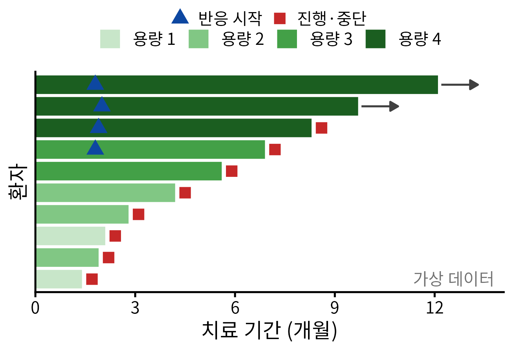{width="100%"}

::: fig-cap
**Swimmer**: 환자별 치료 기간과 반응 시점
:::
:::
::::

::: highlight-box-gray
ORR = CR·PR 환자 비율, DCR = CR·PR·SD 환자 비율 · 분모 (분석 대상군)는 미리 정함 · 반응 판정은 RECIST 1.1 (새 병변 등 포함)
:::

## 허가 문서와 안전성 보고 {#sillajen-docs}

:::::: flow-4
::: flow-step
**시작 전**<br>계획서·분석계획서<br>표·그림 틀
:::

::: {.flow-step .hl}
**진행 중**<br>DSUR (매년)·IB 갱신<br>SUSAR 신속보고
:::

::: flow-step
**종료 후**<br>결과보고서 (CSR)<br>전체 표·그림
:::

::: {.flow-step .hl2}
**발표**<br>학회 포스터·논문<br>예: REN026 ESMO 2023
:::
::::::

| 문서 | 통계 산출물 |
|--------------------------|----------------------------------------------------------|
| IB · DSUR | 누적·기간별 이상사례, 노출 기간 표 |
| 분석계획서 · 결과보고서 | 분석 대상군, 표·목록·그림 (TLF), 통계 방법 |
| 학회·논문 | 반응률·생존 분석, waterfall·swimmer |

::: highlight-box
같은 데이터로 **규제기관 문서**와 **학회·논문**을 함께 만든다
:::

# 생성형 AI

## 생성형 AI 의료기기 {#genai-device}

:::::: flow-4
::: flow-step
[2025.1]{.yr} **디지털의료제품법 시행**<br>AI·소프트웨어 별도 법
:::

::: {.flow-step .hl}
[2025.1]{.yr} **생성형 AI 의료기기<br>허가·심사 가이드라인**<br>식약처
:::

::: {.flow-step .hl}
[2026.4]{.yr} **국내 첫 생성형 AI<br>의료기기 허가**<br>흉부 X선 판독 보조
:::

::: {.flow-step .hl2}
[2026.11]{.yr} **보건의료 분야<br>LLM 활용 기준**<br>복지부·개인정보위
:::
::::::

| 구분 | 기존 AI (검출·진단보조) | 생성형 AI (예: 판독문 생성) |
|------------|-------------------------------|-----------------------------------|
| 출력 | 점수, 병변 위치 | 판독문 같은 문장 |
| 평가 | 민감도, 특이도, AUC | 문장의 정확성, 누락, 사실과 다른 내용 |
| 사용 | 점수·위치를 확인해 판단 | 초안을 확인·수정해 판단 |

## 의료데이터와 생성형 AI {#genai-data}

:::::: columns
::: {.column width="40%"}
보건복지부·개인정보보호위원회 (2026.11)

**LLM 활용 격리원칙**

::: large
1. **물리적 격리**<br>LLM 서버는 국내
2. **기능적 격리**<br>입력 데이터 저장·학습 금지
:::

::: highlight-box
ChatGPT·Gemini·Claude 일반 구독 = 유형 1 → 환자 의료데이터 입력 **불가**
:::

::: highlight-box-gray
연구에 쓰기 전 기관 지침 확인
:::
:::

::: {.column width="60%"}
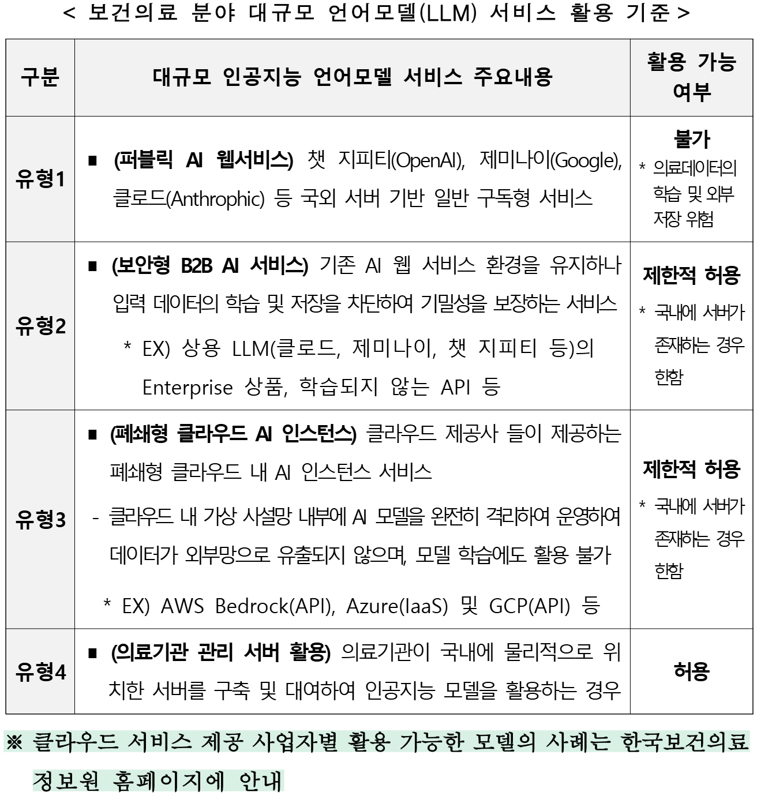{.guide-img fig-align="center"}
:::
::::::

## 정리 {#summary}

::: takehome-grid
::: takehome
[1]{.check-no}

**임상시험**: 사람 대상 안전성·유효성 증명이 목적, 대조군·무작위배정·눈가림
:::

::: takehome
[2]{.check-no}

**신약 인허가** (전형적 흐름): 비임상 → 임상 승인 → 1·2·3상 → 허가 → 시판 후, 급여는 별도
:::

::: takehome
[3]{.check-no}

**신약**은 용량·위약 대조, **의료기기**는 등급·성능·시술자
:::

::: takehome
[4]{.check-no}

**AI 의료기기**: 단독 성능 + 판독자 연구, 허가 후 실사용 연구
:::

::: takehome
[5]{.check-no}

**통계는 계획 단계부터**: 대상자 수·분석계획서 → 결과보고서 → 규제기관 질의
:::

::: takehome
[6]{.check-no}

**생성형 AI**: 환자 의료데이터는 일반 구독 서비스에 넣지 않기
:::
:::

## 감사합니다 {#thanks}
