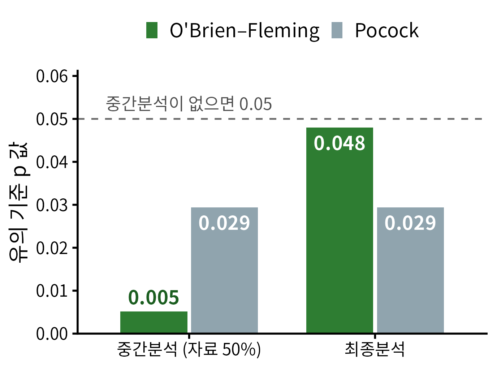
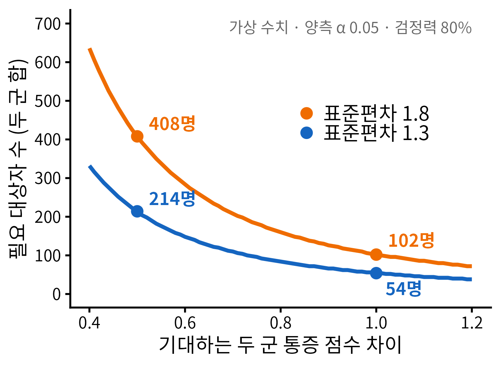
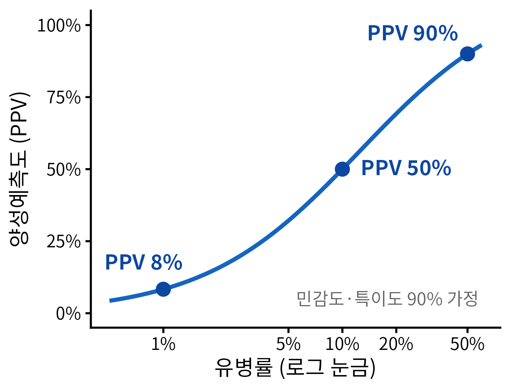

## 내 AI 기기가 환자에게 가기까지 {#roadmap}

```{=html}
<svg class="diagram" viewBox="0 0 1500 400" role="img" aria-label="AI 의료기기가 환자에게 가기까지의 로드맵">
  <rect x="40" y="186" width="1420" height="16" rx="8" fill="#ECEFF1"/>
  <rect x="40" y="186" width="620" height="16" rx="8" fill="#A5D6A7"/>
  <rect x="660" y="186" width="200" height="16" fill="#90CAF9"/>
  <rect x="860" y="186" width="160" height="16" fill="#CE93D8"/>
  <rect x="1020" y="186" width="440" height="16" rx="8" fill="#FFCC80"/>
  <circle cx="110" cy="194" r="40" fill="#2E7D32"/>
  <text x="110" y="207" text-anchor="middle" font-size="34" font-weight="900" fill="#ffffff">1</text>
  <text x="110" y="82" text-anchor="middle" font-size="31" font-weight="900" fill="#263238">사용목적</text>
  <text x="110" y="120" text-anchor="middle" font-size="24" fill="#455A64">무엇을 진단·치료하나</text>
  <circle cx="323" cy="194" r="40" fill="#2E7D32"/>
  <text x="323" y="207" text-anchor="middle" font-size="34" font-weight="900" fill="#ffffff">2</text>
  <text x="323" y="286" text-anchor="middle" font-size="31" font-weight="900" fill="#263238">의료기기·등급</text>
  <text x="323" y="324" text-anchor="middle" font-size="24" fill="#455A64">위해도·품목 확인</text>
  <circle cx="536" cy="194" r="40" fill="#2E7D32"/>
  <text x="536" y="207" text-anchor="middle" font-size="34" font-weight="900" fill="#ffffff">3</text>
  <text x="536" y="82" text-anchor="middle" font-size="31" font-weight="900" fill="#263238">설계·규격 시험</text>
  <text x="536" y="120" text-anchor="middle" font-size="24" fill="#455A64">안전·성능·SW 검증</text>
  <circle cx="749" cy="194" r="40" fill="#1565C0"/>
  <text x="749" y="207" text-anchor="middle" font-size="34" font-weight="900" fill="#ffffff">4</text>
  <text x="749" y="286" text-anchor="middle" font-size="31" font-weight="900" fill="#263238">임상시험</text>
  <text x="749" y="324" text-anchor="middle" font-size="24" fill="#455A64">필요한 근거에 맞춰 설계</text>
  <circle cx="962" cy="194" r="40" fill="#7B1FA2"/>
  <text x="962" y="207" text-anchor="middle" font-size="34" font-weight="900" fill="#ffffff">5</text>
  <text x="962" y="82" text-anchor="middle" font-size="31" font-weight="900" fill="#263238">허가·인증</text>
  <text x="962" y="120" text-anchor="middle" font-size="24" fill="#455A64">식약처, 해외는 따로</text>
  <circle cx="1175" cy="194" r="40" fill="#EF6C00"/>
  <text x="1175" y="207" text-anchor="middle" font-size="34" font-weight="900" fill="#ffffff">6</text>
  <text x="1175" y="286" text-anchor="middle" font-size="31" font-weight="900" fill="#263238">진료 도입</text>
  <text x="1175" y="324" text-anchor="middle" font-size="24" fill="#455A64">평가·급여 여부 확인</text>
  <circle cx="1388" cy="194" r="40" fill="#EF6C00"/>
  <text x="1388" y="207" text-anchor="middle" font-size="34" font-weight="900" fill="#ffffff">7</text>
  <text x="1388" y="82" text-anchor="middle" font-size="31" font-weight="900" fill="#263238">허가 이후</text>
  <text x="1388" y="120" text-anchor="middle" font-size="24" fill="#455A64">변경 관리·실사용근거</text>
  <text x="350" y="388" text-anchor="middle" font-size="24" font-weight="800" fill="#1B5E20">개발</text>
  <text x="760" y="388" text-anchor="middle" font-size="24" font-weight="800" fill="#0D47A1">임상</text>
  <text x="940" y="388" text-anchor="middle" font-size="24" font-weight="800" fill="#4A148C">허가</text>
  <text x="1240" y="388" text-anchor="middle" font-size="24" font-weight="800" fill="#8a4b12">시장</text>
</svg>
```

::: highlight-box
질문: **내가 만든 AI 기기는 어떻게 환자에게 쓰일 수 있을까?**
:::

::: highlight-box-gray
오늘 순서: 규제 틀 (**1–3, 5–6단계**) → 임상시험 (**4단계**) → 지원 사례 → 허가 이후 (**7단계**)
:::

# 의료기기 인허가

## 의료기기 여부와 등급: 치과 품목 {#device-class}

```{=html}
<svg class="diagram" style="width:80%; margin:0 auto;" viewBox="0 20 1460 550" role="img" aria-label="의료기기 등급 피라미드와 치과 임플란트 품목별 등급">
  <polygon points="10,560 650,560 587.5,435 72.5,435" fill="#C8E6C9"/>
  <polygon points="75,430 585,430 522.5,305 137.5,305" fill="#81C784"/>
  <polygon points="140,300 520,300 457.5,175 202.5,175" fill="#43A047"/>
  <polygon points="205,170 455,170 392.5,45 267.5,45" fill="#1B5E20"/>
  <g text-anchor="middle">
    <text x="330" y="497" font-size="32" font-weight="900" fill="#1B5E20">1등급 · 신고</text>
    <text x="330" y="535" font-size="22" fill="#1B5E20">위해도 거의 없음</text>
    <text x="330" y="367" font-size="32" font-weight="900" fill="#0f3d12">2등급 · 인증</text>
    <text x="330" y="405" font-size="22" fill="#0f3d12">낮음 · 일부는 허가</text>
    <text x="330" y="237" font-size="30" font-weight="900" fill="#ffffff">3등급 · 허가</text>
    <text x="330" y="275" font-size="22" fill="#ffffff">중증도</text>
    <text x="330" y="112" font-size="24" font-weight="900" fill="#ffffff">4등급 · 허가</text>
    <text x="330" y="146" font-size="21" fill="#ffffff">고도</text>
  </g>
  <rect x="760" y="330" width="380" height="230" rx="10" fill="#F5E6C8"/>
  <g fill="#E8D3A8"><circle cx="800" cy="400" r="9"/><circle cx="850" cy="470" r="12"/><circle cx="1080" cy="430" r="10"/><circle cx="1100" cy="520" r="13"/><circle cx="820" cy="535" r="8"/><circle cx="1040" cy="540" r="9"/></g>
  <path d="M760,345 L760,322 Q850,290 950,296 Q1050,290 1140,322 L1140,345 Z" fill="#F48FB1"/>
  <path d="M915,300 L985,300 L978,515 L950,548 L922,515 Z" fill="#B0BEC5" stroke="#546E7A" stroke-width="3"/>
  <g stroke="#546E7A" stroke-width="3">
    <line x1="916" y1="330" x2="984" y2="318"/><line x1="917" y1="362" x2="983" y2="350"/><line x1="918" y1="394" x2="982" y2="382"/>
    <line x1="919" y1="426" x2="981" y2="414"/><line x1="920" y1="458" x2="980" y2="446"/><line x1="921" y1="490" x2="979" y2="478"/>
  </g>
  <path d="M926,300 L974,300 L966,232 L934,232 Z" fill="#CFD8DC" stroke="#546E7A" stroke-width="3"/>
  <path d="M888,238 C878,200 876,150 893,124 C908,103 930,116 950,110 C970,116 992,103 1007,124 C1024,150 1022,200 1012,238 Z" fill="#ffffff" stroke="#90A4AE" stroke-width="3"/>
  <g fill="#FFB74D" stroke="#EF6C00" stroke-width="2"><circle cx="1000" cy="345" r="9"/><circle cx="1018" cy="362" r="8"/><circle cx="996" cy="372" r="7"/><circle cx="1022" cy="388" r="9"/><circle cx="1004" cy="398" r="7"/></g>
  <rect x="800" y="128" width="40" height="86" rx="12" fill="#B39DDB" stroke="#5E35B1" stroke-width="3"/>
  <rect x="815" y="214" width="10" height="70" fill="#78909C"/>
  <text x="788" y="160" text-anchor="end" font-size="26" font-weight="800" fill="#263238">시술기구</text>
  <text x="788" y="194" text-anchor="end" font-size="26" font-weight="800" fill="#66BB6A">1등급</text>
  <g stroke="#455A64" stroke-width="2"><line x1="972" y1="266" x2="1128" y2="250"/><line x1="1030" y1="372" x2="1128" y2="356"/><line x1="984" y1="452" x2="1128" y2="462"/></g>
  <text x="1135" y="258" font-size="27" font-weight="800" fill="#263238">상부구조물 <tspan fill="#43A047">2등급</tspan></text>
  <text x="1135" y="364" font-size="27" font-weight="800" fill="#263238">골 이식재 <tspan fill="#1B5E20">4등급</tspan></text>
  <text x="1135" y="470" font-size="27" font-weight="800" fill="#263238">고정체 <tspan fill="#2E7D32">3등급</tspan></text>
</svg>
```

::: small-source
식약처 고시 「의료기기 품목 및 품목별 등급에 관한 규정」 제2023-41호 (2023.6.12) 기준 · 식약처 「의료기기와 개인용 건강관리 (웰니스) 제품 판단기준」
:::

::: highlight-box
먼저 **의료기기인지** 확인: 질병의 진단·치료·예방 목적이면 의료기기,<br>일상 건강관리용 저위험 제품은 웰니스일 수 있음<br>의료기기면 **위해도** (사용목적·침습성·접촉 기간)로 등급 결정
:::

## 허가에 내는 자료: 기술문서와 시험 {#regs-docs}

```{=html}
<div class="icon-grid-4 doc-grid">
  <div class="icon-card ic-green"><svg viewBox="0 0 100 100" aria-hidden="true"><path d="M15,70 A35,35 0 1 1 85,70" fill="none" stroke="#2E7D32" stroke-width="8" stroke-linecap="round"/><line x1="50" y1="62" x2="70" y2="38" stroke="#1B5E20" stroke-width="7" stroke-linecap="round"/><circle cx="50" cy="62" r="7" fill="#1B5E20"/></svg><span class="t">성능</span>제품 규격대로 작동하나<span class="s">정확도·반복성 시험</span></div>
  <div class="icon-card ic-blue"><svg viewBox="0 0 100 100" aria-hidden="true"><path d="M58,8 L24,56 H48 L40,92 L78,40 H54 Z" fill="#1565C0"/></svg><span class="t">전기·기계 안전</span>감전·과열·전자파<span class="s">IEC 60601-1, 60601-1-2</span></div>
  <div class="icon-card ic-teal"><svg viewBox="0 0 100 100" aria-hidden="true"><path d="M50,10 C50,10 22,46 22,64 A28,28 0 0 0 78,64 C78,46 50,10 50,10 Z" fill="#00838F"/><circle cx="40" cy="64" r="7" fill="#E0F2F1"/></svg><span class="t">생물학적 안전</span>몸에 닿는 재료<span class="s">ISO 10993</span></div>
  <div class="icon-card ic-purple"><svg viewBox="0 0 100 100" aria-hidden="true"><path d="M34,28 L14,50 L34,72 M66,28 L86,50 L66,72" fill="none" stroke="#7B1FA2" stroke-width="8" stroke-linecap="round" stroke-linejoin="round"/><line x1="56" y1="22" x2="44" y2="78" stroke="#7B1FA2" stroke-width="7" stroke-linecap="round"/></svg><span class="t">소프트웨어</span>개발·검증 기록<span class="s">IEC 62304</span></div>
  <div class="icon-card ic-orange"><svg viewBox="0 0 100 100" aria-hidden="true"><path d="M30,14 L30,74 L44,62 L54,86 L64,82 L54,58 L72,58 Z" fill="#EF6C00" stroke="#8a4b12" stroke-width="3" stroke-linejoin="round"/></svg><span class="t">사용적합성</span>사용 오류 줄이기<span class="s">IEC 62366</span></div>
  <div class="icon-card ic-gray"><svg viewBox="0 0 100 100" aria-hidden="true"><rect x="22" y="44" width="56" height="44" rx="8" fill="#37474F"/><path d="M34,44 V32 A16,16 0 0 1 66,32 V44" fill="none" stroke="#37474F" stroke-width="8"/><circle cx="50" cy="64" r="6" fill="#ECEFF1"/></svg><span class="t">사이버보안</span>통신·데이터·업데이트 경로<span class="s">식약처 가이드라인</span></div>
  <div class="icon-card ic-red"><svg viewBox="0 0 100 100" aria-hidden="true"><path d="M50,12 L90,84 H10 Z" fill="#FFEBEE" stroke="#C62828" stroke-width="7" stroke-linejoin="round"/><line x1="50" y1="38" x2="50" y2="60" stroke="#C62828" stroke-width="8" stroke-linecap="round"/><circle cx="50" cy="72" r="5" fill="#C62828"/></svg><span class="t">위험관리</span>위험을 찾고 줄이기<span class="s">ISO 14971</span></div>
  <div class="icon-card ic-green"><svg viewBox="0 0 100 100" aria-hidden="true"><path d="M12,86 V46 L32,58 V46 L52,58 V30 H70 V86 Z" fill="#2E7D32"/><circle cx="74" cy="34" r="16" fill="#ffffff" stroke="#2E7D32" stroke-width="5"/><path d="M66,34 l6,6 l10,-12" fill="none" stroke="#2E7D32" stroke-width="5" stroke-linecap="round" stroke-linejoin="round"/></svg><span class="t">품질관리 (GMP)</span>제조·품질 체계<span class="s">ISO 13485 기반</span></div>
</div>
```

::: highlight-box
임상 자료는 이 목록의 일부 · 임상 자료나 새 임상시험이 필요한지는 사용목적·위해도·기존 제품과의 차이, 기존 근거로 판단
:::

## 의료기기: 허가에서 진료까지 {#device-path}

:::::: flow-6
::: flow-step
**등급 분류**<br>품목·위해도
:::

::: flow-step
**임상시험 승인**<br>필요할 때<br>식약처 + IRB
:::

::: {.flow-step .hl}
**탐색 임상**<br>pilot<br>필요에 따라
:::

::: {.flow-step .hl}
**확증 임상**<br>pivotal<br>허가 근거
:::

::: flow-step
**허가·인증**<br>식약처
:::

::: {.flow-step .hl2}
**진료 도입·급여**<br>기존 기술 확인<br>필요시 신의료기술 평가
:::
::::::

```{=html}
<div class="span-row"><div class="sp-pre" style="grid-column: 1 / 2">허가 전 준비</div><div class="sp-main" style="grid-column: 2 / 6">인허가 임상 (필요할 때): 식약처·IRB 승인 → 허가</div><div class="sp-post">허가 후</div></div>
```

::: chain
[진료 도입·급여]{.lbl} [기존 기술인지 확인]{.node} [→]{.arr} [새 기술이면 신의료기술평가]{.node} [→]{.arr} [급여 여부 결정]{.node}
:::

::: highlight-box
허가 = **팔 수 있다** · 진료 도입과 급여는 **따로** 확인
:::

## 디지털의료기기와 빠른 길 {#digital}

```{=html}
<div class="icon-grid-3 fast-grid">
  <div class="icon-card ic-blue"><svg viewBox="0 0 100 100" aria-hidden="true"><rect x="26" y="26" width="48" height="48" rx="8" fill="#1565C0"/><text x="50" y="58" text-anchor="middle" font-size="22" font-weight="900" fill="#ffffff">AI</text><g stroke="#1565C0" stroke-width="5"><line x1="36" y1="10" x2="36" y2="26"/><line x1="50" y1="10" x2="50" y2="26"/><line x1="64" y1="10" x2="64" y2="26"/><line x1="36" y1="74" x2="36" y2="90"/><line x1="50" y1="74" x2="50" y2="90"/><line x1="64" y1="74" x2="64" y2="90"/><line x1="10" y1="36" x2="26" y2="36"/><line x1="10" y1="50" x2="26" y2="50"/><line x1="10" y1="64" x2="26" y2="64"/><line x1="74" y1="36" x2="90" y2="36"/><line x1="74" y1="50" x2="90" y2="50"/><line x1="74" y1="64" x2="90" y2="64"/></g></svg><span class="t">디지털의료기기</span>디지털의료제품법<br>(2024.1 제정, 2025.1 시행)<span class="s">AI·로봇 등 디지털기술을 적용한 의료기기 · 임상·소프트웨어·변경 관리 규정을 따로 둠</span></div>
  <div class="icon-card ic-green"><svg viewBox="0 0 100 100" aria-hidden="true"><path d="M50,8 L61,38 L93,39 L68,58 L77,90 L50,72 L23,90 L32,58 L7,39 L39,38 Z" fill="#2E7D32"/></svg><span class="t">혁신의료기기</span>의료기기산업 육성 및<br>혁신의료기기 지원법 (2020.5~)<span class="s">지정되면 우선심사·단계별 심사 · 통합심사: 지정·급여 여부 확인·신의료기술평가를 한 번에</span></div>
  <div class="icon-card ic-purple"><svg viewBox="0 0 100 100" aria-hidden="true"><circle cx="50" cy="50" r="38" fill="none" stroke="#7B1FA2" stroke-width="6"/><ellipse cx="50" cy="50" rx="16" ry="38" fill="none" stroke="#7B1FA2" stroke-width="5"/><line x1="12" y1="50" x2="88" y2="50" stroke="#7B1FA2" stroke-width="5"/><path d="M20,30 H80 M20,70 H80" stroke="#7B1FA2" stroke-width="4" fill="none"/></svg><span class="t">해외</span>미국 FDA<br>Breakthrough Devices Program<span class="s">나라마다 따로 신청 · 임상 자료는 여러 나라에 쓸 수 있게 설계</span></div>
</div>
```

::: highlight-box-blue
**디지털의료제품법**: 요건을 갖춘 비접촉·저위험 임상은 식약처 승인 대신 실시기관 승인으로 진행 가능
:::

::: highlight-box
빠른 길도 **성능·임상 근거는 필요**: 빨라지는 것은 심사 순서와 절차
:::

# 임상시험 기본

## 임상시험: 공정한 비교의 조건 {#trial-def}

::: definition-box
사람을 대상으로 의약품·의료기기의 **안전성**과 **유효성**을 증명하기 위한 시험
:::

:::: columns
::: {.column width="54%"}
```{=html}
<svg class="diagram" viewBox="0 0 900 330" role="img" aria-label="무작위배정 임상시험 흐름">
  <defs><marker id="arA" viewBox="0 0 10 10" refX="8" refY="5" markerWidth="6" markerHeight="6" orient="auto"><path d="M0,0 L10,5 L0,10 z" fill="#78909C"/></marker></defs>
  <rect x="4" y="115" width="176" height="100" rx="14" fill="#ffffff" stroke="#90A4AE" stroke-width="3"/>
  <text x="92" y="160" text-anchor="middle" font-size="28" font-weight="800" fill="#263238">대상자</text>
  <text x="92" y="194" text-anchor="middle" font-size="20" fill="#455A64">선정·제외 기준</text>
  <line x1="182" y1="165" x2="220" y2="165" stroke="#78909C" stroke-width="4" marker-end="url(#arA)"/>
  <circle cx="290" cy="165" r="64" fill="#1565C0"/>
  <text x="290" y="158" text-anchor="middle" font-size="24" font-weight="800" fill="#ffffff">무작위</text>
  <text x="290" y="190" text-anchor="middle" font-size="24" font-weight="800" fill="#ffffff">배정</text>
  <line x1="345" y1="132" x2="424" y2="86" stroke="#78909C" stroke-width="4" marker-end="url(#arA)"/>
  <line x1="345" y1="198" x2="424" y2="244" stroke="#78909C" stroke-width="4" marker-end="url(#arA)"/>
  <rect x="432" y="22" width="236" height="112" rx="14" fill="#E8F5E9" stroke="#2E7D32" stroke-width="3"/>
  <text x="550" y="70" text-anchor="middle" font-size="28" font-weight="800" fill="#1B5E20">시험군</text>
  <text x="550" y="106" text-anchor="middle" font-size="21" fill="#1B5E20">새 치료</text>
  <rect x="432" y="196" width="236" height="112" rx="14" fill="#ECEFF1" stroke="#78909C" stroke-width="3"/>
  <text x="550" y="244" text-anchor="middle" font-size="28" font-weight="800" fill="#37474F">대조군</text>
  <text x="550" y="280" text-anchor="middle" font-size="21" fill="#37474F">위약·표준치료</text>
  <rect x="490" y="147" width="120" height="36" rx="18" fill="#F3E5F5" stroke="#7B1FA2" stroke-width="2"/>
  <text x="550" y="172" text-anchor="middle" font-size="19" font-weight="800" fill="#4A148C">눈가림</text>
  <line x1="670" y1="78" x2="728" y2="140" stroke="#78909C" stroke-width="4" marker-end="url(#arA)"/>
  <line x1="670" y1="252" x2="728" y2="190" stroke="#78909C" stroke-width="4" marker-end="url(#arA)"/>
  <rect x="736" y="110" width="160" height="110" rx="14" fill="#FFF3E0" stroke="#EF6C00" stroke-width="3"/>
  <text x="816" y="158" text-anchor="middle" font-size="26" font-weight="800" fill="#8a4b12">결과 비교</text>
  <text x="816" y="192" text-anchor="middle" font-size="19" fill="#8a4b12">1차 평가변수</text>
</svg>
```

::: fig-cap
무작위배정 임상시험 (RCT)의 기본 구조
:::
:::

::: {.column width="46%"}
```{=html}
<div class="cond-grid">
  <div class="icon-card ic-green"><svg viewBox="0 0 100 100" aria-hidden="true"><circle cx="30" cy="32" r="12" fill="#2E7D32"/><path d="M10,76 a20,20 0 0 1 40,0 z" fill="#2E7D32"/><circle cx="70" cy="32" r="12" fill="#90A4AE"/><path d="M50,76 a20,20 0 0 1 40,0 z" fill="#90A4AE"/><text x="50" y="97" text-anchor="middle" font-size="15" font-weight="800" fill="#455A64">vs</text></svg><div><span class="t">대조군</span>위약·표준치료와 비교</div></div>
  <div class="icon-card ic-blue"><svg viewBox="0 0 100 100" aria-hidden="true"><rect x="16" y="16" width="68" height="68" rx="14" fill="#ffffff" stroke="#1565C0" stroke-width="5"/><g fill="#1565C0"><circle cx="34" cy="34" r="6"/><circle cx="66" cy="34" r="6"/><circle cx="50" cy="50" r="6"/><circle cx="34" cy="66" r="6"/><circle cx="66" cy="66" r="6"/></g></svg><div><span class="t">무작위배정</span>두 군을 평균적으로 비슷하게</div></div>
  <div class="icon-card ic-teal"><svg viewBox="0 0 100 100" aria-hidden="true"><path d="M8,50 C24,24 76,24 92,50 C76,76 24,76 8,50 Z" fill="#ffffff" stroke="#00838F" stroke-width="5"/><circle cx="50" cy="50" r="13" fill="#00838F"/><line x1="18" y1="84" x2="82" y2="16" stroke="#00838F" stroke-width="6" stroke-linecap="round"/></svg><div><span class="t">눈가림</span>기대·평가 편향 줄이기</div></div>
  <div class="icon-card ic-purple"><svg viewBox="0 0 100 100" aria-hidden="true"><rect x="22" y="16" width="56" height="72" rx="8" fill="#ffffff" stroke="#7B1FA2" stroke-width="5"/><rect x="38" y="9" width="24" height="14" rx="4" fill="#7B1FA2"/><path d="M34,54 l11,11 l21,-22" fill="none" stroke="#7B1FA2" stroke-width="6" stroke-linecap="round" stroke-linejoin="round"/></svg><div><span class="t">사전 계획·등록</span>ClinicalTrials.gov, CRIS</div></div>
</div>
```
:::
::::

::: highlight-box
결과를 보기 전에 **방법을 먼저 정한다**: 평가변수, 대상자 수, 분석 방법
:::

## 임상시험에 참여하는 사람들 {#people}

```{=html}
<svg class="diagram" style="width:88%; margin:0 auto;" viewBox="0 0 1400 600" role="img" aria-label="임상시험 참여자 관계도">
  <g stroke="#B0BEC5" stroke-width="4">
    <line x1="700" y1="300" x2="700" y2="60"/><line x1="700" y1="300" x2="1185" y2="120"/>
    <line x1="700" y1="300" x2="1235" y2="300"/><line x1="700" y1="300" x2="1185" y2="480"/>
    <line x1="700" y1="300" x2="700" y2="540"/><line x1="700" y1="300" x2="215" y2="480"/>
    <line x1="700" y1="300" x2="165" y2="300"/><line x1="700" y1="300" x2="215" y2="120"/>
  </g>
  <circle cx="700" cy="300" r="105" fill="#2A3D21"/>
  <text x="700" y="296" text-anchor="middle" font-size="36" font-weight="900" fill="#ffffff">임상시험</text>
  <text x="700" y="336" text-anchor="middle" font-size="23" fill="#C8E6C9">대상자</text>
  <g text-anchor="middle">
    <rect x="550" y="12" width="300" height="96" rx="16" fill="#E3F2FD" stroke="#1565C0" stroke-width="3"/>
    <text x="700" y="54" font-size="27" font-weight="800" fill="#0D47A1">의뢰자 (Sponsor)</text>
    <text x="700" y="88" font-size="21" fill="#0D47A1">책임 주체: 회사·연구기관</text>
    <rect x="1035" y="72" width="300" height="96" rx="16" fill="#ECEFF1" stroke="#78909C" stroke-width="3"/>
    <text x="1185" y="114" font-size="27" font-weight="800" fill="#263238">CRO</text>
    <text x="1185" y="148" font-size="21" fill="#37474F">임상 업무 대행</text>
    <rect x="1085" y="252" width="300" height="96" rx="16" fill="#E8F5E9" stroke="#2E7D32" stroke-width="3"/>
    <text x="1235" y="294" font-size="27" font-weight="800" fill="#1B5E20">시험책임자 (PI)</text>
    <text x="1235" y="328" font-size="21" fill="#1B5E20">의사·치과의사: 진료·평가</text>
    <rect x="1035" y="432" width="300" height="96" rx="16" fill="#F3E5F5" stroke="#7B1FA2" stroke-width="3"/>
    <text x="1185" y="474" font-size="27" font-weight="800" fill="#4A148C">IRB</text>
    <text x="1185" y="508" font-size="21" fill="#4A148C">기관 윤리 심의</text>
    <rect x="550" y="492" width="300" height="96" rx="16" fill="#FFF3E0" stroke="#EF6C00" stroke-width="3"/>
    <text x="700" y="534" font-size="27" font-weight="800" fill="#8a4b12">규제기관</text>
    <text x="700" y="568" font-size="21" fill="#8a4b12">식약처 등 나라별 기관</text>
    <rect x="65" y="432" width="300" height="96" rx="16" fill="#F3E5F5" stroke="#7B1FA2" stroke-width="3"/>
    <text x="215" y="474" font-size="27" font-weight="800" fill="#4A148C">DSMB</text>
    <text x="215" y="508" font-size="21" fill="#4A148C">독립 안전성 모니터링</text>
    <rect x="15" y="252" width="300" height="96" rx="16" fill="#2E7D32"/>
    <text x="165" y="294" font-size="27" font-weight="800" fill="#ffffff">통계 담당자</text>
    <text x="165" y="328" font-size="21" fill="#E8F5E9">대상자 수·분석계획서·분석</text>
    <rect x="65" y="72" width="300" height="96" rx="16" fill="#ECEFF1" stroke="#78909C" stroke-width="3"/>
    <text x="215" y="114" font-size="27" font-weight="800" fill="#263238">CRA · CRC</text>
    <text x="215" y="148" font-size="21" fill="#37474F">자료 확인·방문 관리</text>
  </g>
</svg>
```

::: highlight-box
회사를 세워 임상시험을 맡기면 여러분이 **의뢰자** · 차라투는 **통계 담당자**: 설계부터 허가 서류까지
:::

## DSMB: 진행 중인 임상을 지켜보는 독립 위원회 {#dsmb}

:::: columns
::: {.column width="56%"}
```{=html}
<svg class="diagram" viewBox="0 0 860 540" role="img" aria-label="DSMB 비공개 회의와 공개 회의, 눈가림 벽">
  <defs><marker id="arD" viewBox="0 0 10 10" refX="8" refY="5" markerWidth="6" markerHeight="6" orient="auto"><path d="M0,0 L10,5 L0,10 z" fill="#78909C"/></marker><marker id="arDp" viewBox="0 0 10 10" refX="8" refY="5" markerWidth="5" markerHeight="5" orient="auto"><path d="M0,0 L10,5 L0,10 z" fill="#7B1FA2"/></marker></defs>
  <rect x="6" y="205" width="150" height="120" rx="14" fill="#ffffff" stroke="#90A4AE" stroke-width="3"/>
  <text x="81" y="257" text-anchor="middle" font-size="26" font-weight="800" fill="#263238">임상 자료</text>
  <text x="81" y="292" text-anchor="middle" font-size="20" fill="#455A64">기관·DB</text>
  <line x1="158" y1="238" x2="204" y2="160" stroke="#78909C" stroke-width="4" marker-end="url(#arD)"/>
  <line x1="158" y1="292" x2="204" y2="420" stroke="#78909C" stroke-width="4" marker-end="url(#arD)"/>
  <rect x="190" y="8" width="662" height="236" rx="18" fill="#F3E5F5" stroke="#CE93D8" stroke-width="2.5"/>
  <text x="212" y="46" font-size="23" font-weight="900" fill="#4A148C">비공개 회의 · 군별 결과</text>
  <rect x="212" y="70" width="250" height="150" rx="14" fill="#ffffff" stroke="#7B1FA2" stroke-width="3"/>
  <text x="337" y="126" text-anchor="middle" font-size="26" font-weight="800" fill="#4A148C">독립 통계</text>
  <text x="337" y="158" text-anchor="middle" font-size="26" font-weight="800" fill="#4A148C">담당자</text>
  <text x="337" y="196" text-anchor="middle" font-size="19" fill="#6A1B9A">군별 표·그림 작성</text>
  <line x1="466" y1="145" x2="564" y2="145" stroke="#7B1FA2" stroke-width="4" marker-end="url(#arDp)"/>
  <rect x="574" y="70" width="258" height="150" rx="14" fill="#7B1FA2"/>
  <text x="703" y="130" text-anchor="middle" font-size="32" font-weight="900" fill="#ffffff">DSMB</text>
  <text x="703" y="167" text-anchor="middle" font-size="19" fill="#F3E5F5">임상의 + 통계학자</text>
  <text x="703" y="196" text-anchor="middle" font-size="19" fill="#F3E5F5">안전성·효과 검토</text>
  <line x1="190" y1="272" x2="852" y2="272" stroke="#C62828" stroke-width="3.5" stroke-dasharray="12 8"/>
  <rect x="204" y="256" width="336" height="32" fill="#ffffff"/>
  <text x="214" y="281" font-size="20" font-weight="800" fill="#C62828">눈가림 벽: 군별 결과는 넘지 않음</text>
  <line x1="703" y1="222" x2="703" y2="352" stroke="#7B1FA2" stroke-width="5" marker-end="url(#arDp)"/>
  <rect x="714" y="246" width="136" height="54" rx="8" fill="#ffffff" stroke="#7B1FA2" stroke-width="2"/>
  <text x="782" y="269" text-anchor="middle" font-size="19" font-weight="900" fill="#4A148C">권고</text>
  <text x="782" y="292" text-anchor="middle" font-size="16" fill="#4A148C">계속·수정·중단</text>
  <rect x="190" y="300" width="662" height="232" rx="18" fill="#ECEFF1" stroke="#B0BEC5" stroke-width="2.5"/>
  <text x="212" y="338" font-size="23" font-weight="900" fill="#37474F">공개 회의 · 군 합산 정보</text>
  <rect x="212" y="360" width="300" height="150" rx="14" fill="#ffffff" stroke="#90A4AE" stroke-width="2.5"/>
  <text x="362" y="404" text-anchor="middle" font-size="21" fill="#37474F">등록 현황 · 탈락</text>
  <text x="362" y="440" text-anchor="middle" font-size="21" fill="#37474F">전체 이상사례</text>
  <text x="362" y="476" text-anchor="middle" font-size="21" fill="#37474F">자료 품질</text>
  <rect x="574" y="360" width="258" height="150" rx="14" fill="#ffffff" stroke="#546E7A" stroke-width="3"/>
  <text x="703" y="424" text-anchor="middle" font-size="26" font-weight="800" fill="#263238">의뢰자·연구자</text>
  <text x="703" y="460" text-anchor="middle" font-size="19" fill="#455A64">권고를 받아 결정</text>
</svg>
```
:::

::: {.column width="44%"}
::: col-head
김진섭: DSMB 통계 위원 참여
:::

:::::: qa
::: qa-item
[2023~ APS-STROKE]{.q} 항인지질항체증후군 뇌졸중: 클로피도그렐 기반 항혈소판제 vs 와파린 · 다기관 · NCT05995600
:::

::: qa-item
[2024~ SVO70]{.q} 소혈관폐색 뇌졸중의 LDL 목표 (&lt;70 vs 90–110 mg/dL) · 4,016명 · NCT06649240
:::

::: qa-item
[2026~ 심장내과 RCT]{.q} 준비 중 · IRB 권고로 통계 위원 참여
:::
::::::
:::
::::

::: highlight-box
위원은 연구와 **이해관계가 없어야** 함 · 같은 연구의 통계 담당자와 DSMB 통계 위원은 겸하지 않음
:::

## DSMB 통계 위원이 보는 것: 무작위배정과 중간분석 {#dsmb-work}

:::: columns
::: {.column width="46%"}
{width="100%"}

::: fig-cap
중간분석 1회 (자료 50%), 양측 α 0.05 (gsDesign 경계)
:::
:::

::: {.column width="54%"}
::: check-list
::: check-item
[1]{.check-no}

**등록 전 첫 회의**: 헌장, 자료 검토 주기와 검토할 자료, 비밀유지 합의
:::

::: check-item
[2]{.check-no}

**무작위배정 검토**: 층화 변수가 많으면 층마다 대상자가 너무 적어짐 → 기관 포함 1–2개
:::

::: check-item
[3]{.check-no}

**군별 결과는 DSMB만**: 연구자에게는 전체 기저 특성·안전성·탈락만 (전체 결과도 눈가림을 깰 수 있음)
:::

::: check-item
[4]{.check-no}

**효과로 중단을 판단하면 유의수준 조정**: 시점과 방법은 계획서·헌장에 미리
:::
:::
:::
::::

::: highlight-box
O'Brien–Fleming: 중간 **p < 0.005**일 때만 멈추고, 최종은 **p < 0.048**로 판정 → 전체 유의수준 0.05 유지
:::

# 의료기기 임상 설계

## 임상 설계 비교: 대표적인 경향 {#compare}

```{=html}
<table class="cmp-table">
<colgroup><col style="width:17%"><col style="width:38%"><col style="width:45%"></colgroup>
<thead><tr><th>항목</th><th><svg class="th-ic" viewBox="0 0 100 100" aria-hidden="true"><g transform="rotate(-35 50 50)"><rect x="16" y="36" width="68" height="28" rx="14" fill="#ffffff" stroke="#A5D6A7" stroke-width="6"/><path d="M50,36 h20 a14,14 0 0 1 0,28 h-20 z" fill="#A5D6A7"/></g></svg>신약</th><th><svg class="th-ic" viewBox="0 0 100 100" aria-hidden="true"><path d="M30,38 C27,24 33,12 42,14 C46,15 48,18 50,18 C52,18 54,15 58,14 C67,12 73,24 70,38 Z" fill="#ffffff" stroke="#90CAF9" stroke-width="5"/><rect x="43" y="38" width="14" height="10" fill="#CFD8DC"/><path d="M40,48 H60 L57,84 L50,92 L43,84 Z" fill="#CFD8DC" stroke="#90CAF9" stroke-width="4"/></svg>의료기기</th></tr></thead>
<tbody>
<tr><td>단계</td><td>1·2·3·4상</td><td>탐색 (pilot) → 확증 (pivotal)</td></tr>
<tr><td>핵심 질문</td><td>어느 용량에서 얼마나 효과가 있나</td><td>성능, 사용법, 시술 결과</td></tr>
<tr><td>첫 대상</td><td>건강인 (항암제는 환자)</td><td>주로 환자</td></tr>
<tr><td>눈가림</td><td>위약 이중눈가림이 흔함</td><td>수술·시술은 어려움 → 평가자 눈가림</td></tr>
<tr><td>시술자 영향</td><td>적음</td><td>숙련도·학습곡선</td></tr>
<tr><td>제품 변경</td><td>성분 고정 (제형·공정 변경은 평가)</td><td>버전 개선이 잦음</td></tr>
<tr><td>대상자 수</td><td>3상 수백–수천 명</td><td>보통 수십–수백 명</td></tr>
<tr><td>임상 필요</td><td>신약은 필수</td><td>등급·동등성에 따라 면제되기도 함</td></tr>
</tbody>
</table>
```

## 피지컬 AI 임상 평가: 임플란트 로봇 예 {#physical}

:::: columns
::: {.column width="40%"}
```{=html}
<svg class="diagram" viewBox="0 0 640 600" role="img" aria-label="임플란트 식립 정확도: 계획 위치와 실제 위치">
  <line x1="40" y1="34" x2="92" y2="34" stroke="#2E7D32" stroke-width="5" stroke-dasharray="11 7"/>
  <text x="102" y="43" font-size="25" font-weight="800" fill="#1B5E20">계획 위치</text>
  <line x1="300" y1="34" x2="352" y2="34" stroke="#455A64" stroke-width="6"/>
  <text x="362" y="43" font-size="25" font-weight="800" fill="#263238">실제 식립</text>
  <rect x="40" y="150" width="560" height="430" rx="14" fill="#F5E6C8"/>
  <path d="M40,168 L40,140 Q170,104 320,112 Q470,104 600,140 L600,168 Z" fill="#F48FB1"/>
  <g transform="translate(20,0) rotate(-9 300 150)">
    <path d="M266,150 L334,150 L326,470 L300,500 L274,470 Z" fill="#CFD8DC" stroke="#455A64" stroke-width="4"/>
    <g stroke="#455A64" stroke-width="2.5"><line x1="267" y1="200" x2="333" y2="188"/><line x1="268" y1="250" x2="332" y2="238"/><line x1="269" y1="300" x2="331" y2="288"/><line x1="270" y1="350" x2="330" y2="338"/><line x1="271" y1="400" x2="329" y2="388"/><line x1="272" y1="450" x2="328" y2="438"/></g>
  </g>
  <path d="M266,150 L334,150 L326,470 L300,500 L274,470 Z" fill="none" stroke="#2E7D32" stroke-width="4" stroke-dasharray="12 8"/>
  <line x1="320" y1="150" x2="320" y2="300" stroke="#90A4AE" stroke-width="2.5" stroke-dasharray="6 5"/>
  <path d="M320,270 A120,120 0 0 0 338.8,268.5" fill="none" stroke="#C62828" stroke-width="4"/>
  <circle cx="300" cy="150" r="9" fill="#2E7D32"/>
  <circle cx="320" cy="150" r="9" fill="#C62828"/>
  <circle cx="300" cy="500" r="9" fill="#2E7D32"/>
  <circle cx="374.8" cy="495.7" r="9" fill="#C62828"/>
  <line x1="330" y1="146" x2="430" y2="96" stroke="#263238" stroke-width="2"/>
  <text x="436" y="94" font-size="25" font-weight="800" fill="#C62828">진입점 오차 (mm)</text>
  <line x1="346.8" y1="262.5" x2="440" y2="250" stroke="#263238" stroke-width="2"/>
  <text x="446" y="258" font-size="25" font-weight="800" fill="#C62828">각도 오차 (°)</text>
  <line x1="384.8" y1="499.7" x2="436" y2="540" stroke="#263238" stroke-width="2"/>
  <text x="442" y="548" font-size="25" font-weight="800" fill="#C62828">끝점 오차 (mm)</text>
</svg>
```

::: fig-cap
식립 정확도: 계획 위치와 실제 위치의 차이 (예시 그림)
:::
:::

::: {.column width="60%"}
| 단계 | 무엇을 보나 |
|--------------|----------------------------------------------|
| 벤치·모형 | 정확도, 반복성, 오작동 |
| 카데바·동물 | 실제 조직에서 정확도·안전 (필요할 때) |
| 탐색 임상 | 소수 환자에서 안전성, 확증 설계에 쓸 가정 |
| 확증 임상 | 미리 정한 1차 평가변수로 허가 근거 |

::: highlight-box-gray
**평가변수 예**: 진입점·끝점 오차 (mm), 각도 오차 (°), 합병증·기기 오작동, 수술 시간
:::

::: highlight-box
**비교**: 자유 식립·고정 가이드 또는 미리 정한 성능 목표 · **사용자**: 학습곡선, 사용적합성
:::
:::
::::

## 치과 임상의 분석 단위 {#dental-unit}

```{=html}
<svg class="diagram" style="width:84%; margin:0 auto;" viewBox="0 0 1400 470" role="img" aria-label="한 환자 여러 임플란트와 split-mouth 설계">
  <text x="370" y="36" text-anchor="middle" font-size="28" font-weight="900" fill="#263238">한 환자, 여러 임플란트</text>
  <rect x="25" y="56" width="210" height="330" rx="18" fill="#E8F5E9" stroke="#2E7D32" stroke-width="2.5"/>
  <circle cx="130" cy="104" r="24" fill="#2E7D32"/>
  <path d="M90,176 a40,40 0 0 1 80,0 z" fill="#2E7D32"/>
  <text x="130" y="210" text-anchor="middle" font-size="24" font-weight="800" fill="#2E7D32">환자 A</text>
  <rect x="67.0" y="232" width="34" height="28" rx="9" fill="#ffffff" stroke="#2E7D32" stroke-width="2.5"/>
  <rect x="79.0" y="260" width="10" height="10" fill="#B0BEC5"/>
  <path d="M71.0,270 L97.0,270 L94.0,318 L84.0,330 L74.0,318 Z" fill="#CFD8DC" stroke="#546E7A" stroke-width="2"/>
  <line x1="72.0" y1="285" x2="96.0" y2="281" stroke="#546E7A" stroke-width="1.6"/>
  <line x1="72.0" y1="297" x2="96.0" y2="293" stroke="#546E7A" stroke-width="1.6"/>
  <line x1="72.0" y1="309" x2="96.0" y2="305" stroke="#546E7A" stroke-width="1.6"/>
  <rect x="113.0" y="232" width="34" height="28" rx="9" fill="#ffffff" stroke="#2E7D32" stroke-width="2.5"/>
  <rect x="125.0" y="260" width="10" height="10" fill="#B0BEC5"/>
  <path d="M117.0,270 L143.0,270 L140.0,318 L130.0,330 L120.0,318 Z" fill="#CFD8DC" stroke="#546E7A" stroke-width="2"/>
  <line x1="118.0" y1="285" x2="142.0" y2="281" stroke="#546E7A" stroke-width="1.6"/>
  <line x1="118.0" y1="297" x2="142.0" y2="293" stroke="#546E7A" stroke-width="1.6"/>
  <line x1="118.0" y1="309" x2="142.0" y2="305" stroke="#546E7A" stroke-width="1.6"/>
  <rect x="159.0" y="232" width="34" height="28" rx="9" fill="#ffffff" stroke="#2E7D32" stroke-width="2.5"/>
  <rect x="171.0" y="260" width="10" height="10" fill="#B0BEC5"/>
  <path d="M163.0,270 L189.0,270 L186.0,318 L176.0,330 L166.0,318 Z" fill="#CFD8DC" stroke="#546E7A" stroke-width="2"/>
  <line x1="164.0" y1="285" x2="188.0" y2="281" stroke="#546E7A" stroke-width="1.6"/>
  <line x1="164.0" y1="297" x2="188.0" y2="293" stroke="#546E7A" stroke-width="1.6"/>
  <line x1="164.0" y1="309" x2="188.0" y2="305" stroke="#546E7A" stroke-width="1.6"/>
  <text x="130" y="368" text-anchor="middle" font-size="21" fill="#37474F">임플란트 3개</text>
  <rect x="265" y="56" width="210" height="330" rx="18" fill="#E3F2FD" stroke="#1565C0" stroke-width="2.5"/>
  <circle cx="370" cy="104" r="24" fill="#1565C0"/>
  <path d="M330,176 a40,40 0 0 1 80,0 z" fill="#1565C0"/>
  <text x="370" y="210" text-anchor="middle" font-size="24" font-weight="800" fill="#1565C0">환자 B</text>
  <rect x="353.0" y="232" width="34" height="28" rx="9" fill="#ffffff" stroke="#1565C0" stroke-width="2.5"/>
  <rect x="365.0" y="260" width="10" height="10" fill="#B0BEC5"/>
  <path d="M357.0,270 L383.0,270 L380.0,318 L370.0,330 L360.0,318 Z" fill="#CFD8DC" stroke="#546E7A" stroke-width="2"/>
  <line x1="358.0" y1="285" x2="382.0" y2="281" stroke="#546E7A" stroke-width="1.6"/>
  <line x1="358.0" y1="297" x2="382.0" y2="293" stroke="#546E7A" stroke-width="1.6"/>
  <line x1="358.0" y1="309" x2="382.0" y2="305" stroke="#546E7A" stroke-width="1.6"/>
  <text x="370" y="368" text-anchor="middle" font-size="21" fill="#37474F">임플란트 1개</text>
  <rect x="505" y="56" width="210" height="330" rx="18" fill="#FFF3E0" stroke="#EF6C00" stroke-width="2.5"/>
  <circle cx="610" cy="104" r="24" fill="#EF6C00"/>
  <path d="M570,176 a40,40 0 0 1 80,0 z" fill="#EF6C00"/>
  <text x="610" y="210" text-anchor="middle" font-size="24" font-weight="800" fill="#EF6C00">환자 C</text>
  <rect x="524.0" y="232" width="34" height="28" rx="9" fill="#ffffff" stroke="#EF6C00" stroke-width="2.5"/>
  <rect x="536.0" y="260" width="10" height="10" fill="#B0BEC5"/>
  <path d="M528.0,270 L554.0,270 L551.0,318 L541.0,330 L531.0,318 Z" fill="#CFD8DC" stroke="#546E7A" stroke-width="2"/>
  <line x1="529.0" y1="285" x2="553.0" y2="281" stroke="#546E7A" stroke-width="1.6"/>
  <line x1="529.0" y1="297" x2="553.0" y2="293" stroke="#546E7A" stroke-width="1.6"/>
  <line x1="529.0" y1="309" x2="553.0" y2="305" stroke="#546E7A" stroke-width="1.6"/>
  <rect x="570.0" y="232" width="34" height="28" rx="9" fill="#ffffff" stroke="#EF6C00" stroke-width="2.5"/>
  <rect x="582.0" y="260" width="10" height="10" fill="#B0BEC5"/>
  <path d="M574.0,270 L600.0,270 L597.0,318 L587.0,330 L577.0,318 Z" fill="#CFD8DC" stroke="#546E7A" stroke-width="2"/>
  <line x1="575.0" y1="285" x2="599.0" y2="281" stroke="#546E7A" stroke-width="1.6"/>
  <line x1="575.0" y1="297" x2="599.0" y2="293" stroke="#546E7A" stroke-width="1.6"/>
  <line x1="575.0" y1="309" x2="599.0" y2="305" stroke="#546E7A" stroke-width="1.6"/>
  <rect x="616.0" y="232" width="34" height="28" rx="9" fill="#ffffff" stroke="#EF6C00" stroke-width="2.5"/>
  <rect x="628.0" y="260" width="10" height="10" fill="#B0BEC5"/>
  <path d="M620.0,270 L646.0,270 L643.0,318 L633.0,330 L623.0,318 Z" fill="#CFD8DC" stroke="#546E7A" stroke-width="2"/>
  <line x1="621.0" y1="285" x2="645.0" y2="281" stroke="#546E7A" stroke-width="1.6"/>
  <line x1="621.0" y1="297" x2="645.0" y2="293" stroke="#546E7A" stroke-width="1.6"/>
  <line x1="621.0" y1="309" x2="645.0" y2="305" stroke="#546E7A" stroke-width="1.6"/>
  <rect x="662.0" y="232" width="34" height="28" rx="9" fill="#ffffff" stroke="#EF6C00" stroke-width="2.5"/>
  <rect x="674.0" y="260" width="10" height="10" fill="#B0BEC5"/>
  <path d="M666.0,270 L692.0,270 L689.0,318 L679.0,330 L669.0,318 Z" fill="#CFD8DC" stroke="#546E7A" stroke-width="2"/>
  <line x1="667.0" y1="285" x2="691.0" y2="281" stroke="#546E7A" stroke-width="1.6"/>
  <line x1="667.0" y1="297" x2="691.0" y2="293" stroke="#546E7A" stroke-width="1.6"/>
  <line x1="667.0" y1="309" x2="691.0" y2="305" stroke="#546E7A" stroke-width="1.6"/>
  <text x="610" y="368" text-anchor="middle" font-size="21" fill="#37474F">임플란트 4개</text>
  <text x="370" y="440" text-anchor="middle" font-size="23" fill="#263238">임플란트 8개, 환자 3명: 같은 환자끼리 비슷함 (군집)</text>
  <text x="1100" y="36" text-anchor="middle" font-size="28" font-weight="900" fill="#263238">Split-mouth</text>
  <line x1="1100" y1="58" x2="1100" y2="400" stroke="#7B1FA2" stroke-width="3" stroke-dasharray="9 7"/>
  <circle cx="901.3" cy="347.5" r="24" fill="#A5D6A7" stroke="#2E7D32" stroke-width="2.5"/>
  <circle cx="911.2" cy="284.2" r="24" fill="#A5D6A7" stroke="#2E7D32" stroke-width="2.5"/>
  <circle cx="930.7" cy="225.7" r="24" fill="#A5D6A7" stroke="#2E7D32" stroke-width="2.5"/>
  <circle cx="958.6" cy="174.9" r="24" fill="#A5D6A7" stroke="#2E7D32" stroke-width="2.5"/>
  <circle cx="993.6" cy="134.4" r="24" fill="#A5D6A7" stroke="#2E7D32" stroke-width="2.5"/>
  <circle cx="1033.9" cy="106.3" r="24" fill="#A5D6A7" stroke="#2E7D32" stroke-width="2.5"/>
  <circle cx="1077.6" cy="91.8" r="24" fill="#A5D6A7" stroke="#2E7D32" stroke-width="2.5"/>
  <circle cx="1122.4" cy="91.8" r="24" fill="#ECEFF1" stroke="#78909C" stroke-width="2.5"/>
  <circle cx="1166.1" cy="106.3" r="24" fill="#ECEFF1" stroke="#78909C" stroke-width="2.5"/>
  <circle cx="1206.4" cy="134.4" r="24" fill="#ECEFF1" stroke="#78909C" stroke-width="2.5"/>
  <circle cx="1241.4" cy="174.9" r="24" fill="#ECEFF1" stroke="#78909C" stroke-width="2.5"/>
  <circle cx="1269.3" cy="225.7" r="24" fill="#ECEFF1" stroke="#78909C" stroke-width="2.5"/>
  <circle cx="1288.8" cy="284.2" r="24" fill="#ECEFF1" stroke="#78909C" stroke-width="2.5"/>
  <circle cx="1298.7" cy="347.5" r="24" fill="#ECEFF1" stroke="#78909C" stroke-width="2.5"/>
  <text x="960" y="428" text-anchor="middle" font-size="25" font-weight="800" fill="#1B5E20">시험 처치</text>
  <text x="1240" y="428" text-anchor="middle" font-size="25" font-weight="800" fill="#455A64">대조 처치</text>
  <text x="1100" y="464" text-anchor="middle" font-size="23" fill="#263238">같은 환자의 좌우를 비교 → 대응 분석</text>
</svg>
```

```{=html}
<div class="icon-grid-3 unit-cards">
  <div class="icon-card ic-green"><span class="t">군집</span>같은 환자의 치아·임플란트는 서로 비슷함 → 독립 관측 아님<span class="s">환자 단위 요약, GEE·혼합효과모형</span></div>
  <div class="icon-card ic-purple"><span class="t">Split-mouth</span>같은 환자 좌우 비교 → 대응 분석<span class="s">처치가 반대쪽에 영향을 주면 (carry-across) 쓰기 어려움</span></div>
  <div class="icon-card ic-blue"><span class="t">대상자 수</span>환자 수 기준 + 군집 효과 (ICC) 반영<span class="s">예: 환자 50명 × 3개 = 150개, ICC 0.3 → 실질 약 94개</span></div>
</div>
```

::: highlight-box
임플란트 150개 ≠ 환자 150명: **분석 단위부터 정한다**
:::

# 지원 사례: 루닛 · RACING · 에버엑스 · 신라젠

## 루닛: AI 영상진단 소프트웨어 {#lunit}

:::: columns
::: {.column width="58%"}
| 제품 | 영상 |
|--------------------|------------------------------|
| INSIGHT CXR | 흉부 X선 |
| INSIGHT MMG | 유방촬영술 |
| INSIGHT DBT | 3D 유방단층촬영 |
| SCOPE | 병리 조직 슬라이드 |

::: col-head
차라투 지원
:::

- 허가용 임상: 단독 성능·판독자 연구 통계, 분석계획서·보고서
- 규제기관 질의 답변 · 허가 이후 실사용 연구, 메타분석
:::

::: {.column width="42%"}
```{=html}
<svg class="diagram" viewBox="0 0 520 470" role="img" aria-label="AI 판독 보조 화면 예시">
  <rect x="2" y="2" width="516" height="466" rx="16" fill="#1f2a30"/>
  <path d="M100,70 Q260,36 420,70 L452,450 L68,450 Z" fill="#56656d"/>
  <path d="M150,112 C118,200 124,330 150,402 C190,418 230,408 246,392 L246,122 C220,96 176,96 150,112 Z" fill="#1f2a30"/>
  <path d="M370,112 C402,200 396,330 370,402 C330,418 290,408 274,392 L274,122 C300,96 344,96 370,112 Z" fill="#1f2a30"/>
  <rect x="246" y="70" width="28" height="380" fill="#8a989f"/>
  <ellipse cx="334" cy="236" rx="64" ry="50" fill="#FFEB3B" opacity="0.35"/>
  <ellipse cx="334" cy="236" rx="42" ry="33" fill="#FF9800" opacity="0.6"/>
  <ellipse cx="334" cy="236" rx="21" ry="17" fill="#F44336" opacity="0.85"/>
  <rect x="262" y="18" width="240" height="46" rx="10" fill="#ffffff"/>
  <text x="382" y="49" text-anchor="middle" font-size="21" font-weight="800" fill="#C62828">이상 소견 점수 87</text>
  <text x="22" y="452" font-size="17" fill="#B0BEC5">예시 그림 (가상)</text>
</svg>
```
:::
::::

::: highlight-box
같은 제품도 **나라마다 허가**: 나라마다 요구하는 임상 설계·통계가 다름 · 예: INSIGHT DBT는 CE (2023.3), FDA 510(k) (2023.11)
:::

## 루닛 사례: AI 판독자 연구 설계와 심사 질문 {#lunit-reader}

:::: columns
::: {.column width="52%"}
::: col-head
설계: 같은 판독의가 AI 없이 / AI와 함께 판독
:::

{width="100%"}

::: muted-note
암 비율을 높인 케이스 · 두 판독 사이 휴지기, 순서는 무작위 · 1차 평가변수 ROC AUC · 분석 Obuchowski–Rockette, DBM
:::
:::

::: {.column width="48%"}
::: col-head
심사에서 흔히 받는 통계 질문
:::

:::::: qa
::: qa-item
[Q. 대상자 수 근거는?]{.q} 이전 연구의 AUC 차이·분산으로 검정력 계산
:::

::: qa-item
[Q. 공동 1차 평가변수 2개를 모두 충족해야 성공이면 α 보정은?]{.q} 둘 다 유의해야 성공이므로 보정 불필요 (intersection–union)
:::

::: qa-item
[Q. 케이스 구성 비율의 근거는?]{.q} 암 비율을 높여 민감도 추정의 정밀도 확보
:::
::::::

::: muted-note
일반적인 설계와 질문의 예 (특정 심사 내용 아님)
:::
:::
::::

::: highlight-box-gray
검증 데이터는 학습에 쓰지 않은 독립 자료 · 같은 환자 영상이 학습·검증에 섞이지 않게 · 다른 기관·장비에서도 확인
:::

## 루닛 사례: 허가 이후 근거 {#lunit-rwe}

:::: columns
::: {.column width="52%"}
::: col-head
실사용근거 연구 (연구자 주도)
:::

```{=html}
<svg class="diagram" viewBox="0 0 700 330" role="img" aria-label="AI 도입 전후 비교 설계">
  <rect x="10" y="40" width="315" height="120" rx="14" fill="#ECEFF1" stroke="#78909C" stroke-width="3"/>
  <text x="167" y="92" text-anchor="middle" font-size="30" font-weight="900" fill="#37474F">AI 도입 전</text>
  <text x="167" y="130" text-anchor="middle" font-size="22" fill="#455A64">의사 판독</text>
  <rect x="375" y="40" width="315" height="120" rx="14" fill="#E8F5E9" stroke="#2E7D32" stroke-width="3"/>
  <text x="532" y="92" text-anchor="middle" font-size="30" font-weight="900" fill="#1B5E20">AI 도입 후</text>
  <text x="532" y="130" text-anchor="middle" font-size="22" fill="#1B5E20">의사 + AI 판독</text>
  <polygon points="350,32 338,10 362,10" fill="#EF6C00"/>
  <line x1="350" y1="32" x2="350" y2="172" stroke="#EF6C00" stroke-width="3" stroke-dasharray="7 5"/>
  <g font-size="23" font-weight="800" text-anchor="middle">
    <rect x="10" y="196" width="160" height="52" rx="26" fill="#F3E5F5"/><text x="90" y="230" fill="#4A148C">민감도</text>
    <rect x="186" y="196" width="160" height="52" rx="26" fill="#F3E5F5"/><text x="266" y="230" fill="#4A148C">특이도</text>
    <rect x="362" y="196" width="160" height="52" rx="26" fill="#F3E5F5"/><text x="442" y="230" fill="#4A148C">재검률</text>
    <rect x="538" y="196" width="152" height="52" rx="26" fill="#F3E5F5"/><text x="614" y="230" fill="#4A148C">PPV</text>
  </g>
  <text x="350" y="298" text-anchor="middle" font-size="22" fill="#455A64">참조표준: 일정 기간 안의 암 진단 · 한 환자 여러 검사는 군집으로</text>
</svg>
```
:::

::: {.column width="48%"}
::: col-head
메타분석: 기존 연구 성능 정리
:::

{width="78%" fig-align="center"}
:::
::::

::: highlight-box
허가 후에도 **실제 진료 데이터**로 성능 확인 · 반복 검사 (GEE 등)·환자 구성 차이 (IPTW 등) 고려, 시기별 진료 변화는 남을 수 있음
:::

## RACING 연구 {#racing}

```{=html}
<svg class="diagram" style="width:90%; margin:0 auto;" viewBox="0 0 1500 330" role="img" aria-label="RACING 연구 설계">
  <defs><marker id="arR" viewBox="0 0 10 10" refX="8" refY="5" markerWidth="6" markerHeight="6" orient="auto"><path d="M0,0 L10,5 L0,10 z" fill="#78909C"/></marker></defs>
  <rect x="4" y="105" width="260" height="120" rx="14" fill="#ffffff" stroke="#90A4AE" stroke-width="3"/>
  <text x="134" y="157" text-anchor="middle" font-size="30" font-weight="900" fill="#263238">ASCVD 3,780명</text>
  <text x="134" y="195" text-anchor="middle" font-size="22" fill="#455A64">국내 26개 기관</text>
  <line x1="266" y1="165" x2="285" y2="165" stroke="#78909C" stroke-width="4" marker-end="url(#arR)"/>
  <circle cx="365" cy="165" r="72" fill="#1565C0"/>
  <text x="365" y="157" text-anchor="middle" font-size="24" font-weight="800" fill="#ffffff">무작위배정</text>
  <text x="365" y="192" text-anchor="middle" font-size="27" font-weight="900" fill="#ffffff">1 : 1</text>
  <line x1="428" y1="130" x2="490" y2="88" stroke="#78909C" stroke-width="4" marker-end="url(#arR)"/>
  <line x1="428" y1="200" x2="490" y2="242" stroke="#78909C" stroke-width="4" marker-end="url(#arR)"/>
  <rect x="498" y="14" width="480" height="132" rx="14" fill="#E8F5E9" stroke="#2E7D32" stroke-width="3"/>
  <text x="738" y="64" text-anchor="middle" font-size="29" font-weight="900" fill="#1B5E20">병용 1,894명</text>
  <text x="738" y="106" text-anchor="middle" font-size="22" fill="#1B5E20">로수바스타틴 10 mg + 에제티미브 10 mg</text>
  <rect x="498" y="184" width="480" height="132" rx="14" fill="#ECEFF1" stroke="#78909C" stroke-width="3"/>
  <text x="738" y="234" text-anchor="middle" font-size="29" font-weight="900" fill="#37474F">고강도 단독 1,886명</text>
  <text x="738" y="276" text-anchor="middle" font-size="22" fill="#37474F">로수바스타틴 20 mg</text>
  <line x1="980" y1="80" x2="1078" y2="146" stroke="#78909C" stroke-width="4" marker-end="url(#arR)"/>
  <line x1="980" y1="250" x2="1078" y2="184" stroke="#78909C" stroke-width="4" marker-end="url(#arR)"/>
  <text x="1012" y="173" text-anchor="middle" font-size="23" font-weight="800" fill="#455A64">3년</text>
  <rect x="1086" y="90" width="410" height="150" rx="14" fill="#FFF3E0" stroke="#EF6C00" stroke-width="3"/>
  <text x="1291" y="138" text-anchor="middle" font-size="27" font-weight="900" fill="#8a4b12">1차 평가변수</text>
  <text x="1291" y="176" text-anchor="middle" font-size="21" fill="#8a4b12">심혈관 사망·주요 심혈관 사건</text>
  <text x="1291" y="208" text-anchor="middle" font-size="21" fill="#8a4b12">비치명적 뇌졸중</text>
</svg>
```

| 항목 | 내용 |
|--------------|----------------------------------------------------------------------------|
| 대상 | 죽상경화성 심혈관질환 (ASCVD) 환자 |
| 설계 | 무작위배정, 공개 (open-label), 비열등성, 사건은 눈가림 위원회가 판정 |
| 등록·후원 | 2017.2–2018.12 등록, 한미약품 연구비 (설계·분석 관여 없음) |

::: highlight-box
허가된 약끼리 비교한 **연구자 주도 임상** · 병용은 LDL을 더 낮추고 내약성이 좋을 것으로 기대 → 사건률 증가가 **정해 둔 한계 이내**인지 확인 (비열등성)
:::

## RACING: 비열등성 시험 {#ni}

:::: columns
::: {.column width="63%"}
{width="100%"}
:::

::: {.column width="37%"}
:::::: stat-stack
::: stat-card
**질문**<br>새 치료가 기존보다 **한계 이상 나쁘지 않은가**
:::

::: stat-card
**비열등성 한계** 2.0%p<br>미리 정한 허용 가능한 최대 증가폭 (3년 1,000명당 20명)
:::

::: {.stat-card .blue}
**판정**<br>90% CI 상한 0.83 < 2.0 → **비열등**
:::

::: stat-card
**기기 임상도 같은 설계**<br>예: 로봇 식립 오차가 고정 가이드보다 **한계 이상 크지 않은가**
:::
::::::
:::
::::

::: highlight-box-gray
단측 α 0.05 검정 = 양측 90% CI의 상한으로 판정 · 비열등 ≠ 두 치료가 같다
:::

## RACING: 대상자 수 계산 {#sample-size}

:::: columns
::: {.column width="50%"}
::: check-list
::: check-item
[1]{.check-no}

예상 3년 사건률: 병용 13%, 단독 14%
:::

::: check-item
[2]{.check-no}

비열등성 한계 2.0%p
:::

::: check-item
[3]{.check-no}

단측 α 0.05, 검정력 80% → 군당 1,605명
:::

::: check-item
[4]{.check-no}

탈락 15% 고려 → **총 3,780명**
:::
:::
:::

::: {.column width="50%"}
{width="100%"}

::: fig-cap
비열등성 대상자 수 계산기 (군당 1,603명, 논문은 1,605명)
:::
:::
::::

::: highlight-box
가설·한계·대상자 수·판정을 같은 척도로: **3년 사건률 차이** (HR은 보조)
:::

## RACING에서 통계가 한 일 {#racing-stat}

:::: columns
::: {.column width="55%"}
::: check-list
::: check-item
[1]{.check-no}

**설계**: 비열등성 한계 2.0%p와 대상자 수 (비율 차이 기반)
:::

::: check-item
[2]{.check-no}

**분석**: 미리 정한 척도 그대로: 사건률 차이 + 90% CI, HR은 보조
:::

::: check-item
[3]{.check-no}

**리비전**: 심사자 요청으로 Kaplan–Meier 추정치 대신 단순 비율
:::

::: check-item
[4]{.check-no}

**리비전**: 비율 차이의 신뢰구간은 Wilson 방법
:::
:::
:::

::: {.column width="45%"}
```{=html}
<div class="ba">
  <div class="ba-card before"><span class="ba-lb">처음 제출</span><span class="ba-v">9.3% vs 10.3%</span><span class="ba-s">Kaplan–Meier 3년 누적 발생률</span></div>
  <div class="ba-arrow">↓ 심사자 요청</div>
  <div class="ba-card after"><span class="ba-lb">리비전</span><span class="ba-v">9.1% vs 9.9%</span><span class="ba-s">172/1,894 vs 186/1,886 (단순 비율)<br>차이의 CI: Wilson 방법</span></div>
</div>
```
:::
::::

::: highlight-box-gray
차라투: 대상자 수 계산·통계 검토, 리비전 통계분석 지원 · KM과 단순 비율은 중도절단 처리가 달라 설계에 맞춰 선택
:::

## 에버엑스: 디지털치료기기 허가까지 {#everex}

::: definition-box
모라 큐어: 앱으로 하는 재활 운동치료 · **치료 효과를 주장하는 소프트웨어 의료기기**
:::

:::::: flow-4
::: flow-step
[2022.10]{.yr} **탐색 임상 승인**<br>슬개대퇴통증증후군
:::

::: {.flow-step .hl}
[2023.11]{.yr} **탐색 임상 중간 결과**<br>40명<br>차라투: 데이터 분석·웹 분석 도구
:::

::: {.flow-step .hl}
[2024]{.yr} **확증 임상 승인**<br>10개 기관 RCT 계획<br>차라투: 대상자 수·통계 부분 작성
:::

::: {.flow-step .hl2}
[2025.12]{.yr} **품목허가 발표**<br>10개 기관 RCT 결과<br>혁신의료기기 지정 제품
:::
::::::

::: highlight-box
탐색 임상 → 확증 임상 (RCT) → 허가 · 만성 요통은 확증 임상 준비 단계에서 대상자 수 자문 (2024.8)
:::

## 에버엑스 사례: 대상자 수 정하기 (가상 예시) {#everex-n}

:::: columns
::: {.column width="48%"}
{width="100%"}
:::

::: {.column width="52%"}
::: check-list
::: check-item
[1]{.check-no}

분석 대상자 기준을 정하고, 기존 연구·탐색 자료로 기대 차이·표준편차 검토
:::

::: check-item
[2]{.check-no}

대조군이 바뀌면 기대 차이가 바뀌고 대상자 수도 바뀜
:::

::: check-item
[3]{.check-no}

다른 조건이 같으면 표준편차가 작을수록 대상자 수 감소 (선정 기준을 좁히면 적용 범위도 좁아짐)
:::

::: check-item
[4]{.check-no}

유의수준·검정력을 정하고 탈락을 고려해 더 모집
:::
:::
:::
::::

::: highlight-box
기대 차이가 절반이 되면 대상자 수는 약 **4배**: 대조군 선택이 비용을 좌우
:::

## 신라젠: 항암 신약 개발 {#sillajen}

```{=html}
<div class="pipeline">
  <div class="hd">후보물질 · 임상</div><div class="hd">비임상</div><div class="hd">1상</div><div class="hd">2상</div><div class="hd">3상</div><div class="hd">허가</div>
  <div class="nm" style="grid-row: 2; grid-column: 1"><b>BAL0891</b><span>TTK·PLK1 이중 억제 · TTK-CS-101</span></div>
  <div class="bar b1" style="grid-row: 2; grid-column: 2 / 4">1상 · ESMO 2026 중간결과</div>
  <div class="nm" style="grid-row: 3; grid-column: 1"><b>Pexa-Vec (JX-594)</b><span>항암 바이러스 · REN026</span></div>
  <div class="bar b2" style="grid-row: 3; grid-column: 2 / 5">1b/2a상 신세포암 · ESMO 2023 발표</div>
</div>
```

```{=html}
<div class="icon-grid-4 sj-support">
  <div class="icon-card ic-green"><span class="t">모니터링 웹</span>1상 자료 실시간 확인</div>
  <div class="icon-card ic-blue"><span class="t">설계·대상자 수</span>분석계획서 검토, 2단계 설계</div>
  <div class="icon-card ic-purple"><span class="t">안전성 보고</span>IB·DSUR 표</div>
  <div class="icon-card ic-orange"><span class="t">학회·논문</span>ESMO 포스터, 논문 재분석</div>
</div>
```

::: highlight-box-gray
BAL0891: 단독·paclitaxel 병용 1상 · Pexa-Vec: cemiplimab (항 PD-1) 병용
:::

## 신라젠 사례: BAL0891 1상 {#bal0891}

:::: columns
::: {.column width="48%"}
::: col-head
설계
:::

- 용량 증량: 단독, paclitaxel 병용
- DLT → MTD → RP2D
- 확장 코호트: 특정 암종의 초기 항종양 활성 탐색
- 평가: 이상사례 (CTCAE), 약동학, 반응 (RECIST 1.1)

::: col-head
통계가 한 일
:::

- 데이터 갱신마다 표·그림 자동 갱신 (Shiny)
- RP2D 근거: 용량별 이익·위험 비교
- 확장 코호트 대상자 수 검토
:::

::: {.column width="52%"}
```{=html}
<svg class="diagram" viewBox="0 0 760 470" role="img" aria-label="1상 모니터링 웹 예시 화면">
  <rect x="2" y="2" width="756" height="466" rx="14" fill="#ffffff" stroke="#B0BEC5" stroke-width="3"/>
  <path d="M2,16 a14,14 0 0 1 14,-14 h728 a14,14 0 0 1 14,14 v30 h-756 z" fill="#ECEFF1"/>
  <circle cx="26" cy="25" r="7" fill="#EF5350"/><circle cx="48" cy="25" r="7" fill="#FFCA28"/><circle cx="70" cy="25" r="7" fill="#66BB6A"/>
  <text x="420" y="32" text-anchor="middle" font-size="18" fill="#607D8B">1상 모니터링 웹 (가상 화면)</text>
  <rect x="20" y="60" width="124" height="38" rx="8" fill="#2A3D21"/>
  <text x="82" y="86" text-anchor="middle" font-size="19" font-weight="800" fill="#ffffff">이상사례</text>
  <text x="202" y="86" text-anchor="middle" font-size="19" fill="#455A64">반응</text>
  <text x="292" y="86" text-anchor="middle" font-size="19" fill="#455A64">생존</text>
  <text x="392" y="86" text-anchor="middle" font-size="19" fill="#455A64">약동학</text>
  <rect x="20" y="110" width="350" height="222" rx="8" fill="#F7F9FA"/>
  <text x="32" y="134" font-size="17" fill="#607D8B">Waterfall</text>
  <line x1="35" y1="200" x2="355" y2="200" stroke="#90A4AE" stroke-width="2"/>
  <g>
    <rect x="40" y="146" width="18" height="54" fill="#E57373"/><rect x="62.5" y="159.5" width="18" height="40.5" fill="#E57373"/>
    <rect x="85" y="168.5" width="18" height="31.5" fill="#E57373"/><rect x="107.5" y="177.5" width="18" height="22.5" fill="#E57373"/>
    <rect x="130" y="183.8" width="18" height="16.2" fill="#B0BEC5"/><rect x="152.5" y="191" width="18" height="9" fill="#B0BEC5"/>
    <rect x="175" y="195.5" width="18" height="4.5" fill="#B0BEC5"/><rect x="197.5" y="200" width="18" height="4.5" fill="#B0BEC5"/>
    <rect x="220" y="200" width="18" height="10.8" fill="#B0BEC5"/><rect x="242.5" y="200" width="18" height="18" fill="#B0BEC5"/>
    <rect x="265" y="200" width="18" height="31.5" fill="#42A5F5"/><rect x="287.5" y="200" width="18" height="45" fill="#42A5F5"/>
    <rect x="310" y="200" width="18" height="63" fill="#42A5F5"/><rect x="332.5" y="200" width="18" height="90" fill="#0D47A1"/>
  </g>
  <rect x="390" y="110" width="350" height="222" rx="8" fill="#F7F9FA"/>
  <text x="728" y="134" text-anchor="end" font-size="17" fill="#607D8B">PFS</text>
  <polyline points="405,122 405,315 728,315" fill="none" stroke="#90A4AE" stroke-width="2"/>
  <path d="M405,140 H450 V160 H500 V185 H545 V215 H600 V240 H650 V262 H722" fill="none" stroke="#2E7D32" stroke-width="4"/>
  <rect x="20" y="348" width="720" height="34" rx="6" fill="#2A3D21"/>
  <g font-size="17" font-weight="800" fill="#ffffff" text-anchor="middle">
    <text x="90" y="371">용량</text><text x="230" y="371">환자</text><text x="370" y="371">TEAE</text><text x="510" y="371">3등급 이상</text><text x="650" y="371">DLT</text>
  </g>
  <g fill="#CFD8DC">
    <rect x="55" y="396" width="70" height="14" rx="7"/><rect x="195" y="396" width="70" height="14" rx="7"/><rect x="335" y="396" width="70" height="14" rx="7"/><rect x="475" y="396" width="70" height="14" rx="7"/><rect x="615" y="396" width="70" height="14" rx="7"/>
    <rect x="55" y="424" width="70" height="14" rx="7"/><rect x="195" y="424" width="70" height="14" rx="7"/><rect x="335" y="424" width="70" height="14" rx="7"/><rect x="475" y="424" width="70" height="14" rx="7"/><rect x="615" y="424" width="70" height="14" rx="7"/>
  </g>
</svg>
```
:::
::::

# 허가 이후와 생성형 AI

## AI를 다시 학습시키면? 변경 관리 {#ai-change}

:::: columns
::: {.column width="42%"}
```{=html}
<svg class="diagram" style="width:82%; margin:0 auto;" viewBox="0 0 600 580" role="img" aria-label="AI 의료기기 변경 관리 순환">
  <defs><marker id="arC" viewBox="0 0 10 10" refX="8" refY="5" markerWidth="6" markerHeight="6" orient="auto"><path d="M0,0 L10,5 L0,10 z" fill="#78909C"/></marker></defs>
  <circle cx="300" cy="290" r="205" fill="none" stroke="#ECEFF1" stroke-width="26"/>
  <path d="M373.5,98.6 A205,205 0 0 1 459.3,161.0" fill="none" stroke="#78909C" stroke-width="5" marker-end="url(#arC)"/>
  <path d="M504.7,300.7 A205,205 0 0 1 471.9,401.7" fill="none" stroke="#78909C" stroke-width="5" marker-end="url(#arC)"/>
  <path d="M353.1,488.0 A205,205 0 0 1 246.9,488.0" fill="none" stroke="#78909C" stroke-width="5" marker-end="url(#arC)"/>
  <path d="M128.1,401.7 A205,205 0 0 1 95.3,300.7" fill="none" stroke="#78909C" stroke-width="5" marker-end="url(#arC)"/>
  <path d="M140.7,161.0 A205,205 0 0 1 226.5,98.6" fill="none" stroke="#78909C" stroke-width="5" marker-end="url(#arC)"/>
  <rect x="195.0" y="51.0" width="210" height="68" rx="16" fill="#E8F5E9" stroke="#2E7D32" stroke-width="3"/>
  <text x="300.0" y="94.0" text-anchor="middle" font-size="25" font-weight="800" fill="#263238">허가·인증</text>
  <rect x="390.0" y="192.7" width="210" height="68" rx="16" fill="#E3F2FD" stroke="#1565C0" stroke-width="3"/>
  <text x="495.0" y="235.7" text-anchor="middle" font-size="25" font-weight="800" fill="#263238">현장 사용</text>
  <rect x="315.5" y="421.8" width="210" height="68" rx="16" fill="#E3F2FD" stroke="#1565C0" stroke-width="3"/>
  <text x="420.5" y="464.8" text-anchor="middle" font-size="25" font-weight="800" fill="#263238">데이터 수집·감시</text>
  <rect x="74.5" y="421.8" width="210" height="68" rx="16" fill="#F3E5F5" stroke="#7B1FA2" stroke-width="3"/>
  <text x="179.5" y="464.8" text-anchor="middle" font-size="25" font-weight="800" fill="#263238">재학습·개선</text>
  <rect x="0.0" y="192.7" width="210" height="68" rx="16" fill="#FFF3E0" stroke="#EF6C00" stroke-width="3"/>
  <text x="105.0" y="235.7" text-anchor="middle" font-size="25" font-weight="800" fill="#263238">성능 재검증</text>
  <text x="300" y="284" text-anchor="middle" font-size="27" font-weight="900" fill="#2A3D21">AI 의료기기</text>
  <text x="300" y="320" text-anchor="middle" font-size="27" font-weight="900" fill="#2A3D21">수명주기</text>
</svg>
```
:::

::: {.column width="58%"}
:::::: qa
::: qa-item
[원칙]{.q} 변경 내용과 규정에 따라 변경 허가·인증 등 추가 절차가 필요한지 판단
:::

::: qa-item
[미국 FDA: PCCP (2024.12 최종 가이드라인)]{.q} 변경 범위·검증 방법·허용 기준을 미리 승인받고, 그 기준을 충족한 업데이트는 새 신청 없이 적용 · 계획 자체를 바꾸면 새 신청
:::

::: qa-item
[국내: 디지털의료기기 변경관리계획 가이드라인 (2026.6)]{.q} 예상되는 허가 후 변경을 미리 심사받는 방법 안내
:::

::: qa-item
[통계]{.q} 같은 기준으로 재검증, 하위군 성능, 사용 중 성능 저하 감시
:::
::::::
:::
::::

::: highlight-box
**승인된 범위 안에서 검증 기준을 충족**한 업데이트는 바로 적용, **범위 밖**이면 변경 절차 검토
:::

## 의료데이터와 생성형 AI {#genai-data}

:::::: columns
::: {.column width="40%"}
보건복지부·개인정보보호위원회 (2026.11)

**LLM 활용 격리원칙**

::: large
1. **물리적 격리**<br>LLM 서버는 국내
2. **기능적 격리**<br>입력 데이터 저장·학습 금지
:::

::: highlight-box
ChatGPT·Gemini·Claude 일반 구독 = 유형 1 → 환자 의료데이터 입력 **불가**
:::

::: highlight-box-gray
연구에 쓰기 전 기관 지침 확인
:::
:::

::: {.column width="60%"}
{.guide-img fig-align="center"}
:::
::::::

## 정리: 내 AI 기기를 병원에 보내기 전에 {#checklist}

::: {.takehome-grid .ck-grid}
::: takehome
[1]{.check-no}

**사용목적**: 무엇을 진단·치료하나 → 의료기기 여부·등급
:::

::: takehome
[2]{.check-no}

**시험·품질**: 성능·전기안전·생체적합성 시험, 소프트웨어·사이버보안 검증, 위험관리, GMP
:::

::: takehome
[3]{.check-no}

**임상 필요 여부**: 사용목적·위해도, 기존 제품과의 차이, 기존 근거
:::

::: takehome
[4]{.check-no}

**임상 설계**: 평가변수·대조군·눈가림·분석 단위·대상자 수: 통계는 처음부터
:::

::: takehome
[5]{.check-no}

**허가 경로**: 국내·해외, 디지털의료기기·혁신의료기기
:::

::: takehome
[6]{.check-no}

**진료 도입**: 기존 기술 확인, 신의료기술평가, 급여
:::

::: takehome
[7]{.check-no}

**허가 이후**: 실사용 성능, AI 변경 관리
:::

::: takehome
[8]{.check-no}

**데이터**: 환자 데이터 보호, 생성형 AI 활용 기준
:::

:::

## 감사합니다 {#thanks}

# 부록

## 나라별 규제기관 {#regulators}

```{=html}
<div class="country-grid">
  <div class="country"><div class="cc" style="background:#1565C0">KR</div><div><span class="ag">식품의약품안전처 (MFDS)</span><span class="row"><span class="lb">의약품</span>품목허가</span><span class="row"><span class="lb">의료기기</span>1등급 신고 · 2등급 인증 (일부 허가) · 3·4등급 허가</span></div></div>
  <div class="country"><div class="cc" style="background:#C62828">US</div><div><span class="ag">FDA</span><span class="row"><span class="lb">의약품</span>NDA (합성), BLA (바이오)</span><span class="row"><span class="lb">의료기기</span>510(k) 기존 제품과 동등 · De&nbsp;Novo 새로운 저·중위험 · PMA 고위험</span></div></div>
  <div class="country"><div class="cc" style="background:#283593">EU</div><div><span class="ag">EMA (의약품) · 인증기관 (의료기기)</span><span class="row"><span class="lb">의약품</span>중앙절차: EMA 평가 → 유럽위원회 허가</span><span class="row"><span class="lb">의료기기</span>적합성 평가 후 제조자 CE 표시 (등급에 따라 인증기관 참여)</span></div></div>
  <div class="country"><div class="cc" style="background:#AD1457">JP</div><div><span class="ag">PMDA · 후생노동성</span><span class="row"><span class="lb">의약품</span>승인</span><span class="row"><span class="lb">의료기기</span>승인·인증</span></div></div>
</div>
```

::: highlight-box
같은 임상 자료를 여러 나라에 제출 → 국제 조화 지침 **ICH** (의약품)·**IMDRF** (의료기기) · 나라별 추가 요구는 따로
:::

## 연구 윤리와 규정 {#ethics}

:::::: flow-4
::: flow-step
[1947]{.yr} **뉘른베르크 강령**<br>자발적 동의
:::

::: flow-step
[1964]{.yr} **헬싱키 선언**<br>세계의사회 윤리 원칙
:::

::: flow-step
[1979]{.yr} **벨몬트 보고서**<br>터스키기 연구 이후
:::

::: flow-step
[1996]{.yr} **ICH E6 GCP**<br>임상시험 국제 기준
:::
::::::

| 지금 지키는 것 | 내용 |
|----------------------------------|------------------------------------------------------|
| IRB (임상시험심사위원회) | 계획서·설명문·동의서 심의 |
| 동의서 | 충분한 설명 후 서면 동의, 언제든 철회 가능 |
| GCP | 국내: 의약품·의료기기 임상시험 관리기준 |

::: highlight-box-gray
터스키기 매독 연구 (1932–1972): 페니실린이 표준치료가 된 뒤에도 치료하지 않고 관찰
:::

## 신약 임상시험 단계와 허가 확률 {#phases}

:::: columns
::: {.column width="66%"}
```{=html}
<div class="stairs">
  <div class="stair p1"><span class="ph">1상</span><span class="q">안전한가?<br>몸에서 어떻게 움직이나?</span><span class="n">건강인 (항암제는 환자)<br><b>수십 명</b></span></div>
  <div class="stair p2"><span class="ph">2상</span><span class="q">효과가 보이나?<br>어느 용량이 좋은가?</span><span class="n">환자<br><b>수십–수백 명</b></span></div>
  <div class="stair p3"><span class="ph">3상</span><span class="q">대조군과 비교해<br>효과를 확증하나?</span><span class="n">환자, 대조군과 비교<br><b>수백–수천 명</b></span></div>
  <div class="stair p4"><span class="ph">4상</span><span class="q">실제 진료에서도<br>안전한가?</span><span class="n">처방받은 환자<br><b>허가 후 추가 연구</b></span></div>
</div>
<div class="stair-band"><div class="pre">허가 전: 인허가 임상 (1–3상)</div><div class="post">허가 후</div></div>
```
:::

::: {.column width="34%"}
:::::: stat-stack
::: stat-card
[10–15년]{.num} 신약 개발 기간 (PhRMA)
:::

::: stat-card
[7.9%]{.num} 1상 진입 후 허가 도달 확률 (2011–2020, 추정)
:::

::: {.stat-card .red}
[5.3%]{.num} 항암제
:::
::::::

::: small-source
BIO, Informa, QLS (2021)
:::
:::
::::

::: highlight-box-gray
신약 흐름: 비임상 → 임상시험 승인 (IND) → 1·2·3상 → 품목허가 → 급여 → 시판 후 · 의료기기처럼 **허가와 급여는 따로**
:::

## 진단 성능 읽기: 2×2 표 {#diag}

:::: columns
::: {.column width="50%"}
```{=html}
<table class="tt">
  <thead><tr><th></th><th>질병 있음<br>100명</th><th>질병 없음<br>900명</th></tr></thead>
  <tbody>
    <tr><th>검사 양성</th><td class="ok">TP 90</td><td class="ng">FP 90</td></tr>
    <tr><th>검사 음성</th><td class="ng">FN 10</td><td class="ok">TN 810</td></tr>
  </tbody>
</table>
<div class="tt-metrics">
  <div><b>민감도</b> 90 / 100 = <b>90%</b><span>질병 있는 사람 중 양성</span></div>
  <div><b>특이도</b> 810 / 900 = <b>90%</b><span>질병 없는 사람 중 음성</span></div>
  <div><b>양성예측도 (PPV)</b> 90 / 180 = <b>50%</b><span>양성 중 실제 질병</span></div>
  <div><b>음성예측도 (NPV)</b> 810 / 820 = <b>98.8%</b><span>음성 중 실제 정상</span></div>
</div>
```

::: muted-note
가상 예: 1,000명, 유병률 10%
:::
:::

::: {.column width="50%"}
{width="100%"}
:::
::::

::: highlight-box
민감도·특이도는 질병 유무별로 계산 · **PPV는 유병률에 따라 달라짐** → 암 비율을 높인 판독자 연구의 PPV는 실제 검진과 다름
:::

## 항암 1상: 용량 찾기 {#dose}

:::: columns
::: {.column width="60%"}
{width="100%"}
:::

::: {.column width="40%"}
:::::: stat-stack
::: stat-card
**DLT** (용량제한독성)<br>미리 정한 기간 (보통 첫 주기)의 기준 이상 독성
:::

::: stat-card
**MTD** (최대내약용량)<br>미리 정한 독성 기준으로 고른 가장 높은 용량
:::

::: {.stat-card .blue}
**RP2D** (Recommended Phase 2 Dose)<br>독성·약동학·약력학·효과 종합, MTD와 다를 수 있음
:::
::::::
:::
::::

::: highlight-box
모형 기반 방법도 씀: **BLRM** (Bayesian)은 모든 용량의 DLT 자료로 다음 용량 결정을 돕는다
:::

## 허가 문서와 안전성 보고 {#sillajen-docs}

:::::: flow-4
::: flow-step
**시작 전**<br>계획서·분석계획서<br>표·그림 틀
:::

::: {.flow-step .hl}
**진행 중**<br>DSUR (매년)·IB 갱신<br>SUSAR 신속보고
:::

::: flow-step
**종료 후**<br>결과보고서 (CSR)<br>전체 표·그림
:::

::: {.flow-step .hl2}
**발표**<br>학회 포스터·논문<br>예: REN026 ESMO 2023
:::
::::::

| 문서 | 통계 산출물 |
|--------------------------|----------------------------------------------------------|
| IB · DSUR | 누적·기간별 이상사례, 노출 기간 표 |
| 분석계획서 · 결과보고서 | 분석 대상군, 표·목록·그림 (TLF), 통계 방법 |
| 학회·논문 | 반응률·생존 분석, waterfall·swimmer |

::: highlight-box
같은 데이터로 **규제기관 문서**와 **학회·논문**을 함께 만든다
:::
