## 목차

::::: {style="padding: 50px 80px; font-size: 1.5em; line-height: 1.6;"}
::: highlight-box
**I. 자기소개 · R 패키지**
:::

::: spacer-md
:::

::: highlight-box-blue
**II. 수행했던 멀티오믹스 분석**
:::

::: spacer-md
:::

::: highlight-box-teal
**III. 공단·심평원 데이터 분석**
:::
:::::

## 자기소개

::: spacer-xs
:::

:::::: columns
::: {.column width="56%"}
::: card
**차라투(주)** — Zarathu Co., Ltd

-   의학연구지원
-   R 패키지 개발 및 교육
-   인턴십 — 연세대 학부생, 의대생·전공의 30명 이상
:::

::: spacer-xs
:::

[**약력**]{.section-title}

-   **2003–2009** 성균관의대 졸업
-   **2010–2013** 예방의학 전문의 · 서울대 보건대학원
-   **2010–2018** 보건학 박사수료(유전체역학) · 서울대 보건대학원
-   **2014–2016** 책임연구원 · 삼성전자 DMC연구소·무선사업부
-   **2018–현재** 대표 · 차라투(주)
:::

::: {.column width="44%"}
[**기타 활동**]{.section-title}

::: card-navy
-   **2021–2022** 겸임교수 · 성균관대 바이오헬스규제과학과 — R 빅데이터분석 강의
-   **2023–현재** Statistical Editor · Journal of Cardiovascular Intervention
-   **2025–현재** 학술이사(임상시험분과) · 신경약물임상시험학회
-   **2026–현재** 편집위원 · 생물정신의학회
:::
:::
::::::

## 직접 개발한 R 패키지 — Statgarten 오픈소스 생태계

:::: {.columns}
::: {.column width="40%"}
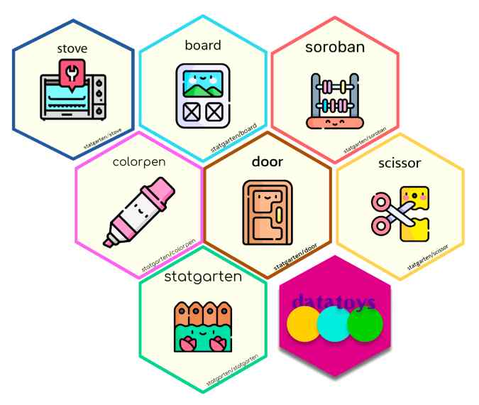{width="100%" fig-align="center"}

::: {.footnote}
Statgarten 통계패키지 생태계
:::
:::

::: {.column width="60%"}
::: {.section-title}
정부 R&D로 단계적 고도화한 오픈소스 자산
:::

::: {.body-text}
**IITP · NIPA 공개SW R&D**로 의학연구용 분석 패키지 · SaaS · 웹 · 튜토리얼까지 단계적으로 구축
:::

| 구분 | 항목 | 내역 |
|:---|:---|:---:|
| **R 패키지** | 통계 분석 함수 | **111종** |
| **공개 SaaS** | openstat.ai | 무료 운영 |
| **R&D 수행** | IITP·NIPA 공개SW | **3건** |
| **지식재산권** | 특허 등록 | **2건** |
| **지식재산권** | SW 저작권 | **1건** |
| **연구 지원** | 분석 지원 논문 | **200편** |
| **임상시험** | 데이터 분석 건수 | **50건** |

::: {.spacer-sm}
:::

::: {.highlight-box}
의학논문에 쓰이는 **거의 모든 분석을 포함**한 R 패키지 — 분석 모듈을 GUI와 통합해 **1\~2줄 코드로 분석 웹 구축** 가능
:::
:::
::::

::: {.notes}
직접 개발해 온 Statgarten 오픈소스 생태계입니다. IITP·NIPA 공개SW R&D를 통해 단계적으로 고도화해 왔으며, 의학연구용 R 패키지 111종, 무료 공개 SaaS openstat.ai, 특허 2건과 SW 저작권 1건을 보유합니다. 오늘 보여드릴 분석들이 모두 이 패키지로 수행됩니다.
:::

## 4대 대표 패키지 — jskm · jstable · jsmodule · splineplot

:::: {.columns}
::: {.column width="50%"}
::: {.section-title}
대표 R 패키지 4종 · CRAN 등록
:::

| 패키지 | 기능 | GitHub |
|:---|:---|:---|
| **jskm** | KM plot 논문용 그림 | jinseob2kim/jskm |
| **jstable** | Regression 논문용 테이블 | jinseob2kim/jstable |
| **jsmodule** | 분석기능 모듈화 (저코드) | jinseob2kim/jsmodule |
| **splineplot** | 비선형 모델 시각화 | jinseob2kim/splineplot |

::: {.section-title}
누적 다운로드
:::

| 지역 | 다운로드 | 비고 |
|:---|:---:|:---|
| 글로벌 누적 | **30만 회+** | CRAN + GitHub |
| 일본 | **3만 회** | 블로그 리뷰 |
| 중국 | **7만 회** | 영상 후기 |

::: {.spacer-sm}
:::

::: {.highlight-box}
본 패키지 활용 논문 **200편** (NEJM · Lancet · JAMA 등 최상위 저널 포함), 임상 데이터 분석 **50건**
:::
:::

::: {.column width="50%"}
::: {.section-title}
패키지 화면 (jskm · jstable)
:::

::: {style="display: grid; grid-template-columns: 1fr 1fr; gap: 8px;"}
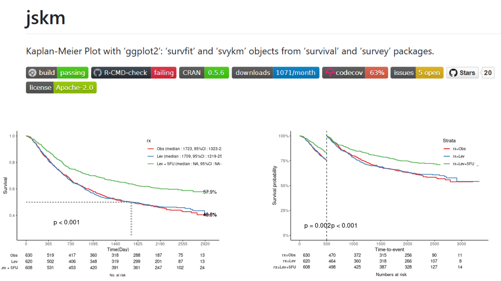{width="100%"}

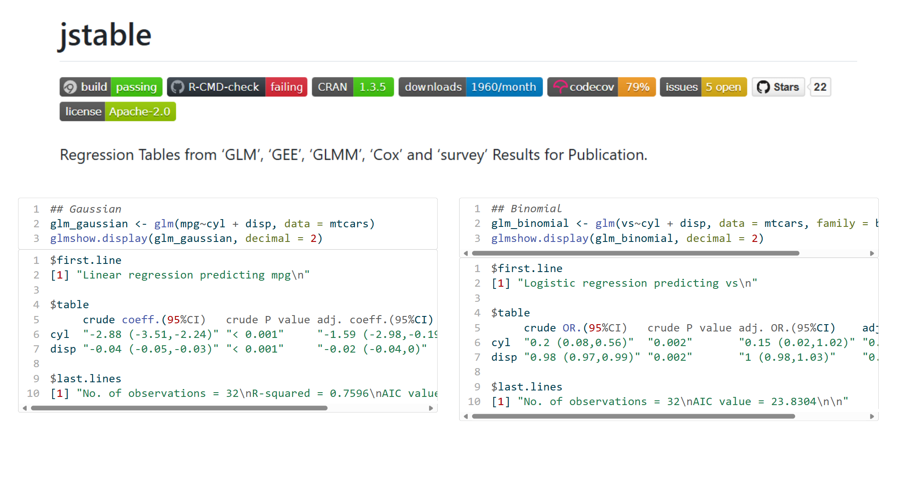{width="100%"}
:::

::: {.spacer-xs}
:::

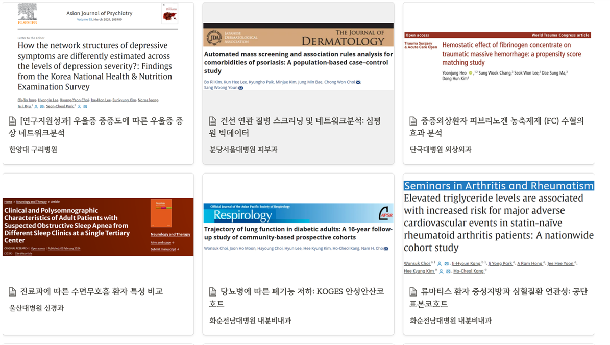{width="90%" fig-align="center"}
:::
::::

::: {.notes}
대표 R 패키지 4종입니다. jskm은 Kaplan-Meier plot을 논문용 그림으로, jstable은 회귀분석 결과를 논문용 테이블로, jsmodule은 분석기능을 모듈화해 저코드로 분석 웹을 만들고, splineplot은 비선형 모델을 시각화합니다. 글로벌 누적 30만 다운로드, 이 패키지로 NEJM·Lancet·JAMA 포함 200편의 논문을 지원했습니다.
:::

## jsmodule — 저코드 분석 웹 · AI Assistant

:::: {.columns}
::: {.column width="55%"}
::: {style="height: 560px; overflow: hidden;"}
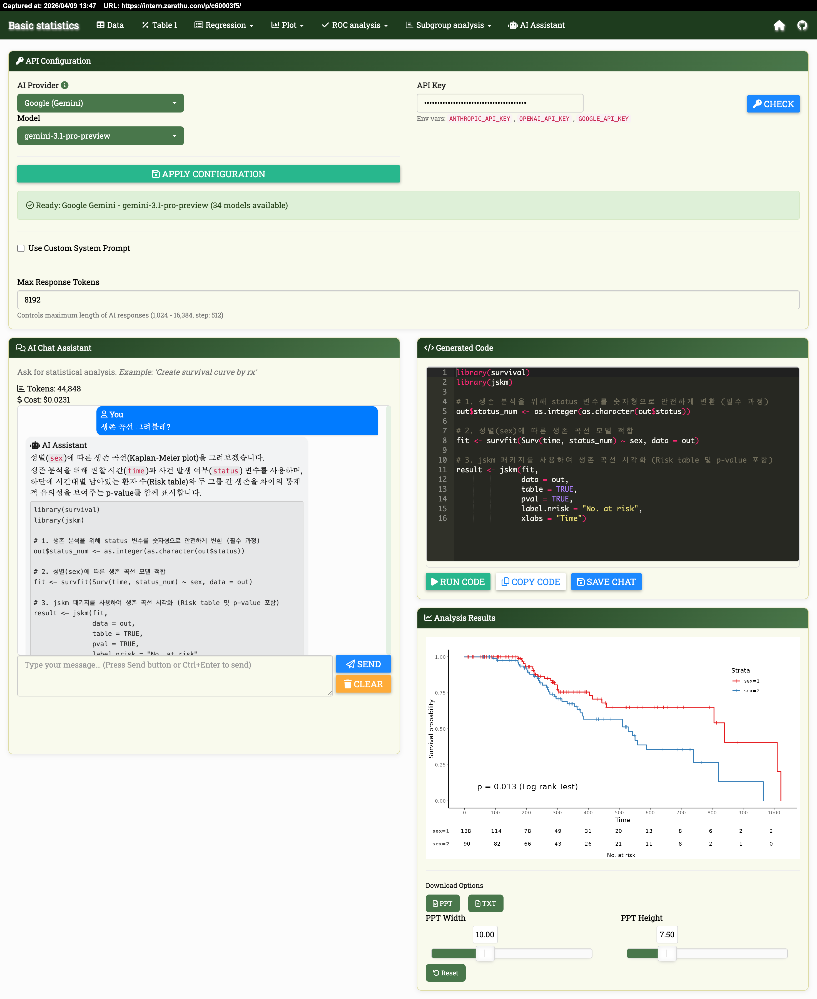{width="100%"}
:::

::: {.footnote}
jsmodule 2.0.0 — AI Assistant 시범 탑재 / openstat.ai 운영 중
:::
:::

::: {.column width="45%"}
::: {.section-title}
이미 작동하는 AI agent 초기 버전
:::

::: {.body-text}
jsmodule 저코드 분석모듈 엔진에 **AI Assistant 기능을 시범 탑재** — *"R 패키지의 AI agent화"* 초기 구현 사례
:::

::: {.module-table}
| 구분 | 구현 기능 |
|:---|:---|
| **LLM 연동** | 질의 기반 분석 코드·통계 절차·시각화 생성·수정·실행 |
| **컨텍스트 활용** | Data Manager 컨텍스트로 이전 표·그림 참조하는 후속 질의 |
| **보안 설계** | row-level 데이터 미포함 / 샌드박스 / 변수명 일반화 |
| **출력 포맷** | 표·그림·flextable · **PPTX · Word · Excel · TXT** 내보내기 |
:::

::: {.spacer-sm}
:::

::: {.highlight-box}
코드 생성을 넘어 **분석 설계 · 데이터 검증 · 통계 실행 · 보고서**까지 연결하는 표준화 분석모듈 기반 AI agent
:::
:::
::::

::: {.notes}
jsmodule 2.0.0에는 이미 AI Assistant 기능이 시범 탑재되어 있습니다. 질의를 입력하면 분석 코드·통계 절차·시각화를 생성·수정·실행하고, 이전 표·그림을 참조하는 후속 질의가 가능하며, 결과를 PPTX·Word·Excel로 바로 내보냅니다. openstat.ai에서 약 1,000명의 회원이 사용 중입니다.
:::

## 멀티오믹스 데이터와 분석의 특징

::: spacer-xs
:::

::: accent-box-emerald
**일반 통계(회귀·t검정)를 그대로 적용할 수 없는 데이터** — 데이터 특성마다 전용 분석 전략 필요
:::

::: spacer-xs
:::

::::::::::: columns
:::::: {.column width="50%"}
::: highlight-box
**① 고차원 (p ≫ n)** — 수만\~수백만 마커 vs 수백 표본 → 정규화(Lasso·Elastic Net)·차원축소(PCA·MOFA)
:::

::: highlight-box-blue
**② 다중공선성** — LD·공발현·pathway로 변수 간 강한 상관 → 네트워크·모듈 기반 통합(xMWAS·WGCNA)
:::

::: highlight-box-teal
**③ 다중검정** — 수백만 검정 동시 수행 → genome-wide significance(5 × 10⁻⁸)·FDR 보정
:::
::::::

:::::: {.column width="50%"}
::: highlight-box-purple
**④ 데이터 이종성** — 계층별 분포·스케일 상이(SNP·count·beta·log-normal) → 정규화 후 단계별 통합
:::

::: highlight-box-gray
**⑤ 기술적 잡음·교란** — batch effect·집단구조가 신호 왜곡 → ComBat·SVA, PC 보정·deconvolution
:::

::: highlight-box
**⑥ 사전지식·공개데이터** — GWAS Catalog·GTEx·KEGG·UK Biobank 활용 → enrichment·MR·imputation
:::
::::::
:::::::::::

::: footnote
※ p ≫ n: 변수(마커) 수가 표본 수를 크게 초과하는 구조 / MR: Mendelian Randomization (인과성 추론)
:::

::: notes
멀티오믹스 데이터는 일반 임상 데이터와 근본적으로 다른 6가지 특성을 가집니다. 첫째 고차원(p가 n보다 훨씬 큼), 둘째 변수 간 강한 상관(LD나 공발현), 셋째 수백만 건의 다중검정, 넷째 계층별로 분포와 스케일이 다른 이종성, 다섯째 batch effect와 집단구조 같은 기술적 잡음·교란, 여섯째 GWAS Catalog·GTEx 같은 공개 reference 데이터의 적극적 활용입니다. 각 특성마다 그에 맞는 전용 분석 전략이 필요하며, 이어지는 6개 슬라이드에서 각 특징과 대응 전략을 하나씩 상세히 다룹니다.
:::

## ① 고차원 — 변수가 표본을 압도 (p ≫ n) {.feat-tight}

::: spacer-xs
:::

::::: columns
::: {.column width="54%"}
[**현상**]{.section-title}

-   측정 변수 p — SNP 50만+ · CpG 85만 · 전사체 2만+ → 수만\~수백만
-   표본 n — 수십\~수백 수준
-   p가 n을 압도 → 회귀 해 불안정 · 과적합 필연

[**차원의 저주**]{.section-title}

-   변수↑ → 표본 간 거리 희박, 우연 상관 급증
-   최소제곱(OLS) — p \> n이면 유일 해 부재

[**분석 전략**]{.section-title}

-   벌점화 회귀 — Lasso·Ridge·Elastic Net: 변수 선택 + 계수 축소
-   차원축소 — PCA·PLS·MOFA: 잠재 인자로 압축
-   사전 필터링 — 분산·연관 기반 screening
:::

::: {.column width="46%"}
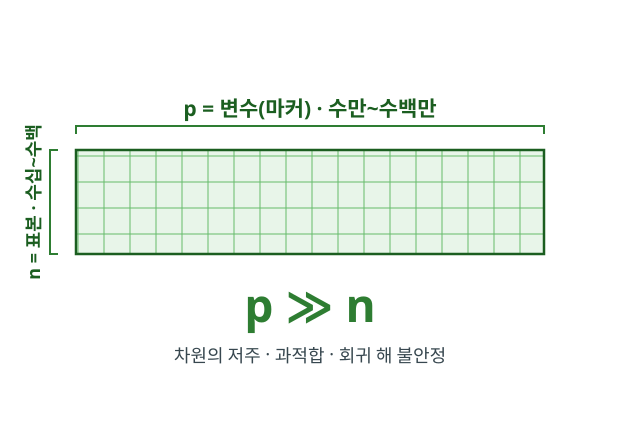{height="280px" fig-align="center"}

::: card
[차원축소 — PLS · MOFA]{.section-title}

-   **PLS**(부분최소제곱) — 결과변수와 가장 관련 큰 방향으로 변수를 압축하는 지도학습형 차원축소 (PCA는 결과를 보지 않는 비지도)
-   **MOFA**(Multi-Omics Factor Analysis) — 여러 오믹스를 동시에 설명하는 공통 잠재인자(factor)를 찾는 비지도 통합 기법
:::
:::
:::::

::: notes
멀티오믹스의 가장 근본적 특징은 변수 수가 표본 수를 압도하는 고차원 구조입니다. SNP는 50만 개 이상, 메틸화는 85만 부위인데 환자는 수십에서 수백 명에 불과합니다. 이 경우 일반 최소제곱 회귀는 유일한 해를 갖지 못하고 과적합됩니다. 그래서 Lasso 같은 벌점화 회귀로 변수를 선택하거나, PCA·MOFA로 차원을 압축하는 전략이 필수입니다.
:::

## ② 다중공선성 — 변수 간 강한 상관 구조 {.feat-tight}

::: spacer-xs
:::

::::: columns
::: {.column width="54%"}
[**상관의 원천**]{.section-title}

-   유전 — 연관불균형(LD): 인접 SNP 블록 단위 동시 유전
-   전사 — 공발현 모듈: 같은 경로 유전자 동조 변동
-   단백·대사 — pathway 내 강한 양/음 상관

[**문제**]{.section-title}

-   회귀계수 분산 폭증(VIF↑) · 부호 역전 · 해석 불가
-   인과 변수 식별 불가(non-identifiability)

[**분석 전략**]{.section-title}

-   모듈·네트워크 통합 — WGCNA · xMWAS
-   Group Lasso · 주성분 회귀 — 상관 그룹 단위 처리
-   LD clumping · fine-mapping — 인과 변이 후보 축소
:::

::: {.column width="46%"}
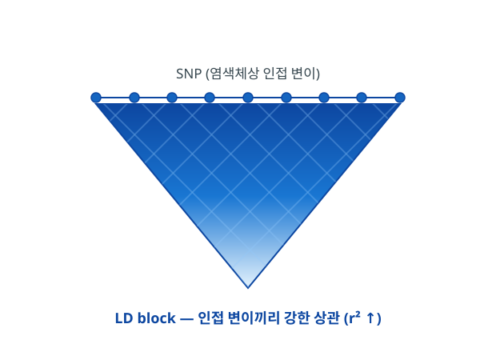{height="270px" fig-align="center"}

::: card
[Lasso vs Group Lasso]{.section-title}

-   **Lasso** — 계수를 **하나씩** 0으로: LD block에서 SNP 하나만 임의 선택(불안정)
-   **Group Lasso** — 묶은 **그룹(LD block·pathway)을 통째로** in/out: 생물학적 단위 유지로 안정적
:::
:::
:::::

::: notes
오믹스 변수들은 서로 독립이 아니라 강하게 상관됩니다. 유전체에서는 인접 SNP가 연관불균형으로 블록 단위로 함께 유전되고, 전사체에서는 같은 경로 유전자가 공발현합니다. 다중공선성이 심하면 회귀계수의 분산이 폭증하고 부호가 뒤집혀 어느 변수가 진짜 원인인지 식별할 수 없습니다. WGCNA나 xMWAS처럼 모듈·네트워크 단위로 다루거나, LD clumping으로 인과 변이를 좁히는 접근이 필요합니다.
:::

## ③ 다중검정 — 수백만 가설의 동시 검정 {.feat-tight}

::: spacer-xs
:::

::::: columns
::: {.column width="54%"}
[**규모와 위험**]{.section-title}

-   GWAS 50만\~1,000만 SNP · EWAS·DEG 수만 부위 동시 검정
-   100만 검정 × α 0.05 = 5만 우연 양성 → 보정 없이 해석 불가

[**보정 방법**]{.section-title}

-   Bonferroni — α/m: GWAS 표준 5 × 10⁻⁸ (= 0.05 / 10⁶)
-   FDR(Benjamini–Hochberg) — 발견 중 거짓 비율 통제, 탐색 단계 적합
-   effective test 수 · 순열검정 — LD 상관 반영

[**진단**]{.section-title}

-   QQ plot · genomic inflation(λ) — 체계적 편향 점검
-   보정 통과 신호만 후속 통합 분석
:::

::: {.column width="46%"}
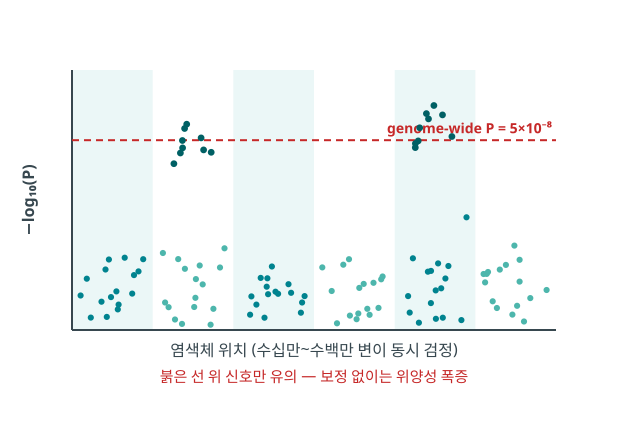{height="360px" fig-align="center"}
:::
:::::

::: notes
GWAS는 수백만 개의 SNP를 동시에 검정하기 때문에, 보정 없이 0.05 기준을 쓰면 100만 검정에서 5만 개의 거짓 양성이 나옵니다. 그래서 Bonferroni 보정으로 genome-wide significance 5×10의 마이너스 8승을 표준으로 쓰고, 탐색 단계에서는 FDR을 사용합니다. QQ plot과 genomic inflation으로 체계적 편향을 점검하고, 보정을 통과한 신호만 후속 통합 분석에 넘깁니다.
:::

## ④ 데이터 이종성 — 계층마다 다른 분포·스케일 {.feat-tight}

::: spacer-xs
:::

::::: columns
::: {.column width="54%"}
[**계층별 데이터 성격**]{.section-title}

-   유전형 — 0/1/2 범주(이산)
-   RNA-seq — count · 과분산 → 음이항
-   메틸화 — β값 0\~1 경계(bounded)
-   단백·대사체 — 연속 · 우편향 → log 정규
-   마이크로바이옴 — 합성 데이터, 합 = 1 제약

[**문제**]{.section-title}

-   단위·분산·결측 구조 상이 → 단순 결합 시 큰 스케일 계층이 지배

[**분석 전략**]{.section-title}

-   계층별 변환·정규화 — VST · log · CLR
-   통합 시점 — Early(연결) · Intermediate(MOFA 잠재인자) · Late(결과 통합)
-   계층별 imputation — 결측 구조 반영
:::

::: {.column width="46%"}
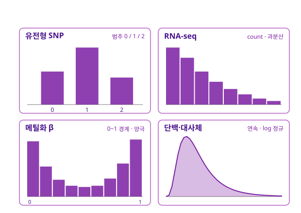{height="360px" fig-align="center"}
:::
:::::

::: notes
오믹스 계층마다 데이터의 분포와 스케일이 완전히 다릅니다. 유전형은 0,1,2 범주이고, RNA-seq는 과분산된 count, 메틸화는 0과 1 사이 경계값, 단백·대사체는 우편향된 연속값, 마이크로바이옴은 합이 1인 합성 데이터입니다. 그냥 합치면 스케일 큰 계층이 결과를 지배하므로, 계층별로 적절히 변환·정규화한 뒤 early·intermediate·late 중 적합한 시점에 통합합니다.
:::

## ④ 데이터 이종성 — 변환·정규화 (VST · log · CLR) {.feat-tight}

::: accent-box-emerald
**"큰 스케일 계층이 지배"는 lasso만의 문제가 아님** — 거리 기반(PCA·클러스터링·kNN) · 벌점 회귀(lasso·ridge) · 모든 통합 분석에 공통되는 **전처리** 문제
:::

:::: columns
::: {.column width="55%"}
[계층별 변환 — 분포가 다르니 각자 맞는 변환]{.section-title}

-   **VST** — RNA-seq count: 평균↑ → 분산↑(과분산) 제거, 발현량 무관 분산 일정화 → 고발현 쏠림 방지
-   **log** — 단백·대사체 우편향 연속값: 대칭(정규)에 가깝게, 큰 값 압축
-   **CLR** — 마이크로바이옴 합성데이터(합 = 1): log(값 / 기하평균)으로 단순체 제약 해제
-   **z-score** — 변환 후 계층별 평균 0·분산 1로 스케일 정렬
:::

::: {.column width="45%"}
::: card
[결측 — 메커니즘이 계층마다 다름]{.section-title}

-   **LOD 이하**(대사체) — 검출한계보다 농도 낮으면 0이 아니라 "측정 안 됨"으로 빠짐. 값이 작아 빠진 것 = **MNAR** → LOD/2·left-censoring
-   **dropout**(scRNA-seq) — 발현하는데 기술적으로 0으로 찍힘. 진짜 0과 구분 어려움 → zero-inflated·MAGIC
-   **플랫폼별** — 칩·패널마다 재는 변수가 달라 특정 변수 통째 결측
-   대치 — **KNN · MissForest · MICE** (계층 특성에 맞게)
:::
:::
::::

::: footnote
순서 원칙 — 계층별 변환·정규화·대치를 먼저, 통합은 그다음 (반대로 하면 스케일 큰 계층이 지배) / MNAR: 값 자체 때문에 결측되는 구조
:::

::: notes
슬라이드 4의 스케일 지배 문제를 자세히 봅니다. 이건 lasso만의 문제가 아니라 거리 기반·벌점 회귀·모든 통합 분석에 공통되는 전처리 문제입니다. RNA-seq count는 VST로 분산을 안정화하고, 단백·대사체 우편향은 log, 마이크로바이옴 합성 데이터는 CLR로 변환한 뒤 z-score로 스케일을 맞춥니다. 결측도 계층마다 메커니즘이 다르므로 합치기 전에 각 계층에 맞게 대치합니다.
:::

## ④ 데이터 이종성 — 통합 시점 (Early · Intermediate · Late) {.feat-tight}

:::: columns
::: {.column width="45%"}
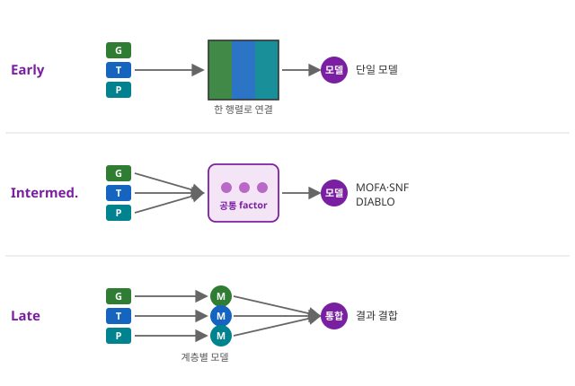{height="380px" fig-align="center"}
:::

::: {.column width="55%"}
[여러 오믹스를 *언제* 합치나]{.section-title}

::: highlight-box
**Early (조기·연결)** — 모든 오믹스 변수를 한 행렬로 이어붙여 단일 모델. 가장 단순하나 p ≫ n·스케일 문제 최악 → 정규화·벌점 필수
:::

::: highlight-box-blue
**Intermediate (중간·잠재인자)** — 각 계층을 공통 잠재공간으로 보내 factor 수준에서 통합 (**MOFA**·SNF·DIABLO). 계층 구조 보존 + 교차신호 포착 → 보통 가장 무난
:::

::: highlight-box-teal
**Late (후기·결과 통합)** — 계층별로 따로 모델 → 예측·결과 결합(앙상블·메타분석).  계층 간 상호작용 놓칠 수 있음
:::
:::
::::

::: notes
오믹스를 언제 합치느냐에 따라 세 전략이 있습니다. Early는 모든 변수를 한 행렬로 이어붙여 단일 모델을 만드는 방식으로 가장 단순하지만 고차원·스케일 문제가 가장 심합니다. Intermediate는 각 계층을 공통 잠재인자로 보내 통합하는 방식으로 MOFA가 대표적이며 보통 가장 무난합니다. Late는 계층별로 따로 모델을 만든 뒤 결과를 합치는 방식으로 강건하지만 계층 간 상호작용은 놓칠 수 있습니다.
:::

## ⑤ 기술적 잡음·교란 — 신호를 가리는 변동

::: spacer-xs
:::

::::: columns
::: {.column width="54%"}
[**기술적 변동 (batch effect)**]{.section-title}

-   실험 런·플랫폼·시약 로트·측정일별 체계적 차이
-   생물학적 신호와 교락 시 가짜 발견 양산

[**생물학적 교란**]{.section-title}

-   집단 구조(ancestry) → GWAS 거짓 연관
-   조직 세포조성 → 메틸화·전사 신호 왜곡

[**분석 전략**]{.section-title}

-   Batch 보정 — ComBat · SVA · RUV · removeBatchEffect
-   집단구조 — 주성분(PC) 공변량 · 혼합모형(LMM)
-   세포조성 — deconvolution 보정
-   설계 단계 — randomization · 균형 배치
:::

::: {.column width="46%"}
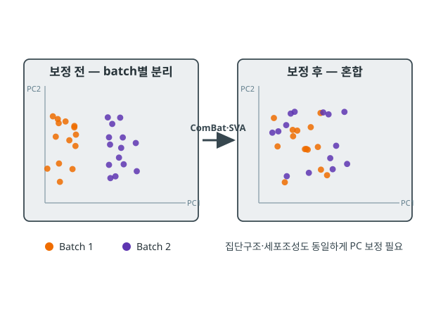{height="400px" fig-align="center"}
:::
:::::

::: notes
오믹스 데이터에는 생물학적 신호보다 기술적 변동이 더 클 때가 많습니다. 실험 날짜나 플랫폼, 시약 로트에 따라 체계적 차이가 생기는데, 이 batch가 비교 군과 교락되면 가짜 발견이 쏟아집니다. 집단 구조나 세포조성 같은 생물학적 교란도 마찬가지입니다. ComBat·SVA로 batch를 보정하고, 주성분이나 혼합모형으로 집단구조를, deconvolution으로 세포조성을 보정합니다. 가장 좋은 건 설계 단계에서 균형 있게 배치하는 것입니다.
:::

## ⑥ 사전지식·공개데이터 — 외부 reference 활용

::: spacer-xs
:::

::::: columns
::: {.column width="54%"}
[**공개 데이터·DB**]{.section-title}

-   변이–형질 — GWAS Catalog · UK Biobank · FinnGen
-   조절 — GTEx(eQTL) · ENCODE
-   경로·기능 — KEGG · Reactome · GO · MSigDB
-   참조 패널 — 1000 Genomes · TopMed

[**활용 분석**]{.section-title}

-   Enrichment — GSEA·ORA: 개별 마커 → 생물학적 해석
-   Mendelian Randomization — 공개 summary 통계로 인과 추론
-   Imputation — 참조 패널로 미측정 변이 보강
-   PRS — 외부 GWAS 가중치로 개인 위험도 산출
:::

::: {.column width="46%"}
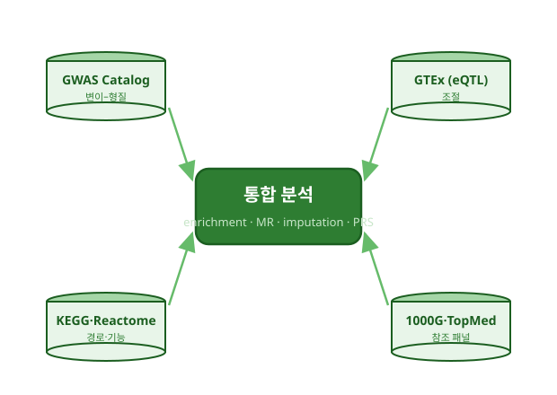{height="400px" fig-align="center"}
:::
:::::

::: notes
멀티오믹스 분석의 강력한 무기는 풍부한 공개 데이터입니다. GWAS Catalog와 UK Biobank의 변이-형질 정보, GTEx의 eQTL, KEGG·Reactome의 경로 정보, 1000 Genomes 같은 참조 패널을 적극 활용합니다. 개별 마커를 pathway enrichment로 생물학적으로 해석하고, 공개 summary 통계로 Mendelian Randomization 인과 추론을 하며, 참조 패널로 측정하지 못한 변이를 imputation하고, 외부 GWAS 가중치로 PRS를 만듭니다. 자체 데이터만으로는 불가능한 분석이 외부 reference로 가능해집니다.
:::

## Case 1. 양극성장애 환자 약물 치료 반응 예측 및 신호 분석

:::::: {.columns .case-slide}
::: {.column width="52%"}
[삼성서울병원 정신건강의학과 백지현 교수님]{.case-owner}

**분석 데이터**

-   양극성장애 환자의 임상정보, 약물 반응 점수, proteomics, SNP, PRS을 포함한 다각적 멀티오믹스 데이터.
-   Lithium과 Valproate 반응을 연속형 점수와 반응군 형태로 정의, 예측 성능 평가와 분자 신호 해석을 동일 프레임 내에 연결.

**분석 목표 및 통계 분석**

-   약물 반응 차이를 설명하는 임상·분자 결합 신호 탐색 후, 반응 예측에 기여하는 feature 축 도출을 위한 분석 설계.
-   [Table 1]{.stat-tech}, [linear/logistic regression]{.stat-tech}로 기본 차이를 정리한 뒤, [SNP-level GWAS]{.stat-tech}, [network analysis]{.stat-tech}, [LASSO]{.stat-tech}, [Random Forest]{.stat-tech}로 확장 진행.

**결과 및 산출물**

-   반응군 비교표, SNP-단백체-임상 통합 네트워크, 변수 중요도 기반 예측 모델 구축, `[75% train / 25% test]` 분할과 `[10-fold CV]` 기준의 성능 비교 체계 정리.
:::

:::: {.column width="48%"}
::: {.case-media .case-media-2 data-caption="상: SNP-단백체-임상 통합 네트워크 커뮤니티. 하: 보정 로지스틱 회귀 결과표 예시."}
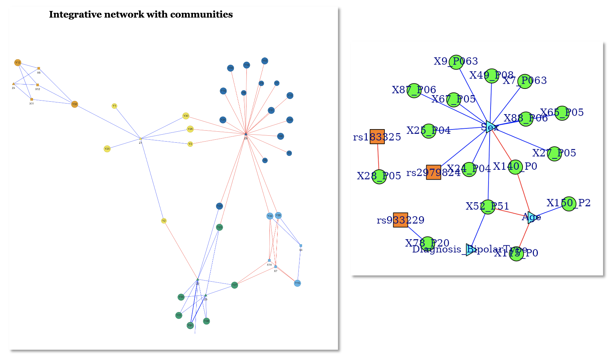{.case-img-2}

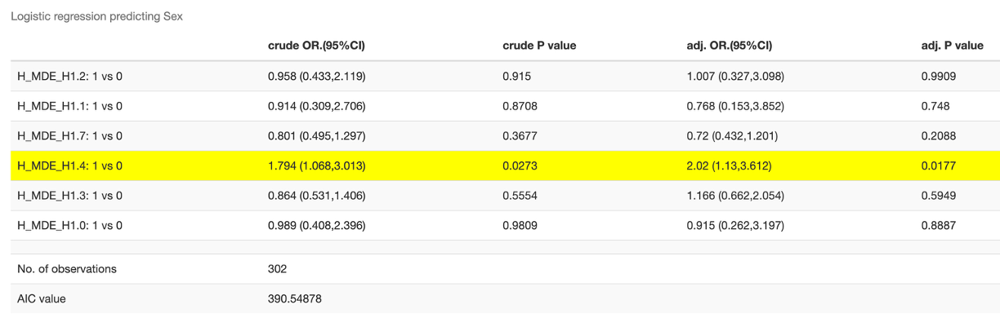{.case-img-2}
:::
::::
::::::

## Case 1. 양극성장애 환자 약물 치료 반응 예측 및 신호 분석

:::::: {.columns .case-slide}
::: {.column width="52%"}
[삼성서울병원 정신건강의학과 백지현 교수님]{.case-owner}

**분석 데이터**

-   한국인 PRS summary statistics, phenotype, eQTL/mQTL, Brain-mMeta를 통합한 멀티오믹스 데이터.
-   단순 예측 score 비교를 넘어, lead SNP와 기능 후보 유전자를 다시 해석하기 위한 post-GWAS 구조 중심 데이터셋.

**분석 목표 및 통계 분석**

-   ancestry-informed PRS 재산출을 통한 예측력 재점검 후, 기능적 근거가 더 설득력 있는 SNP-유전자 축 도출을 위한 재해석.
-   [PRScs]{.stat-tech}, [PRScsx]{.stat-tech}로 trait별 score를 산출하고 [logistic ROC]{.stat-tech}로 성능 비교, 이후 [SMR/HEIDI]{.stat-tech} 기반으로 대안 SNP와 기능 후보 재평가.

**결과 및 산출물**

-   PRS 비교표와 기능 후보 SNP 요약 자료를 정리하고, SLC25A12 gene-based SMR은 `p_SMR = 0.381`로 강한 지지 근거가 제한적이므로 대안 SNP 비교 중심의 해석.
:::

:::: {.column width="48%"}
::: {.case-media .case-media-2 data-caption="상: PRScsx 분석 파이프라인, 하: network 분석 및 Node statistics를 위한 Interacitve 웹."}
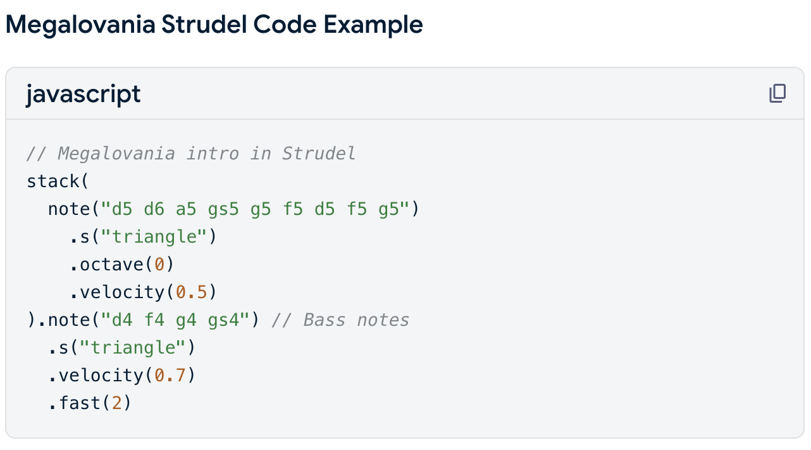{.case-img-2}

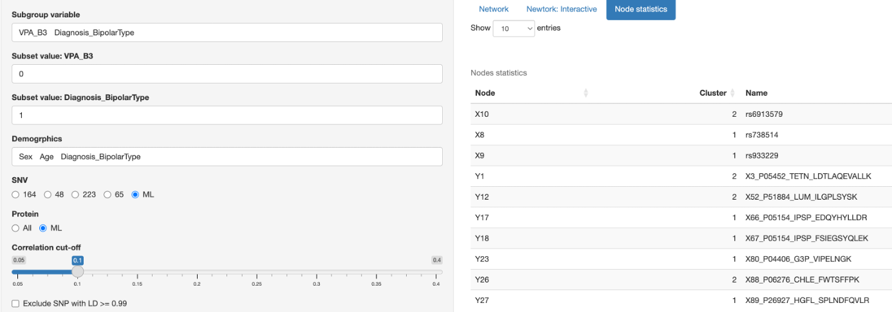{.case-img-2}
:::
::::
::::::

## Case 1 보충 ①. 연구 배경·목표와 분석 데이터

:::::::: {.columns .case-slide}
:::: {.column width="50%"}
[삼성서울병원 정신건강의학과 백지현 교수님]{.case-owner}

**연구 배경**

-   양극성장애(bipolar disorder)는 유전 영향이 크고, lithium·valproate 같은 약물의 반응이 환자마다 크게 달라 미리 예측하기 어려움
-   유전·단백체·임상 정보를 함께 보면 반응 예측과 발병 기전 이해에 도움이 될 것으로 봄

::: spacer-md
:::

**두 갈래로 진행한 연구**

-   ⑴ 약물반응 예측 라인: 임상·단백체·유전 정보를 통합해 lithium·valproate 반응을 예측하는 모델을 구축함
-   ⑵ 유전 위험도·기전 라인: 한국인 양극성장애 GWAS로 위험점수(PRS)를 만들고 위험 변이의 기능적 기전을 규명함
::::

::::: {.column width="50%"}
::: spacer-md
:::

**분석 데이터 ⑴ 약물반응 예측 (BOMICS 코호트)**

-   임상 정보(나이·성별·진단 특성·동반질환 등)를 수집
-   단백체(proteomics): 치료 시점(T0·T1·T2)별 혈액 단백질과 그 변화량을 측정
-   유전 변이(SNP)와 다유전자 위험점수(PRS)를 함께 산출
-   결과 변수로 lithium·valproate 반응(반응 여부로도 구분)을 사용

**분석 데이터 ⑵ 유전 위험도·기전 (한국인 BD GWAS)**

-   [K-CHIP]{.stat-tech}으로 양극성장애 환자·대조군의 유전체를 측정
-   대규모 메타 GWAS 요약통계(약 3만 명)를 활용
-   외부 공개 QTL 데이터(뇌 [eQTL]{.stat-tech}·[mQTL]{.stat-tech})를 함께 사용

::: card
[용어]{.section-title}

-   proteomics(단백체): 혈액 속 단백질을 한꺼번에 측정한 자료임
-   SNP(Single Nucleotide Polymorphism, 단일염기다형성): 사람마다 다른 유전자 한 글자 차이를 뜻함
:::
:::::
::::::::

## Case 1 보충 ②. 약물반응 예측 라인 (BOMICS)

::::::: {.columns .case-slide}
::: {.column width="50%"}
[삼성서울병원 정신건강의학과 백지현 교수님]{.case-owner}

**방법: 임상·단백체·유전 통합**

-   [Table 1]{.stat-tech}·[logistic regression]{.stat-tech}으로 반응군과 비반응군의 기본 차이를 정리함
-   [SNP-level GWAS]{.stat-tech}로 반응 연관 변이를, [network analysis]{.stat-tech}로 SNP·단백질·임상의 연결 구조를 탐색함
-   [LASSO]{.stat-tech}·[Random Forest]{.stat-tech}로 예측 모델을 만들고, 75% 학습 / 25% 검증과 [10-fold 교차검증]{.stat-tech}으로 성능을 평가함

**LASSO**

-   많은 변수(SNP·단백질·임상) 중 예측에 중요하지 않은 변수의 계수를 0으로 눌러, 의미 있는 소수만 남기는 회귀 기반 머신러닝임
-   변수가 표본보다 많을 때 과적합을 막고, 핵심 예측 인자를 자동으로 골라줌

**결과**

-   SNP·단백체·임상 통합 네트워크, 변수 중요도 기반 [LASSO]{.stat-tech}·[Random Forest]{.stat-tech} 예측 모델, [ROC]{.stat-tech} 탐색 Shiny 앱을 산출함
:::

::::: {.column width="50%"}
::: {style="height:38px"}
:::

::: {.case-media .case-media-full data-caption="SNP·단백체·임상 통합 네트워크" style="--case-media-height: 72vh;"}
{.case-img-1}
:::
:::::
:::::::

## Case 1 보충 ③. 유전 위험도·기전 라인. SNP·GWAS

::: card
[유전 위험도·기전 라인]{.section-title}

-   GWAS로 위험 변이를 찾고(이 장), PRS로 발병 위험을 점수화하며(보충④·⑤), SMR로 기전을 확인(보충⑥). 결과는 보충⑦에 정리.
:::

:::::: {.columns .case-slide}
::: {.column width="50%"}
[삼성서울병원 정신건강의학과 백지현 교수님]{.case-owner}

**SNP(Single Nucleotide Polymorphism, 단일염기다형성)**

-   유전체의 한 염기 자리(A·T·G·C)에서 사람마다 염기가 달라지는 변이임. 사람 간 유전체는 약 99.9%가 동일하고, 개인 간 차이의 대부분이 SNP임
-   집단에서 [minor allele]{.stat-tech}(소수 대립유전자) 빈도가 일정 수준 이상으로 흔한 SNP을 분석에 사용함(거의 모두 같은 염기인 자리는 비교할 변이가 없어 제외)
-   과거에는 전장유전체를 다 읽지 못해 알려진 SNP만 칩([K-CHIP]{.stat-tech} 등)으로 측정했고, 지금은 전장유전체(whole genome) 측정도 가능함
-   각 SNP에는 고유 [rs 번호]{.stat-tech}가 붙음(예: rs75776799). 유전형은 minor allele 개수로 0·1·2로 코딩함
:::

:::: {.column width="50%"}
**GWAS(Genome-Wide Association Study, 전장유전체 연관분석)**

-   수백만 개 SNP을 한꺼번에 훑어, 질병과 통계적으로 연관된 위치를 찾는 분석임
-   수백만 번 검정하므로, 우연한 양성을 막기 위해 매우 엄격한 기준($p < 5\times10^{-8}$)을 넘어야 유의하다고 봄

::: highlight-box
**연관은 곧 인과가 아님**

-   설령 어떤 SNP이 질병과 연관되더라도 그 유전자가 원인이라는 보장은 없음
-   바로 옆에 붙어(LD, 연관불평형) 함께 움직인 다른 유전자가 진짜 원인일 수 있음
-   이를 가려내기 위해 뒤의 SMR 분석이 필요함
:::
::::
::::::

## Case 1 보충 ④. PRS (다유전자 위험점수)

::::: {.columns .case-slide}
::: {.column width="52%"}
[삼성서울병원 정신건강의학과 백지현 교수님]{.case-owner}

**PRS: 수천 개 변이의 효과를 더한 위험 점수**

-   양극성장애는 한두 유전자가 아니라 수천 개 변이가 조금씩 위험을 더하는 질환임
-   대규모 GWAS에서 각 변이의 효과크기([β]{.stat-tech}, 보통 로그 오즈비)가 이미 추정되어 있음
-   한 사람의 유전형을 변이마다 0·1·2(위험 대립유전자 개수)로 읽어, β를 곱해 모두 더하면 위험 점수가 됨

$$\text{PRS}=\sum_{i}\beta_i \, x_i \qquad (x_i = 0,1,2)$$

-   $\beta_i$는 변이 $i$의 효과크기, $x_i$는 위험 대립유전자 개수임. 가중치 보정 없이 단순 합산하는 방식이 가장 기본형(classical) PRS이며, 뒤의 PRS-CS가 이를 개선함
:::

::: {.column width="48%"}
**예시: 변이 3개로 본 계산 (개념용)**

| 변이           | β (로그 오즈비) | 유전형 | 기여 (β×개수) |
|:---------------|:---------------:|:------:|:-------------:|
| 변이 1         |      +0.30      |   2    |     +0.60     |
| 변이 2         |      +0.10      |   1    |     +0.10     |
| 변이 3         |      −0.20      |   0    |     0.00      |
| **합계 (PRS)** |                 |        |   **+0.70**   |

-   실제로는 변이 수천 개에서 수만 개를 같은 방식으로 더함
-   점수가 높을수록 그 질환의 유전적 소인이 크다고 해석함
:::
:::::

## Case 1 보충 ⑤. PRS 정확도를 높이는 PRS-CS·PRS-CSx

::::::: {.columns .case-slide}
::: {.column width="50%"}
[삼성서울병원 정신건강의학과 백지현 교수님]{.case-owner}

**단순 합산의 한계와 보정**

-   가까이 있는 SNP들은 서로 비슷한 정보를 담음([LD]{.stat-tech}, Linkage Disequilibrium, 연관불평형). 단순 합산은 이 중복을 과다 반영함
-   표준 참조 유전체(reference panel)로 LD 구조를 보정해야 점수가 정확해짐

**PRS-CS · PRS-CSx (Python 도구)**

-   [PRS-CS]{.stat-tech}(Continuous Shrinkage): 베이지안(Bayesian) 회귀로 각 SNP 효과에 연속 축소 사전분포(continuous shrinkage prior)를 적용해 LD 참조패널 기반으로 효과크기를 다시 추정함. 효과가 약한 변이는 0에 가깝게 강하게 줄이고 뚜렷한 변이는 덜 줄여 잡음을 억제함
-   [PRS-CSx]{.stat-tech}: PRS-CS를 여러 인종(동아시아·유럽) GWAS에 동시에 적용하도록 확장함. 인종별 효과는 따로 추정하되 축소 사전분포를 공유해, 유럽처럼 큰 GWAS 정보를 한국인 등 작은 집단에 전달해 비유럽 예측력을 높임
-   조현병 GWAS 대조군과 양극성장애 표본이 겹친 문제를 확인해, 겹친 한국인 표본(약 1,180명)을 빼고 재계산함. 성능은 [ROC-AUC]{.stat-tech}로 평가(1에 가까울수록 잘 구분)
:::

::::: {.column width="50%"}
::: {.case-media .case-media-full data-caption="PRS-CSx 분석 파이프라인 (여러 인종 GWAS 통합)" style="--case-media-height: 408px;"}
{.case-img-1}
:::

::: {.card style="line-height: 1.45; font-size: 0.685em;"}
[연속 축소 사전분포 (continuous shrinkage prior)]{.section-title}

각 SNP 효과 $\beta_j$에 0 중심 사전분포를 두고, SNP마다 축소 강도를 데이터로 정함

$$\beta_j \sim \mathcal{N}(0,\ \phi\,\psi_j)$$

$\phi$는 전체 축소 정도, $\psi_j$는 SNP별 축소 정도임. 효과가 약한 SNP은 $\psi_j$가 작아 0에 가깝게 강하게 줄이고, 뚜렷한 SNP은 덜 줄임
:::
:::::
:::::::

## Case 1 보충 ⑥. 기전 규명: SMR·HEIDI

::::::: {.columns .case-slide}
::: {.column width="50%"}
[삼성서울병원 정신건강의학과 백지현 교수님]{.case-owner}

**SMR: 변이로 유전자·질병의 인과를 추정**

-   [SMR]{.stat-tech}(Summary-data-based Mendelian Randomization)은 위험 변이가 유전자 발현([eQTL]{.stat-tech})·메틸화([mQTL]{.stat-tech})에 주는 영향을 매개로 하여, 어떤 유전자가 질병의 원인 쪽인지 추정함
-   유전 변이는 태어날 때 정해져, 질병에 걸린 뒤에 변이가 바뀌지는 않음. 그래서 변이를 출발점으로 삼으면 질병이 거꾸로 변이를 바꿨을 가능성이 없어, 변이가 질병의 원인인지를 한 방향으로만 따질 수 있음

**HEIDI: 진짜 표적인지 거르는 검정**

-   [HEIDI]{.stat-tech}는 그 연관이 단지 옆에 붙어(LD) 우연히 같이 움직인 것인지 가려냄. 즉 "이 유전자가 진짜냐, 근처 유전자가 진짜냐"를 판정함
:::

::::: {.column width="50%"}
::: card
[필요한 외부 데이터]{.section-title}

-   [eQTL]{.stat-tech}(expression Quantitative Trait Locus, 발현 양적형질 유전자좌): 변이가 유전자 발현량에 주는 영향(뇌 BrainMeta 등)
-   [mQTL]{.stat-tech}(methylation Quantitative Trait Locus, 메틸화 양적형질 유전자좌): 변이가 DNA 메틸화에 주는 영향(동아시아 mQTL 메타분석)
:::

::: highlight-box
GWAS에서 연관이 나타난 유전자가 실제 기능 표적과 다를 수 있어, SMR로 표적을 다시 확인하는 것이 중요함
:::
:::::
:::::::

## Case 1 보충 ⑦. 결과: 유전 위험도·기전 라인

:::::: {.columns .case-slide}
::: {.column width="50%"}
[삼성서울병원 정신건강의학과 백지현 교수님]{.case-owner}

**PRS 위험점수 성능 (GWAS 인종별)**

| 위험점수 | 인종     |  OR  |  R²   | AUROC |
|:---------|:---------|:----:|:-----:|:-----:|
| 양극성   | 동아시아 | 1.21 | 0.011 | 0.552 |
| 양극성   | 유럽     | 1.58 | 0.061 | 0.627 |
| 양극성   | 다인종   | 1.63 | 0.070 | 0.632 |

-   OR은 위험점수가 1 표준편차 높아질 때 발병 위험(오즈)이 몇 배로 커지는지를 나타냄
-   R²(Nagelkerke)은 위험점수가 발병 여부의 변동을 설명한 비율임
-   AUROC은 환자와 대조군을 한 명씩 뽑았을 때 환자의 점수가 더 높을 확률임(0.5는 무작위, 1은 완벽)
-   유럽·다인종 GWAS 기반 점수가 동아시아 단독보다 한국인 위험을 더 잘 설명했음. 동아시아 점수의 설명력이 낮은 것은 인종 간 유전구조가 달라서가 아니라 주로 동아시아 GWAS 표본이 유럽의 약 1/4로 작기 때문임
:::

:::: {.column width="50%"}
**GWAS 핵심 발견: 새 위험 변이 1곳**

-   전장유전체 유의 변이 [rs75776799]{.stat-tech} 1곳을 발견함([SLC25A12]{.stat-tech} 인트론, P = 2.45×10⁻⁹, OR = 2.65). 기존 양극성장애 연구에서 보고된 적 없는 새 위치임
-   [SLC25A12]{.stat-tech}는 미토콘드리아 칼슘 운반 단백질을 만드는 유전자로, 미토콘드리아 기능이 발병에 관여할 가능성을 시사함

**SMR·HEIDI 기전 분석: 인과 유전자 미확정**

-   뇌 eQTL·동아시아 mQTL 기반 SMR에서 다중검정 보정 후 유의한 인과 유전자는 없었음(eQTL 7개 유전자 모두 [p_SMR]{.stat-tech} \> 0.05)
-   mQTL에서는 [DLX2-AS1]{.stat-tech}·[ITGA6]{.stat-tech} 부근 일부 프로브(probe, 메틸화를 측정하는 DNA 지점)만 약한 연관(p \< 0.05, 엄격 보정은 미통과). 인과 유전자는 더 큰 자료로 규명이 필요함

::: highlight-box
**정리**: 한국인 양극성장애에서 새 위험 변이([SLC25A12]{.stat-tech})를 발견함. 다만 이 변이가 어느 유전자를 통해 작동하는지는 SMR·HEIDI로는 확정되지 않아, 더 큰 자료로 후속 규명이 필요함
:::
::::
::::::

## Case 2. 소아 아토피성 염증 피부 지질체-전사체 통합 분석

:::::: {.columns .case-slide}
:::: {.column width="48%"}
::: {.case-media .case-media-full data-caption="PCA, heatmap, volcano, GO/KEGG Enrichment Analysis"}
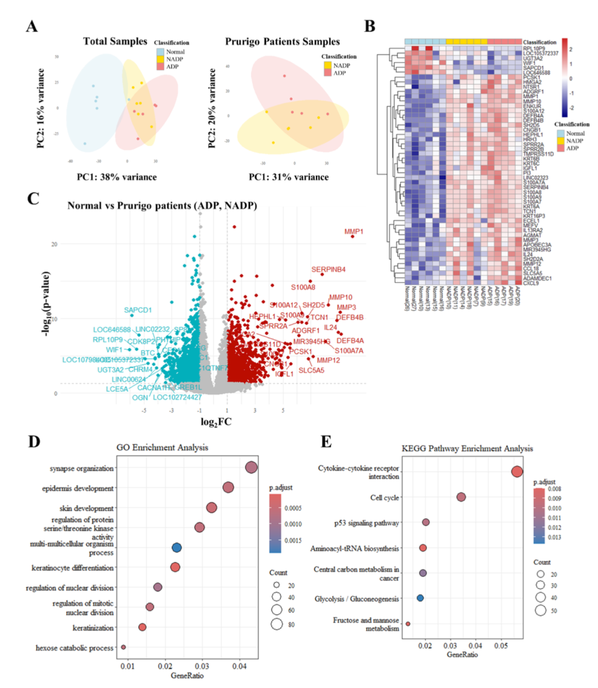{.case-img-1}
:::
::::

::: {.column width="52%"}
[강남성심병원 피부과 김혜원 교수님]{.case-owner}

**분석 데이터**

-   소아 아토피 피부 lipidomics, 부위 A/B/C 정보와 임상 중증도 지표가 함께 정리된 site-specific 통합 자료.
-   이후 sensitive skin, prurigo 데이터셋으로 확장, 질환별 차이와 공통 lipid 패턴을 비교 가능한 프레임으로 구성.

**분석 목표 및 통계 분석**

-   염증 반응과 연결되는 lipid axis 탐색 후, 부위별 변화와 질환 간 공통 signature 도출을 위한 다층 비교 설계.
-   [fold-change]{.stat-tech}와 [limma + empirical Bayes]{.stat-tech} 기반 차이 검정을 우선 수행하고, [BH-FDR]{.stat-tech}, [Spearman correlation]{.stat-tech}, [PCA/UMAP]{.stat-tech}로 신호를 단계적으로 정리.

**결과 및 산출물**

-   부위별 lipid fold-change 요약표와 Figure 세트를 정리하고, 3질환 통합 자료에서는 unique lipid 248개 중 18개 공통 species 확인으로 질환 간 공통 축 제시.
:::
::::::

## Case 2. 소아 아토피성 염증 피부 지질체-전사체 통합 분석

:::::: {.columns .case-slide}
:::: {.column width="48%"}
::: {.case-media .case-media-2 data-caption="상:Total samples 분류 및 ADP volcano plot, 하: Lipid-Gene Interaction Network"}
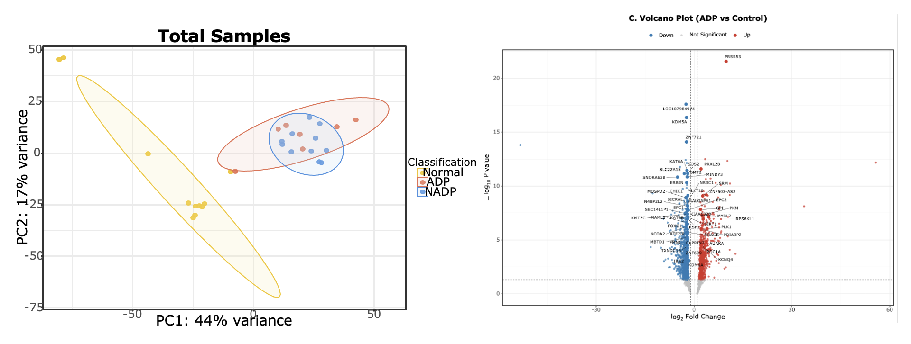{.case-img-2}

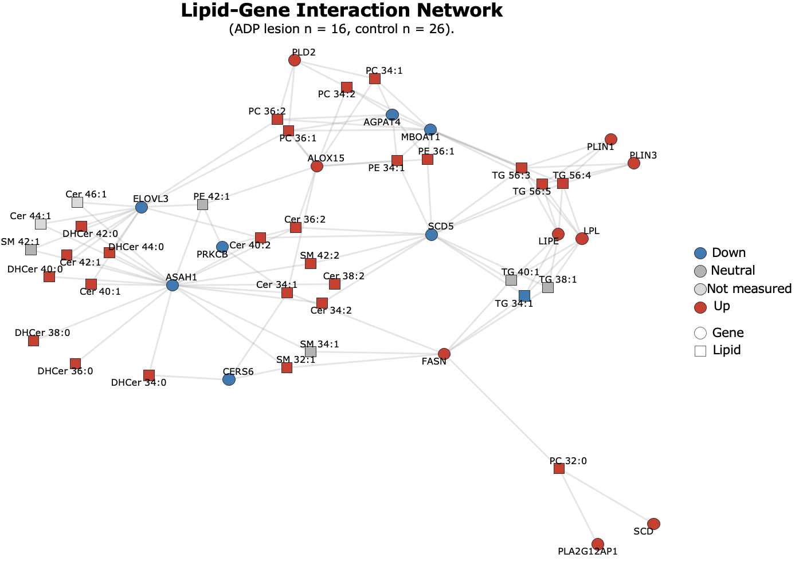{.case-img-2}
:::
::::

::: {.column width="52%"}
[강남성심병원 피부과 김혜원 교수님]{.case-owner}

**분석 데이터**

-   transcriptome 29샘플, lipid-matched subset, 염증·섬유화 후보 유전자 세트를 함께 묶은 multiomics 확장 자료.
-   피부 표면 lipid 변화와 전사체 수준 염증 경로를 직접 연결해 볼 수 있도록 구성한 matched analysis 자료.

**분석 목표 및 통계 분석**

-   lipidomics에서 관찰된 변화축을 transcriptome과 연결한 뒤, 염증·장벽 관련 후보 pathway 재정렬을 통한 multiomics 근거 보강.
-   [DESeq2]{.stat-tech} 기반 DEG 산출 후 [VST PCA]{.stat-tech}, [GO/KEGG enrichment]{.stat-tech}, [BH-corrected correlation]{.stat-tech}을 통한 lipid-gene 연결축 재평가.

**결과 및 산출물**

-   논문용 Figure 1\~5 세트와 multiomics correlation 패널을 정리하고, `LAD vs Healthy` 비교에서는 `[FDR \< 0.05]` 유전자 3개 확인 및 후속 검증 후보군 압축.
:::
::::::

## Case 2 보충 ①. 연구 배경·목표와 분석 데이터

:::::: {.columns .case-slide}
:::: {.column width="50%"}
[강남성심병원 피부과 김혜원 교수님]{.case-owner}

**연구 배경과 목표**

-   소아 아토피·민감피부·결절성 양진은 겉모습은 달라도 만성 가려움과 아토피성 염증을 공통으로 가짐
-   세 질환에 공통된 피부 지질(lipid) 변화가 있는지, 그것이 어느 대사 경로 및 가려움과 연결되는지 규명이 목표

**분석 데이터 (세 질환, 자체 측정)**

| 질환        | 검체 수 | 환자 / 대조 구성         |
|:------------|:-------:|:-------------------------|
| 소아 아토피 |   120   | 환자 20명 × 부위 3곳     |
| 결절성 양진 |   93    | 병변 38 / 정상 26        |
| 민감피부    |   76    | 환자 70(4 유형) / 정상 6 |

::: highlight-box
**분석은 두 갈래로 진행**: ⑴ 피부 표면 지질체(lipidomics) 라인, ⑵ 양진 전사체(transcriptome) 라인
:::
::::

::: {.column width="50%"}
**사용한 분석 도구 (R package)**

-   [limma]{.stat-tech}: 원래 유전자 발현 분석용으로 개발된 통계 도구로, 지질 수백 개의 환자·정상 차이를 한 번에 안정적으로 검정
-   [DESeq2]{.stat-tech}: RNA 시퀀싱(전사체) 데이터에서 환자·정상 간 발현이 다른 유전자를 찾는 표준 통계 도구
-   [data.table]{.stat-tech} · [ggplot2]{.stat-tech}: 데이터 정리와 그림 작성

**함께 사용한 외부 공개 데이터**

-   [KEGG]{.stat-tech}(Kyoto Encyclopedia of Genes and Genomes, 교토 유전자·유전체 백과사전): 어떤 지질·유전자가 몸속 어느 대사 경로에서 일하는지 정리해 둔 무료 공개 데이터베이스
-   변한 지질을 이 지도에 대입하면 낱개가 아니라 "어느 대사 경로 전체가 움직였는지"로 해석 가능
-   변한 유전자는 [GO/KEGG enrichment]{.stat-tech}(기능·경로 농축분석)로 분석. 변한 유전자들이 특정 기능(GO)이나 대사경로(KEGG)에 우연 이상으로 몰려 있는지 통계로 확인해, 어떤 생물학적 과정이 달라졌는지 파악
:::
::::::

## Case 2 보충 ②. 분석 방법 (1): fold-change와 원자료

::::: {.columns .case-slide}
::: {.column width="50%"}
[강남성심병원 피부과 김혜원 교수님]{.case-owner}

**fold-change(FC, 배수변화)란**

-   환자군이 정상 대비 어떤 분자가 몇 배 늘거나 줄었는지를 나타낸 값
-   log2로 표기: +1이면 2배, +2이면 4배, −1이면 절반

$$\text{log2FC}=\log_2\!\frac{\text{환자군 평균}}{\text{정상군 평균}}$$

**원자료는 "개수(count)" 데이터**

-   유전자 발현(전사체)의 원자료는 각 유전자가 몇 번 읽혔는지를 센 개수(count)
-   개수 자료에는 표본마다 측정된 양과 표본 수(N) 정보가 함께 담겨 있음
-   보통 log 변환 후 두 군의 평균을 비교해 배수변화를 계산
:::

::: {.column width="50%"}
**예시: 개수 자료에서 배수변화 계산**

| 유전자   | 환자군 | 정상군 |    배수변화     |
|:---------|:------:|:------:|:---------------:|
| 유전자 X |  120   |   40   | 3배 (log2 +1.6) |
| 유전자 Y |   30   |   60   | 0.5배 (log2 −1) |

-   환자군에서 X는 늘고(증가), Y는 줄어든(감소) 것으로 읽음
:::
:::::

## Case 2 보충 ③. 분석 방법 (2): limma와 empirical Bayes

:::::: {.columns .case-slide}
::: {.column width="50%"}
[강남성심병원 피부과 김혜원 교수님]{.case-owner}

**적은 표본, 많은 분자에서 생기는 검정력 문제**

-   표본(환자 수)은 적은데 측정 분자(유전자·지질)는 수백\~수천 개
-   개수 자료를 단순 표준화(normalization)만 하면 표본 수(N) 정보가 옅어져, 통계 검정의 힘(power)이 떨어짐
-   분자 하나하나 따로 분산을 추정하면 결과가 불안정

**limma의 해결**

-   [limma]{.stat-tech}: 수백\~수천 개 분자의 분산 정보를 서로 빌려 와 분산을 안정적으로 추정해, 적은 표본에서도 검정력을 회복
-   원래 유전자 발현용으로 개발됐고 지질 분석에도 널리 사용

| 구분             | 단순 t검정    | limma                |
|:-----------------|:--------------|:---------------------|
| 분산 추정        | 분자마다 따로 | 전체에서 빌려 안정화 |
| 적은 표본 검정력 | 낮음          | 회복                 |
:::

:::: {.column width="50%"}
**empirical Bayes는 함께 따라옴**

-   [empirical Bayes(경험적 베이즈)]{.stat-tech}: "정보를 서로 빌려오는" 핵심 기법으로, limma를 쓰면 자동으로 함께 적용됨

$$\tilde{s}_g^{2}=\frac{d_0\,s_0^{2}+d_g\,s_g^{2}}{d_0+d_g}$$

개별 분산을 그 분자 하나로만 추정하면 불안정. limma는 개별 분산 $s_g^2$ 를 전체 분자의 공통 분산 $s_0^2$ 와 가중평균으로 섞어 더 안정적인 분산 $\tilde{s}_g^2$ 를 산출($d_0$·$d_g$ 는 두 정보의 가중치). 표본이 적을수록 공통 분산에 더 의존

::: spacer-sm
:::

**그 외 단계 (요약)**

-   [BH-FDR(거짓발견율)]{.stat-tech}: 수백 개 동시 검정의 우연 양성을 보정. q \< 0.05면 신뢰
-   [PCA(주성분분석)]{.stat-tech}: 수백 개 분자를 2\~3개 축으로 압축해 환자군·정상군이 갈라지는지 확인
::::
::::::

## Case 2 보충 ④. 분석 방법 (3): KEGG pathway 분석

::::: {.columns .case-slide}
::: {.column width="50%"}
[강남성심병원 피부과 김혜원 교수님]{.case-owner}

**KEGG란**

-   [KEGG]{.stat-tech}(Kyoto Encyclopedia of Genes and Genomes): 유전자·대사물질이 몸속에서 어떤 대사 경로로 연결되는지 그림 지도로 정리한 무료 공개 데이터베이스
-   예: ceramide는 sphingolipid metabolism(스핑고지질 대사) 경로에 속함

**경로 단위 해석에 사용**

-   변한 유전자·지질을 낱개로 보지 않고 "어느 경로가 통째로 움직였나"로 해석
-   enrichment(농축분석): 변한 목록이 특정 경로에 우연 이상으로 몰려 있는지 통계로 검정

| KEGG 경로               | 이 연구의 변화   |
|:------------------------|:-----------------|
| Sphingolipid metabolism | Cer·DHCer 증가   |
| Glycerolipid metabolism | TG 감소          |
| Fatty acid metabolism   | FFA 변화(아토피) |
:::

::: {.column width="50%"}
**R 패키지로 분석 가능**

-   [clusterProfiler]{.stat-tech}: `enrichKEGG`·`enrichGO`로 경로 농축분석, `gseKEGG`로 순위기반 분석
-   [KEGGREST]{.stat-tech}: KEGG 경로·유전자 정보를 내려받아 조회
-   [pathview]{.stat-tech}: KEGG 경로 그림 위에 결과(증가·감소)를 색으로 표시
-   이 연구에서는 변한 지질을 sphingolipid·glycerolipid 등 KEGG 경로에 매핑해 경로 단위로 해석

``` r
library(clusterProfiler)
ek <- enrichKEGG(gene = deg, organism = "hsa")
dotplot(ek)
```
:::
:::::

## Case 2 보충 ⑤. 결과 ⑴ 지질체(lipidomics) 라인

:::::: {.columns .case-slide}
::: {.column width="50%"}
[강남성심병원 피부과 김혜원 교수님]{.case-owner}

**핵심 결과: Ceramide(세라마이드) 증가**

-   Ceramide(세라마이드): 피부 장벽을 이루는 대표 지질로, 피부 방어막의 핵심 성분
-   보통 아토피는 장벽 ceramide가 줄어 건조한데, 표면 지질에선 오히려 증가(새로 만드는 작용인 신생합성이 활발해졌다는 뜻)
-   특히 [Cer 34:1]{.stat-tech}이 아토피·양진에서 확실히 증가

| 질환        | 유의 지질 수 | 대표 변화 (log2FC)        |
|:------------|:------------:|:--------------------------|
| 소아 아토피 |     11종     | Cer 34:1 +0.94 · FFA 증가 |
| 결절성 양진 |     47종     | Cer 34:1 +3.08 · TG 감소  |
| 민감피부    |     2종      | TG 62:4·64:4 감소         |

-   FFA(유리지방산), TG(중성지방), Cer(세라마이드)
-   log2FC가 +1이면 2배, +3.08이면 약 8.5배 증가
:::

:::: {.column width="50%"}
::: {.case-media .case-media-full data-caption="질환별 PCA · heatmap · volcano plot · GO/KEGG enrichment (지질체 결과)"}
{.case-img-1}
:::
::::
::::::

## Case 2 보충 ⑥. 결과 ⑵ 전사체(transcriptome) 라인

:::::: {.columns .case-slide}
::: {.column width="50%"}
[강남성심병원 피부과 김혜원 교수님]{.case-owner}

**전사체 차등발현 분석**

-   양진 환자 29명(정상 11·아토피양진 7·비아토피양진 11)의 유전자 발현(전사체) 분석
-   [DESeq2]{.stat-tech}: RNA 발현이 환자·정상 간 다른 유전자(DEG)를 찾는 표준 통계 도구. 이어 [GO/KEGG enrichment]{.stat-tech}로 염증·장벽 경로 확인

**지질–유전자 연결 (multiomics)**

-   표면 ceramide 변화를, 그 지질을 만들고 분해하는 핵심 유전자와 연결

| 핵심 유전자 | 역할             |
|:------------|:-----------------|
| CERS6       | ceramide 합성    |
| ASAH1       | ceramide 분해    |
| ELOVL3      | 지방산 사슬 연장 |

-   지질·유전자가 대부분 다른 환자라 개인 연결이 아니라 변화 방향의 일치로 해석
:::

:::: {.column width="50%"}
::: {.case-media .case-media-full data-caption="Lipid-Gene Interaction Network (지질–유전자 연결, 전사체 결과)"}
{.case-img-1}
:::
::::
::::::

## Case 2 보충 ⑦. 종간 검증과 통합 모델

::::::: {.columns .case-slide}
::: {.column width="52%"}
[강남성심병원 피부과 김혜원 교수님]{.case-owner}

**마우스에서도 같은 변화 (cross-species 검증)**

-   사람뿐 아니라 아토피 마우스 피부에서도 Cer 34:1 증가
-   사람·마우스에서 같은 방향으로 재현돼, 우연이 아니라 종을 넘어 보존된 변화일 가능성

| Cer 34:1         | 변화  | 유의성         |
|:-----------------|:-----:|:---------------|
| 마우스 아토피    | 3.6배 | p = 0.002      |
| 사람 소아 아토피 | 1.9배 | FDR 0.004      |
| 사람 결절성 양진 | 8.5배 | FDR 0.001 미만 |
:::

::::: {.column width="48%"}
::: highlight-box
**통합 모델: Neuroimmune–Lipid Crosstalk(신경–면역–지질 상호작용)**

ceramide 상승이 면역세포와 가려움을 전달하는 감각신경을 자극해 만성 가려움을 일으킨다는 통합 가설
:::

::: spacer-md
:::

**연구의 의의**

-   세 질환을 관통하는 공통 지질 축(ceramide)을 제시
-   가려움 조절을 위한 치료 표적 후보로 연결 가능
:::::
:::::::

## Case 3. STING1-lysosome 발현량 난소암 환자 생존 분석

:::::: {.columns .case-slide}
::: {.column width="52%"}
[일산백병원 진단검사의학과 김지예 교수님]{.case-owner}

**분석 데이터**

-   내부 GeoMx spatial transcriptomics와 외부 TCGA/GTEx 난소암 자료를 함께 사용한 생존·분자 통합 자료.
-   단일 유전자 비교를 넘어, STING1-lysosome 관련 245개 유전자 모듈까지 확장 가능한 구조라는 점이 핵심 특징.

**분석 목표 및 통계 분석**

-   STING1-lysosome 축의 예후 연관성 탐색 후, 모듈 수준 재배선과 외부 코호트 검증을 통한 기능 후보 도출 목적의 분석 설계.
-   [Kaplan-Meier]{.stat-tech}, [Cox]{.stat-tech}로 예후 신호를 점검한 뒤, [DESeq2]{.stat-tech}, [GO/KEGG/PPI]{.stat-tech}, [eigengene correlation]{.stat-tech}, [paired Wilcoxon]{.stat-tech}으로 모듈 수준 해석을 확장.

**결과 및 산출물**

-   생존곡선, volcano, module network, eigengene correlation 구축, PFS는 event 부족으로 제한하여 OS 중심 해석과 외부 후보유전자 검증 축 명확히 정리.
:::

:::: {.column width="48%"}
::: {.case-media .case-media-2 data-caption="상: 누적발생/KM 곡선 예시. 하: TCGA 기반 volcano와 gene-correlation heatmap."}
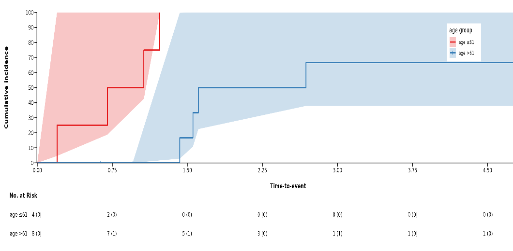{.case-img-2}

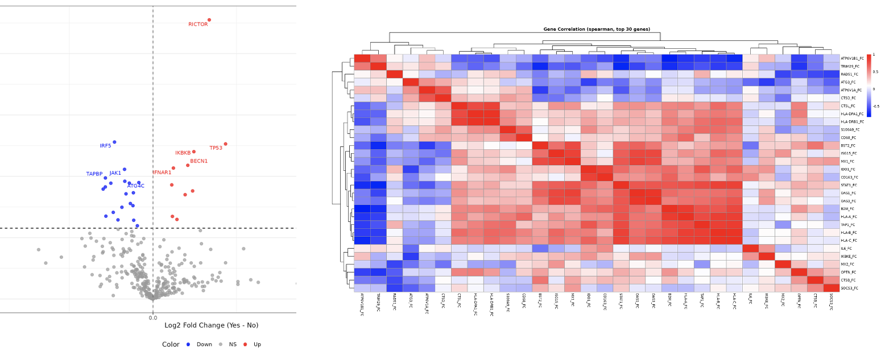{.case-img-2}
:::
::::
::::::

## Case 4. COPD 환자 사망 연관 SNP 탐색을 위한 GWAS 분석

:::::: {.columns .case-slide}
:::: {.column width="48%"}
::: {.case-media .case-media-2 data-caption="상: Manhattan Plot: Pure COPD nocovar, 하: GWAS QQplot, Forest Plot(n=8)"}
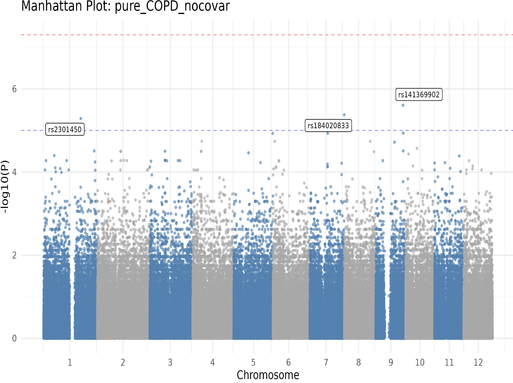

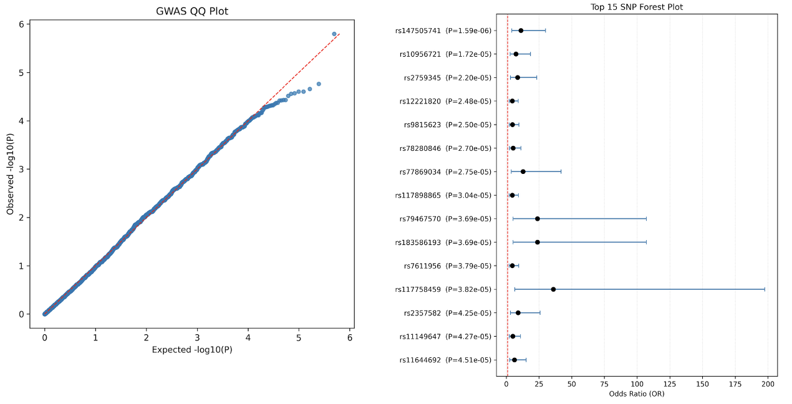
:::
::::

::: {.column width="52%"}
[동탄성심병원 호흡기내과 송진화 교수님]{.case-owner}

**분석 데이터**

-   KOCOSS COPD 코호트 중 SNP 데이터가 있는 환자 대상, 임상 기본정보와 mortality outcome을 통합한 유전연관 분석 자료.
-   전체 코호트뿐 아니라 `pure_COPD`, `TB_COPD`, `Asthma_COPD`, `BE_COPD` phenotype별 하위군을 나눠 subtype-specific signal 탐색.

**분석 목표 및 통계 분석**

-   COPD 환자의 mortality 연관 유전변이를 탐색, 임상 phenotype에 따른 신호 변경 탐색을 위한 subtype-specific GWAS 설계.
-   [Table 1]{.stat-tech}와 결측률 점검, [PLINK logistic GWAS]{.stat-tech}를 `pure_COPD`, `TB_COPD`, `Asthma_COPD`, `BE_COPD` 하위군별 반복 수행, [covariate-adjusted model]{.stat-tech}을 통해 age, sex, BMI, baseline FEV1 보정 결과 통합 비교.

**결과 및 산출물**

-   phenotype별 baseline 특성표, 보정 전후 GWAS, top SNP 요약표 정리 및 하위군별 signal 비교를 위한 Manhattan plot 도출.
-   COPD 아형별 mortality-associated SNP 후보를 분리 후 해석 가능 구조를 확립, 후속 replication 또는 기능 해석을 위한 lead SNP 정리.
:::
::::::

## Case 5. 방광암 및 폐암 진단 바이오마커 모델

:::::: {.columns .case-slide}
::: {.column width="52%"}
[시선바이오머티리얼즈 연구팀]{.case-owner}

**분석 데이터**

-   방광암 methylation marker 자료와 폐암 MPR panel, 외부검증용 test set을 함께 사용한 멀티오믹스 데이터.
-   원 marker 값뿐 아니라 control 기준 percentile feature를 추가 생성.

**분석 목표 및 통계 분석**

-   적용 가능한 diagnostic marker 조합 탐색 후, 설명 가능한 기준값과 배포형 예측 도구까지 연결하기 위한 모델링 설계.
-   [ROC/AUC]{.stat-tech}, [logistic regression]{.stat-tech}으로 기본 성능을 확인 및 [percentile thresholding]{.stat-tech}, [10-fold CV]{.stat-tech}, [LASSO]{.stat-tech}, [Random Forest]{.stat-tech} 결합, 후보 모델 압축.

**결과 및 산출물**

-   ROC 패널, cutoff 기반 모델, 배포형 예측 앱 연결, AUC와 best-threshold, sensitivity/specificity, PPV/NPV, `95% sensitivity 기준 specificity` 제시.
:::

:::: {.column width="48%"}
::: {.case-media .case-media-2 data-caption="상: 통합 진단모델 ROC와 AUC. 하: marker distribution boxplot과 pairwise p-value."}
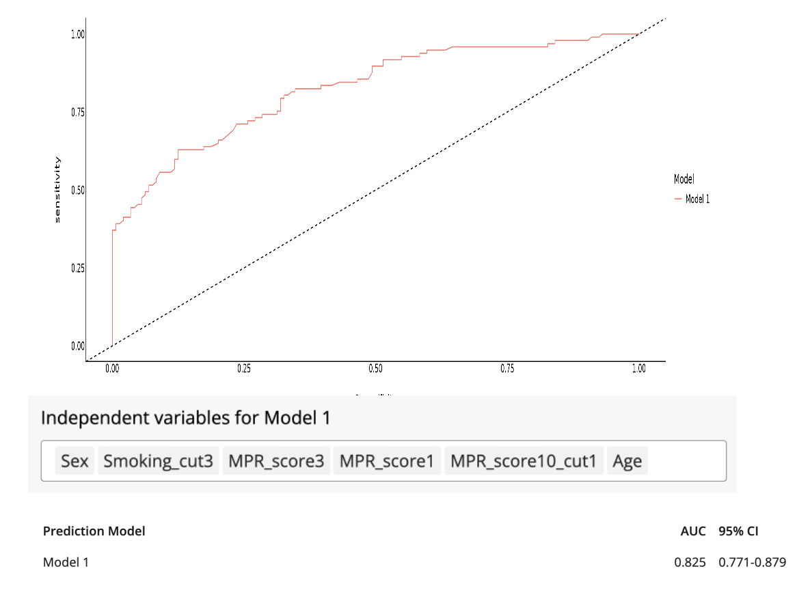{.case-img-2}

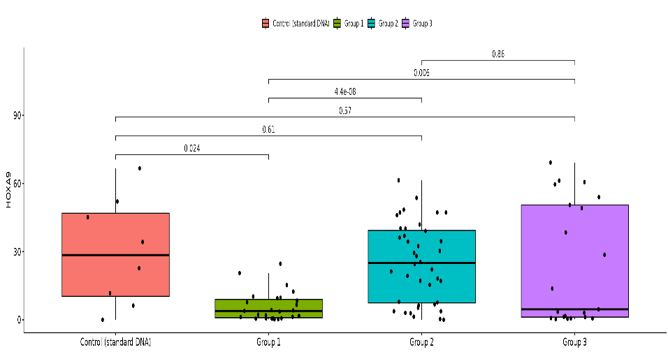{.case-img-2}
:::
::::
::::::

## Case 6. 직장암 수술전 항암방사선용법 반응 유전자 분석

:::::: {.columns .case-slide}
:::: {.column width="48%"}
::: {.case-media .case-media-2 data-caption="상: IC_GR_vs_PR 대표 heatmap. 하: DFS Kaplan-Meier와 TC vs IC volcano."}
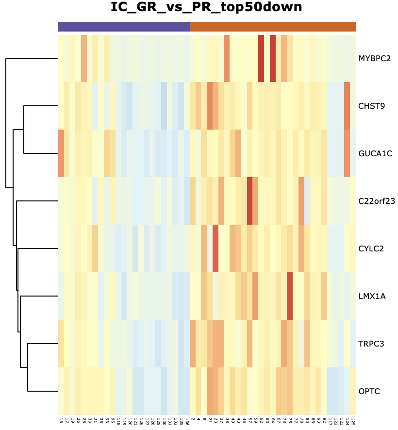{.case-img-2 width="796" height="325"}

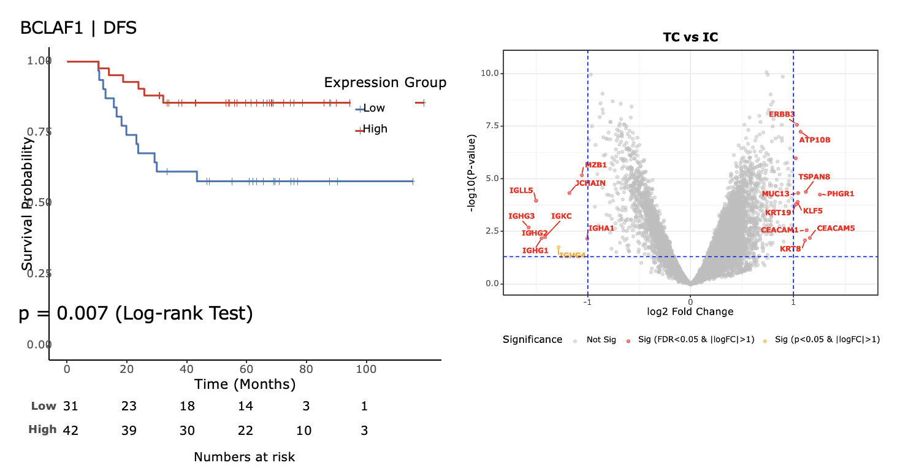{.case-img-2 width="794"}
:::
::::

::: {.column width="52%"}
[동탄성심병원 신은 교수님]{.case-owner}

**분석 데이터**

-   직장암 CCRT 반응군의 TC/IC spatial transcriptomics와 외부 검증 코호트 통합 데이터셋.
-   반응군과 생존 변수를 초기 단계에서 함께 정의하여, discovery와 validation 진행.

**분석 목표 및 통계 분석**

-   반응군 차이를 설명하는 DEG 선별 후, 생존 및 외부 코호트 예측 가능성까지 이어지는 후보유전자 축 도출 목표의 설계.
-   반응군 정의 후 [limma + eBayes]{.stat-tech} 기반 DEG 분석, [heatmap/volcano]{.stat-tech} 시각화, [maxstat + Kaplan-Meier]{.stat-tech}, [ROC/Youden]{.stat-tech} 순 확장.

**결과 및 산출물**

-   DEG 통합표와 생존·검증 Figure를 한 세트로 정리하고, 생존 관련 결과는 69행(유니크 61유전자), 외부 binary validation 결과는 타깃별 1,071행 규모로 저장되어 후속 선별.
:::
::::::

## Case 7. 피부 장벽 및 혈관 반응과 피부 표면 지질체 상관 분석

:::::: {.columns .case-slide}
::: {.column width="52%"}
[강남성심병원 피부과 박진서 교수님]{.case-owner}

**분석 데이터**

-   민감피부 환자군과 대조군의 TEWL, SCH, erythema, porphyrin, SS-10, lipid species를 함께 측정한 통합 자료.
-   표본 수 대비 변수 수가 큰 high-dimensional 구조로, 단일 p-value보다 패턴 탐색과 후보 압축이 중요한 데이터셋.

**분석 목표 및 통계 분석**

-   피부 장벽·혈관 반응 지표와 lipid pattern 사이의 연결 구조 탐색 후, symptom domain별 후보 지질 축 도출을 위한 exploratory 분석 설계.
-   [Spearman correlation]{.stat-tech}과 [linear regression]{.stat-tech}으로 1차 후보를 점검한 뒤, [PCA]{.stat-tech}, [PLS-DA]{.stat-tech}, [PERMANOVA]{.stat-tech}, [network analysis]{.stat-tech}, [LASSO]{.stat-tech}로 탐색 신호를 압축.

**결과 및 산출물**

-   correlation heatmap과 symptom-lipid network를 구축하고, SS-10 item 대 112개 lipid 상관에서는 `FDR q \< 0.05`통과 lipid 부재, patient-control PLS-DA의 `PERMANOVA P = 0.753, R² = 0.007` exploratory layer 중심 해석 정리.
:::

:::: {.column width="48%"}
::: {.case-media .case-media-2 data-caption="상: erythema·porphyrin vs lipid Spearman heatmap. 하: patient-control PLS-DA와 symptom-lipid network."}
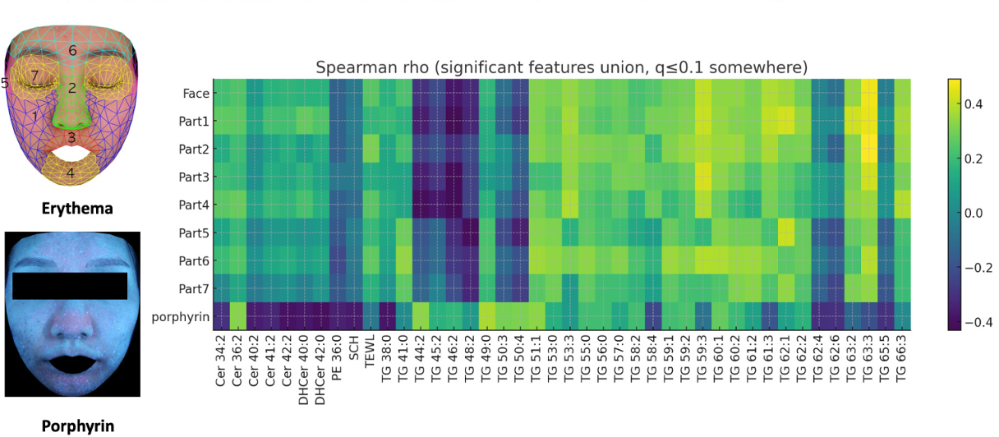{.case-img-2}

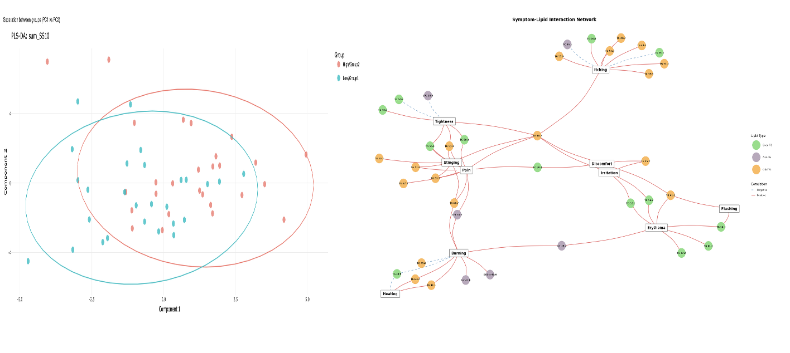{.case-img-2}
:::
::::
::::::

## Case 7 보충 ①. 연구 배경·목표와 분석 데이터

::::: {.columns .case-slide}
::: {.column width="50%"}
[강남성심병원 피부과 박진서 교수님]{.case-owner}

**연구 배경과 목표**

-   민감피부(sensitive skin)는 자극에 따가움·화끈거림 같은 불편한 감각이 나타나지만, 겉으로 보이는 병변이 없어 객관적으로 진단하기 어려운 질환임
-   진단이 환자의 주관적 호소에만 의존하므로, 증상을 뒷받침할 객관적 지표가 필요함
-   피부 표면 지질이 증상·피부장벽·홍조·포피린 같은 임상 지표와 연관되는지 탐색하고, 증상을 설명할 지질(biomarker, 생체표지자)을 찾는 것이 목표임
:::

::: {.column width="50%"}
**분석 데이터 (자체 측정)**

-   민감피부 환자 69명, 대조군 6명 (대조군은 임상 점수가 없어 연관 분석에는 환자만 사용함)
-   피부 표면 지질 112종 (tape stripping으로 채취 후 LC-MS/MS로 정량)
-   [LC-MS/MS]{.stat-tech}(액체크로마토그래피-질량분석): 섞여 있는 지질을 종류별로 분리(LC)한 뒤 질량으로 정확히 식별·정량(MS)하는 표준 측정 방법

| 임상 지표 | 의미 |
|:-----------------------------------|:-----------------------------------|
| TEWL · SCH | TEWL(경피수분손실, 높을수록 장벽 약함)·SCH(각질층 수분도, 높을수록 촉촉) |
| SS-10 | 민감피부 증상 설문(10항목) |
| 홍조(erythema) | 얼굴 사진 분석(전체·부위별) |
| porphyrin(포피린) | 산화된 피지량(UV 사진) |
:::
:::::

## Case 7 보충 ②. 분석 방법 (1): 기본 연관과 군집 탐색

:::::: {.columns .case-slide}
::: {.column width="50%"}
[강남성심병원 피부과 박진서 교수님]{.case-owner}

기본 분석부터 시작해, 결과가 약하면 더 정교한 방법으로 단계적으로 넘어감.

**① 지질–임상 상관: Spearman correlation(스피어만 상관분석)**

-   [Spearman correlation]{.stat-tech}은 두 값의 순위(크기 순서)가 함께 오르내리는 정도를 −1에서 +1 사이로 나타내는 분석임. +1이면 같은 방향, −1이면 반대 방향, 0이면 관계 없음. 순위만 쓰므로 극단값에 덜 민감함
-   각 지질과 각 임상 지표의 상관을 구하고, 그 값을 색으로 칠한 heatmap(열지도)으로 한눈에 표시함
-   결과: 다중비교 보정 후 FDR을 통과하는 지질이 없었음

**② 군집 탐색: PCA(Principal Component Analysis, 주성분분석)**

-   지질 112종 전체를 2\~3개 축으로 압축해, 환자들이 지질 패턴으로 무리 지어지는지 확인함
-   결과: 뚜렷한 그룹 분리가 나타나지 않았음
:::

:::: {.column width="50%"}
::: {.case-media .case-media-full data-caption="임상지표 × 지질 Spearman correlation heatmap"}
{.case-img-1}
:::
::::
::::::

## Case 7 보충 ③. 분석 방법 (2): 그룹 비교와 biomarker 탐색

::::: {.columns .case-slide}
::: {.column width="50%"}
[강남성심병원 피부과 박진서 교수님]{.case-owner}

**③ 그룹 차이 강조: PLS-DA + PERMANOVA**

-   [PLS-DA(부분최소제곱 판별분석)]{.stat-tech}: 두 그룹(예: 증상 높은 군·낮은 군)을 미리 정해 주고, 그 둘을 가장 잘 구분하는 지질 조합을 찾아 주는 방법임. 차이를 도드라지게 보여주는 대신, 실제로 없는 차이도 있어 보이게 만들 위험이 있음
-   [PERMANOVA(순열 분산분석)]{.stat-tech}: 두 그룹의 지질 조성 전체가 통계적으로 정말 다른지를 검정하는 방법임. 자료를 무작위로 여러 번 섞어 비교해, PLS-DA가 강조한 차이가 진짜인지 확인함(기여 지질은 VIP 점수로 추림)
-   결과: 어느 임상 지표로 나눠도 두 군의 지질 조성에 유의한 차이가 없었음

**④ 연결 구조 시각화: network analysis(네트워크 분석)**

-   [network analysis]{.stat-tech}로 증상과 지질을 점·선으로 이어, 어떤 증상이 어떤 지질과 묶이는지 보여줌
-   결과: 보정 전 기준에서 증상끼리 비슷한 것이 묶이고 중성지방(TG)이 자주 등장함(탐색적 참고)
:::

::: {.column width="50%"}
**⑤ biomarker 후보 압축: LASSO(라쏘 회귀)**

-   [LASSO(라쏘 회귀)]{.stat-tech}는 영향력 없는 지질을 0으로 눌러 소수만 남기는 머신러닝으로, 변수가 표본보다 많을 때 유용함
-   결과: 자극감·따가움·화끈거림 등 일부 증상에서만 1\~8개 후보가 선택되고, 나머지 증상에서는 없었음

**⑥ 교차 확인: 환자 대 대조, 정규화 대 원자료**

-   환자·대조 비교와 정규화·원자료 분석으로 결과가 전처리 방식 때문은 아닌지 점검함
-   결과: 원자료에서도 분리되지 않아, 분리가 안 되는 것이 전처리 탓이 아님을 확인함
:::
:::::

## Case 7 보충 ④. 결과와 분석 전략상의 교훈

::::::: {.columns .case-slide}
::: {.column width="50%"}
[강남성심병원 피부과 박진서 교수님]{.case-owner}

**통계적으로 확정된 연관은 없음**

-   어떤 지질도 [FDR q \< 0.05]{.stat-tech}를 통과하지 못했음
-   환자와 대조군의 지질 조성도 차이가 없었음

**탐색적으로 관찰된 경향**

-   [LASSO]{.stat-tech}에서는 자극감·따가움·화끈거림 등 일부 증상에서 1\~8개 지질이 후보로 선택됨
-   증상끼리는 비슷한 것들이 묶였고(예: 화끈거림·열감), 중성지방(TG)이 반복해서 나타남

**표본보다 변수가 많은 문제(n \< p)**

-   표본은 적은데 지질은 112종으로 많아(특히 대조군 6명), 다중비교 보정 후 유의성 확보가 어려움
-   기본 상관·회귀에서 유의한 연관이 없으면 더 복잡한 방법으로도 유의한 결과를 못 만듦
:::

::::: {.column width="50%"}
::: {.case-media .case-media-full data-caption="환자–대조 PLS-DA와 증상–지질 network" style="--case-media-height: 48vh;"}
{.case-img-1}
:::

::: highlight-box
**유의한 결과가 없을 때의 원칙**: 한계(표본 수, 다중비교)를 함께 제시하고, 무리한 추가 분석으로 없는 결과를 만들지 않음
:::
:::::
:::::::

## Case 8. qPCR miRNA 기반 폐암 진단 모델 연구

:::::: {.columns .case-slide}
:::: {.column width="48%"}
::: {.case-media .case-media-2 data-caption="상: 후보 signal regional plot과 miRNA ROC 비교. 하: stage group별 miRNA fold-change boxplot."}
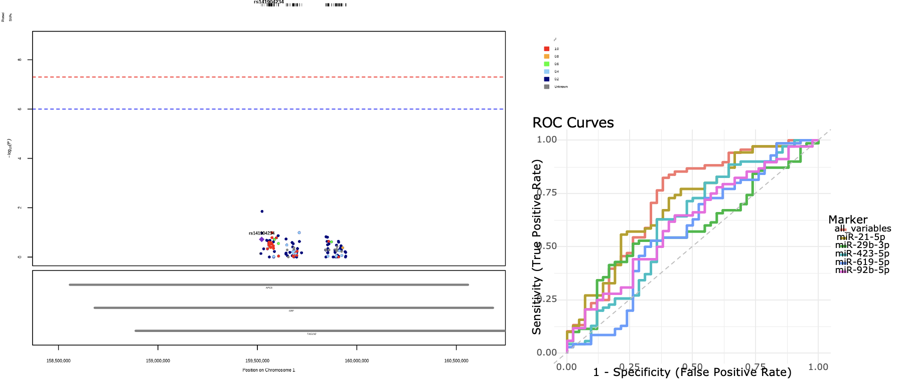{.case-img-2}

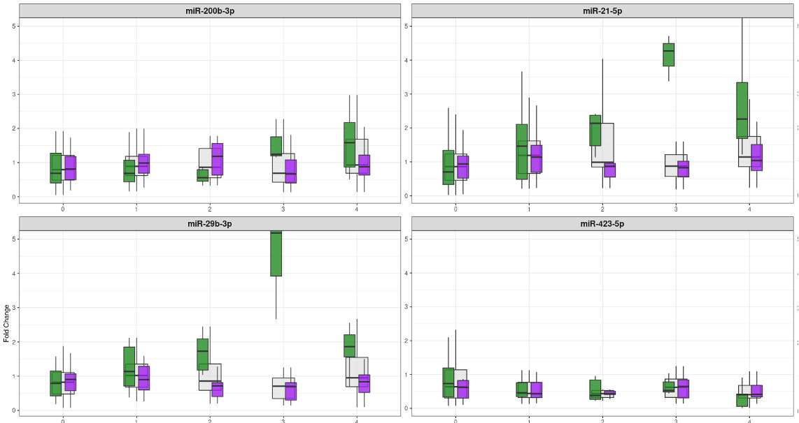{.case-img-2}
:::
::::

::: {.column width="52%"}
[건국대병원 호흡기내과 이계영 교수님]{.case-owner}

**분석 데이터**

-   qPCR miRNA, 연령, 흡연력, 병기, 실험 라운드 정보를 포함한 멀티오믹스 폐암 진단 자료.
-   라운드 차이와 샘플 정합화 이력이 함께 남아 있어, marker 성능 비교와 데이터 정제 이슈를 동시에 다룰 필요성.

**분석 목표 및 통계 분석**

-   단일 miRNA 유의성과 다중 marker panel 성능을 분리 평가한 뒤, 임상변수 보정 모델까지 확장하여 screening용 조합 후보 압축 설계.
-   qPCR 정규화 후 [Table 1]{.stat-tech}, [boxplot + pairwise test]{.stat-tech}, [logistic ROC/AUC]{.stat-tech}, [UpSet combination search]{.stat-tech}, [LASSO]{.stat-tech}, [Random Forest]{.stat-tech} 순으로 비교 평가 진행.

**결과 및 산출물**

-   8개 후보 miRNA에서 3·4·5-marker 조합까지 비교하는 ROC Figure와 Interactive 웹앱으로 연결하고, 최종 AUC·민감도·특이도는 raw qPCR/pins 자료 기준 재계산.
:::
::::::

## Case 9. 공단·심평원 빅데이터 분석

::: spacer-xs
:::

::::::::::::::::: nhis-hira-slide
:::::: nhis-intro-box
::::: nhis-intro-layout
::: nhis-logo-stack


:::

::: nhis-intro-text
**대한민국 공단(KNHIS)·심평원(HIRA) 빅데이터**는 전 국민 단위의 건강검진, 소득, 사망, 데이터를 포함.\
최근 5년간 `Diabetes Care`, `International Journal of Epidemiology`, `JAMA Network Open`, `JAMA Pediatrics` 등에 NHIS/HIRA 기반 연구가 지속적으로 게재
:::
:::::
::::::

**공단/심평원 데이터 활용 및 분석 사례**

:::::::::::: nhis-case-grid
::::: nhis-case-card
[사례 1]{.nhis-case-card-title}

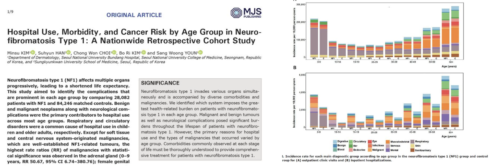

::: nhis-case-meta
분당서울대병원 피부과 김보리 교수님
:::

제1형 신경섬유종증 환자의 연령대에 따른 주요 합병증 발생 변화 연구

::: nhis-case-journal
*Acta Dermato-Venereologica* (IF 4.3) 게재
:::
:::::

::::: nhis-case-card
[사례 2]{.nhis-case-card-title}

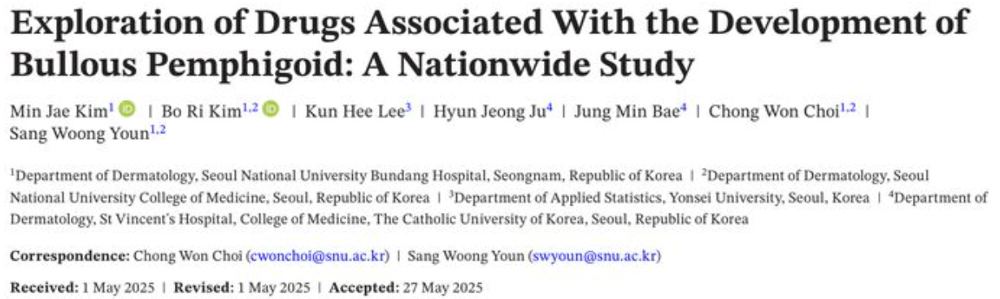

::: nhis-case-meta
분당서울대병원 피부과 김보리 교수님
:::

수포성 천포창(Bullous Pemphigoid, BP)의 발생과 연관된 위험 약물 규명

::: nhis-case-journal
*The Journal of Dermatology* (IF 2.7) 게재
:::
:::::

::::: nhis-case-card
[사례 3]{.nhis-case-card-title}

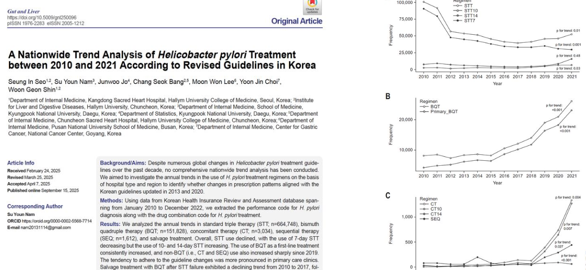

::: nhis-case-meta
강동성심병원 소화기내과 서승인 교수님
:::

H. pylori 제균치료의 실제 처방 경향의 전국적 조사

::: nhis-case-journal
*Gut and Liver* (IF 3.2) 게재
:::
:::::
::::::::::::
:::::::::::::::::

## Case 9. 공단데이터 결합데이터 분석 사례

::::::::::::: {.columns .nhis-overview-slide}
::: {.column width="26%"}
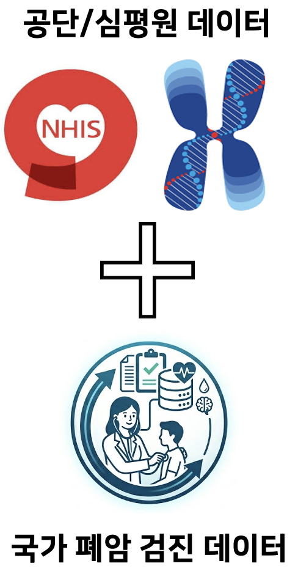{.nhis-bordered-image width="380"}
:::

::::::::::: {.column width="73%"}
::::::::: nhis-overview-right
**서울대학교병원 영상의학과 김형진 교수님**

:::::::: nhis-overview-grid
:::: nhis-case-card
[사례 1]{.nhis-case-card-title} 국가폐암검진에서 발견된 위양성 결과와 사후 관리가 향후 폐암 발생률과 사망률에 미치는 영향 분석

::: nhis-case-journal
*Journal of Internal Medicine* (IF 9.2) 게재
:::

{.nhis-case-image-compact}

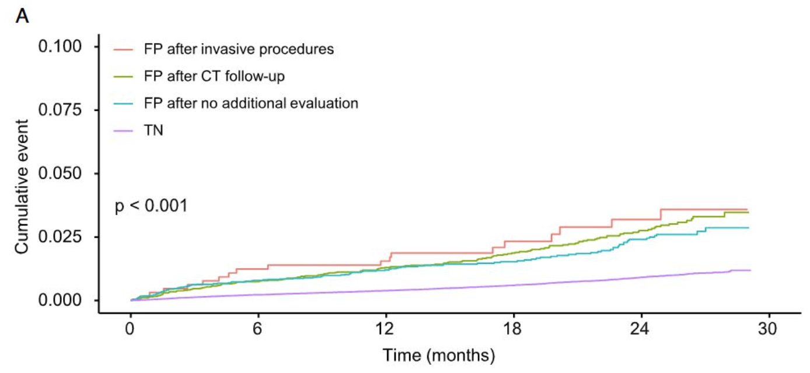{.nhis-case-image-compact}

[전체 표본 수]{.nhis-sample-size}[235,753명]{.nhis-sample-size-number} 대상(2019 \~ 2021)
::::

::::: nhis-case-stack
:::: nhis-case-card
[사례 2]{.nhis-case-card-title} 국가폐암검진에서 발견된 간질성 폐 이상(ILA, Intersitial Lung Abnormalities)의 예후적 가치 분석

::: nhis-case-journal
*The Journal of Dermatology* (IF 2.7) 게재
:::

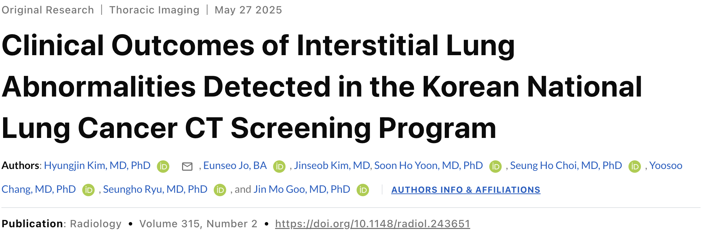{.nhis-case-image-compact}

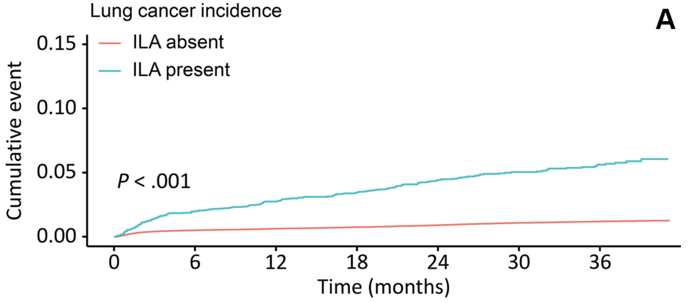{.nhis-case-image-compact}

[전체 표본 수]{.nhis-sample-size}[125,600명]{.nhis-sample-size-number} 대상(2019 \~ 2020)
::::
:::::
::::::::
:::::::::

::: nhis-inline-badge-row
[국가폐암검진 CT 판독 데이터]{.nhis-inline-badge .nhis-inline-badge-blue}와 [건강보험공단 국민 데이터]{.nhis-inline-badge .nhis-inline-badge-orange}을 결합한 [복합적 의료 분석 사례]{.nhis-inline-badge-emphasis} [(기본 소득, 처방 및 확진, 생존여부 등)]{.nhis-inline-badge-subtext}
:::
:::::::::::
:::::::::::::

##  {background-color="#2A3D21"}

::::: {style="text-align: center; padding-top: 180px;"}
<h1 style="color: #ffffff; font-size: 2.0em; border: none; border-image: none;">

연구자 옆에는 차라투

</h1>

::: {style="margin-top: 40px;"}

:::

::: {style="color: #C8E6C9; font-size: 0.7em; margin-top: 60px; line-height: 2;"}
<strong>Contact</strong><br> office\@zarathu.com  \|  +82 70-7954-3712<br> <a href="https://www.zarathu.com" style="color: #C8E6C9;">www.zarathu.com</a>  \|  <a href="https://community.zarathu.com" style="color: #C8E6C9;">community.zarathu.com</a>  \|  <a href="https://openstat.ai" style="color: #C8E6C9;">openstat.ai</a>
:::
:::::
