## 오늘의 출발점 {.module-overview}

**연구 질문 → 분석 단위 → 통계 방법**

QUESTION

**핵심 질문**

범위 · 차이 · 비율 · 군집 · 변화

UNIT

**분석 단위**

사람 · 검체 · 조직 · 분리 균주

EVIDENCE

**결과 표현**

분포 · 회귀 · 차이 · 비율 · 프로파일

**개념 → 논문 Figure/Table → 해석**

## 오늘 볼 5편의 논문 {.module-overview}

01 · RANGE

검사값의 정상 범위

**PTH reference interval**

KNHANES 2024 · 4,502명 → 155명 Percentile · Bootstrap · Survey weighting

BMC Endocr Disord 2026;26:176 GC Labs

02 · AGREEMENT

두 검사법의 일치도

**Triglyceride harmonization**

동일 혈청 98쌍 Passing–Bablok · Bland–Altman · Bias

Ann Lab Med 2025;45:291-299 GC Labs

03 · PROPORTION

집락률·내성률 차이

**GBS colonization**

질 면봉 배양 33,721건 Proportion · Chi-square · Fisher’s exact

Yonsei Med J 2022;63:717-723 서울의과학연구소

04 · MULTIPLICITY

여러 미생물 동시 비교

**CRC tissue microbiome**

환자 38명 · 조직 39개 qPCR · Diversity · Relative abundance · FDR

Sci Rep 2020;10:19915 연세대학교

05 · PROFILE

계통·내성 조합의 시간 변화

**GBS WGS**

과거 37 vs 최근 209 균주 ST/CC · ARG · AMR profile

Ann Lab Med 2025 (alm.2025.0439) 서울의과학연구소

## 분석 단위 먼저 {.module-overview}

**개인** · 논문 1

PTH 검사값 · 155명

**동일 혈청 검체** · 논문 2

두 검사법의 측정값 · 98쌍

**배양 검체** · 논문 3

질 면봉 33,721건

**조직 검체** · 논문 4

환자 38명 · 조직 39개

**분리 균주** · 논문 5

37 vs 209 균주

**사람 ≠ 검체 ≠ 균주** · 논문 4는 환자 38명에서 조직 39개 (한 환자에 병변 2개)

## 연구 질문 → 통계 방법 {.module-overview}

분포의 범위를 추정 · 논문 1

**결과:** 하한–상한

Percentile → 이상치 → Bootstrap CI → Survey weighting

동일 검체의 두 값을 비교 · 논문 2

**결과:** 회귀식 + 차이 + 기준값 대비 bias

Passing–Bablok → Bland–Altman → Harmonization

빈도와 비율을 비교 · 논문 3 · 5

**결과:** n/N (%) + P value

Chi-square 또는 Fisher’s exact test

고차원 결과를 해석 · 논문 4 · 5

**결과:** 전체 군집 + 개별 feature + profile

Diversity → FDR → WGS/ARG 연결

**추정 대상 + 분모 확인** · P value는 그다음

## 참고구간 · 검사값의 중앙 95% {.section-break .module-reference}

01 · RANGE

개인 검사값의 분포 범위 · **2.5th–97.5th percentiles**

## Reference interval ≠ Confidence interval {.module-reference}

REFERENCE INTERVAL

2.5th–97.5th

개인 검사값의 중앙 95% 범위

≠

CONFIDENCE INTERVAL

추정치의 불확실성

하한·상한 추정의 불확실성

**참고집단 선정**

검사값에 영향을 주는 조건 제외

**이상치 확인**

MAD 기반 극단값 평가

**범위 추정**

2.5th–97.5th percentiles

**불확실성 평가**

Bootstrap CI

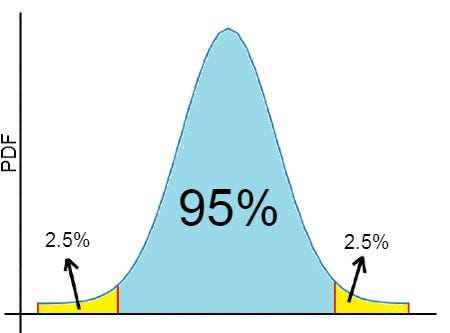{fig-alt="분포의 중앙 95%와 양쪽 2.5% 꼬리" height="330"}

참고구간은 분포의 양쪽 2.5%를 잘라낸 중앙 95% 구간

**중앙 95%를 자르는 위치** ≠ **그 위치를 얼마나 정확히 아는가**

## 논문 1 · PTH 참고집단: 4,502명 → 155명 {.module-reference}

PAPER 1 · PTH · BMC Endocr Disord 2026

**40세 이상 한국 성인의 PTH 참고구간** · KNHANES 2024

PTH 측정 대상자

4,502명

40세 이상만 측정

→

최종 참고집단

155명

질환·보충제·임신·eGFR 제외 후

**참고집단 선정이 핵심** · 4,502명 → 155명

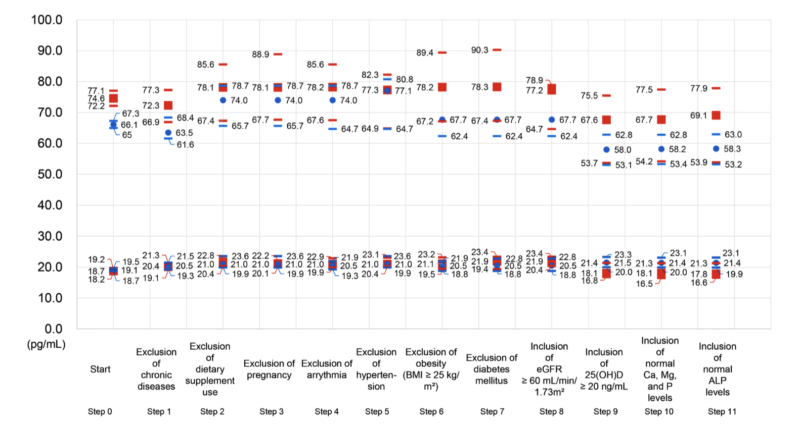{fig-alt="PTH 참고집단의 단계적 포함·제외 과정" height="500"}

Figure 1. PTH 참고집단의 단계적 포함·제외 과정 · Choi R, et al. BMC Endocr Disord 2026;26:176

## 논문 1 · 네 가지 추정 {.module-reference}

Percentile

참고집단의 **2.5th와 97.5th percentile**로 중앙 95% 범위를 추정

Robust method

표본이 120명 미만인 하위집단의 **비가중 참고한계**를 안정적으로 추정 (CLSI EP28-A3c)

Bootstrap 90% CI

재표집을 반복해 하한과 상한 자체의 **불확실성**을 평가

Survey-weighted analysis

PSU·층화·조사 가중치를 반영해 **40세 이상 한국 성인**을 추정

**21.8–65.0 vs 20.5–67.7 pg/mL** · 선정 기준 + 표본 설계

비타민 D·칼슘·마그네슘·인을 추가로 제한한 단계에서는 n &lt; 120이 되어, 저자들도 확정적 참고구간이 아니라 추가 연구가 필요하다고 결론

## 논문 1 · Table 1: 참고집단 {.module-reference}

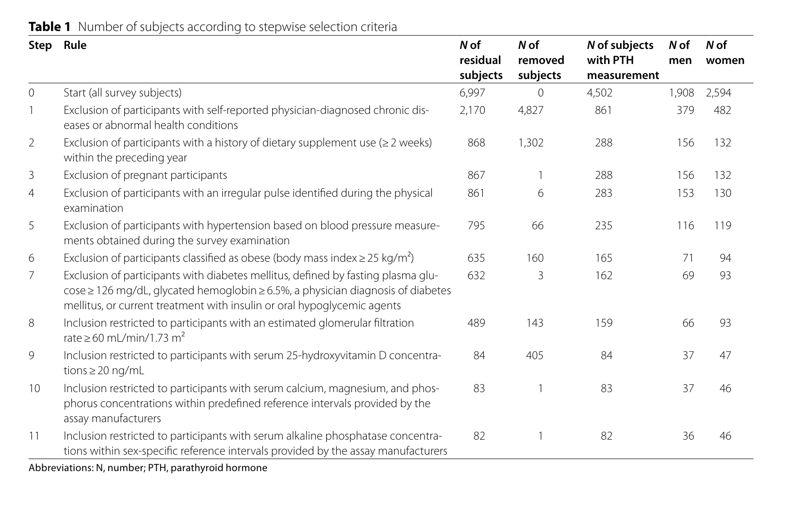{fig-alt="KNHANES 2024 PTH 분석 대상자의 특성" height="505"}

Table 1. KNHANES 2024 PTH 분석 대상자의 특성 · Choi R, et al. BMC Endocr Disord 2026;26:176

1

연령·성별 등 **참고집단의 구성**

2

제외 기준 적용 뒤 **표본 수 변화**

3

하위집단별 n이 **120명 미만인지**

4

가중·비가중 결과를 구분했는지

## 검사법 비교 · Correlation ≠ Agreement {.section-break .module-method}

02 · AGREEMENT

Paired data · **관계 / 차이 / 변환 가능성**

## 논문 2 · 동일 혈청 98개 {.module-method}

PAPER 2 · TRIGLYCERIDE · Ann Lab Med 2025

**검사법 변경 전후 자료 연결** · Triglyceride harmonization

<strong>관계</strong> Correlation

<strong>변환</strong> Passing–Bablok

<strong>차이</strong> Bland–Altman

**동일 혈청 98개** · Paired method-comparison

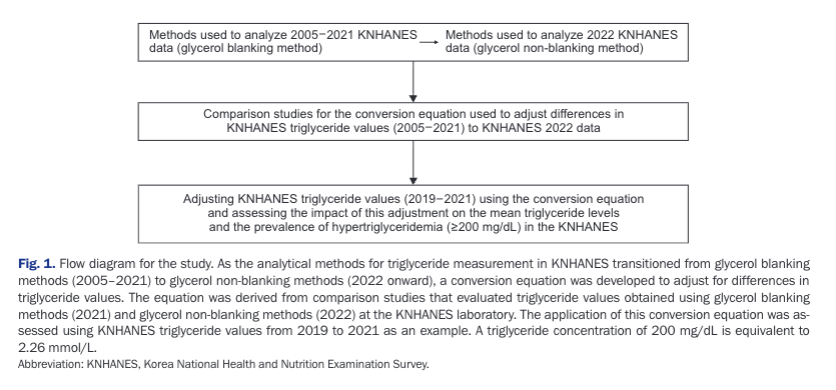{fig-alt="중성지방 검사법 변경 전후의 자료 연결" height="500"}

Figure 1. 동일 검체 비교와 KNHANES 자료의 harmonization 흐름 · Choi R, et al. Ann Lab Med 2025;45:291-299

## Correlation ≠ Agreement {.module-method}

CORRELATION

r = 0.997

두 측정값이 **함께 증가**하는 정도

AVERAGE DIFFERENCE

+10.7 mg/dL

Non-blanking이 평균적으로 더 높음

두 값이 완벽하게 같은 방향으로 움직여도

→

항상 +10 mg/dL → **불일치**

**Correlation = 관계** · **Bland–Altman = 차이**

## Passing–Bablok 회귀분석 개념도 {.module-method .image-only}

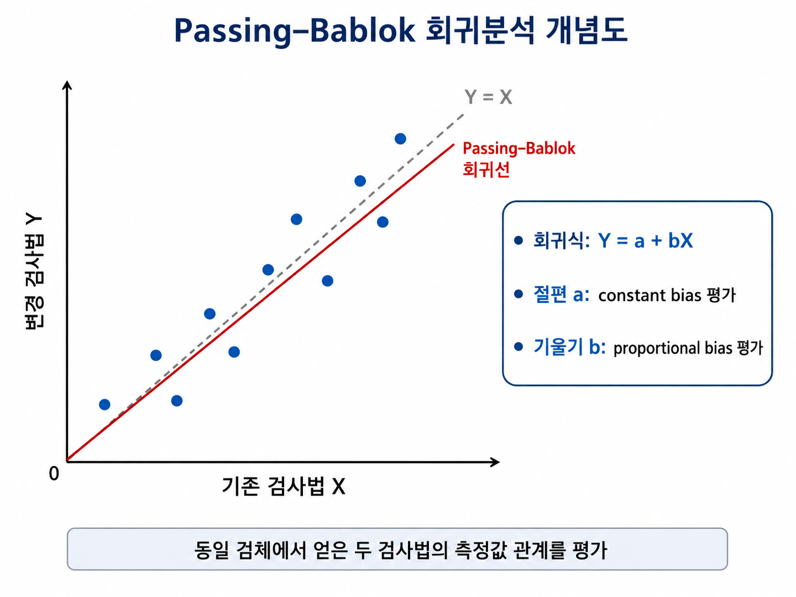{fig-alt="Passing–Bablok 회귀분석 개념도" height="620"}

**절편 = constant bias** · **기울기 = proportional bias**

## 논문 2 · Passing–Bablok + Bland–Altman {.module-method}

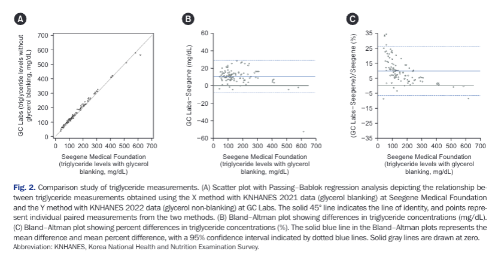{fig-alt="Passing–Bablok 회귀와 Bland–Altman 분석" height="505"}

Figure 2. Passing–Bablok 회귀와 Bland–Altman 분석 · Choi R, et al. Ann Lab Med 2025;45:291-299

변환식

Y = 11.94 + 0.99X

X: blanking 측정값  
Y: non-blanking 기준 변환값

**기울기 95% CI**  
0.977–1.013 → 1 포함

**절편 95% CI**  
9.50–14.76 → 0 불포함

Slope CI: 1 포함 · Intercept CI: 0 불포함 → **constant bias**

## 논문 2 · 변환 후 평균 + 유병률 {.module-method}

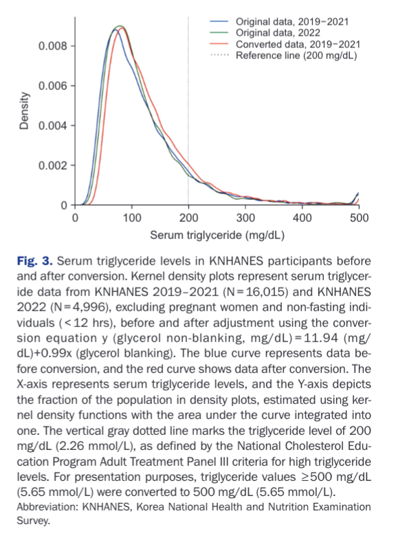{fig-alt="중성지방 변환 전후 분포 변화" height="510"}

Figure 3. KNHANES 2019–2021 중성지방 분포의 변환 전후 변화 · Choi R, et al. Ann Lab Med 2025;45:291-299

평균

123.7

mg/dL

→

변환 후

134.3

mg/dL

고중성지방혈증

11.9%

≥200 mg/dL

→

변환 후

13.8%

비가중 · N = 16,015

**검사법 보정이 유병률 통계를 바꾼다** · 11.9% → 13.8%

## Difference · Bias · Percent bias {.module-method .image-only}

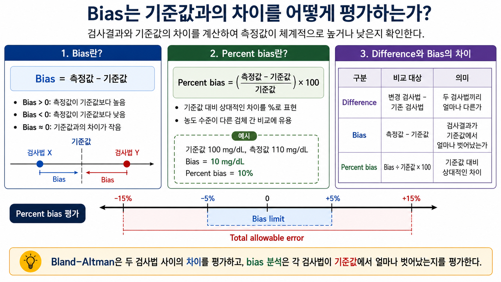{fig-alt="Difference, bias, percent bias의 구분" height="620"}

**Bland–Altman = 두 검사법 사이의 차이** · **Bias = 기준값에서 벗어난 정도**

## 논문 2 · 외부 기준값 대비 Bias {.module-method}

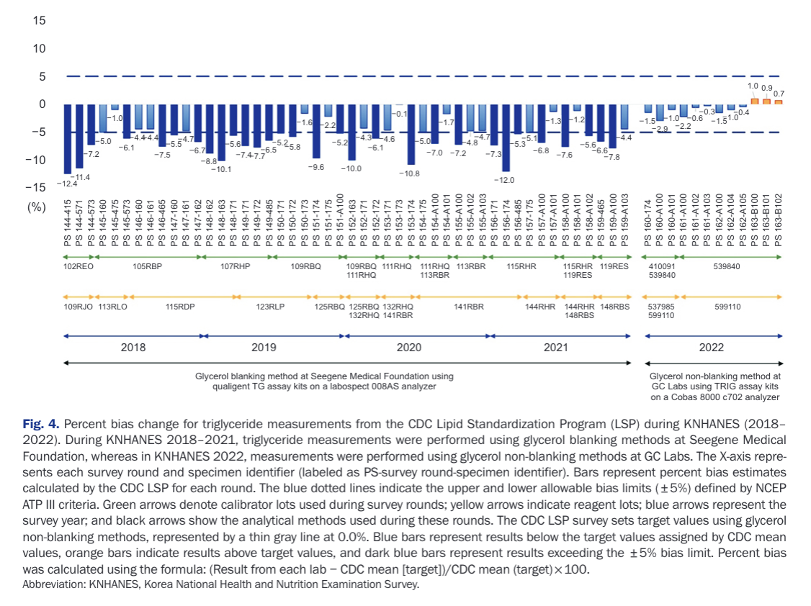{fig-alt="CDC LSP 기준값 대비 검사법별 bias" height="510"}

Figure 4. CDC LSP target value 대비 검사법별 bias · Choi R, et al. Ann Lab Med 2025;45:291-299

2018–2021 · Blanking

기준값보다 전반적으로 낮고, bias가 주로 **−5% 기준을 초과**

2022 · Non-blanking

Bias가 **±5% 이내**로 CDC LSP 기준에서 수용 가능

**방법 간 관계 ≠ 외부 기준값 대비 정확도**

## 비율 비교 · 분모 먼저 {.section-break .module-amr}

03 · PROPORTION

집락률 / 내성률 / MDR · **분모 각각 확인**

## 논문 3 · 집락률 ≠ 내성률 {.module-amr}

PAPER 3 · GBS COLONIZATION · Yonsei Med J 2022

GBS 양성 배양 검체 수

전체 질 면봉 배양 검체 수

집락률

특정 항균제 내성 균주 수

해당 항균제 감수성 검사 균주 수

내성률

**전체 배양 검체**

33,721건

**GBS 양성**

3,578건 · 10.6%

**감수성 검사 시행**

1,672균주 · 46.7%

**MDR**

538균주 · 32.2%

**분모가 한 슬라이드 안에서 세 번 바뀐다** · 33,721 → 3,578 → 1,672

## 논문 3 · 연도별 집락률 {.module-amr}

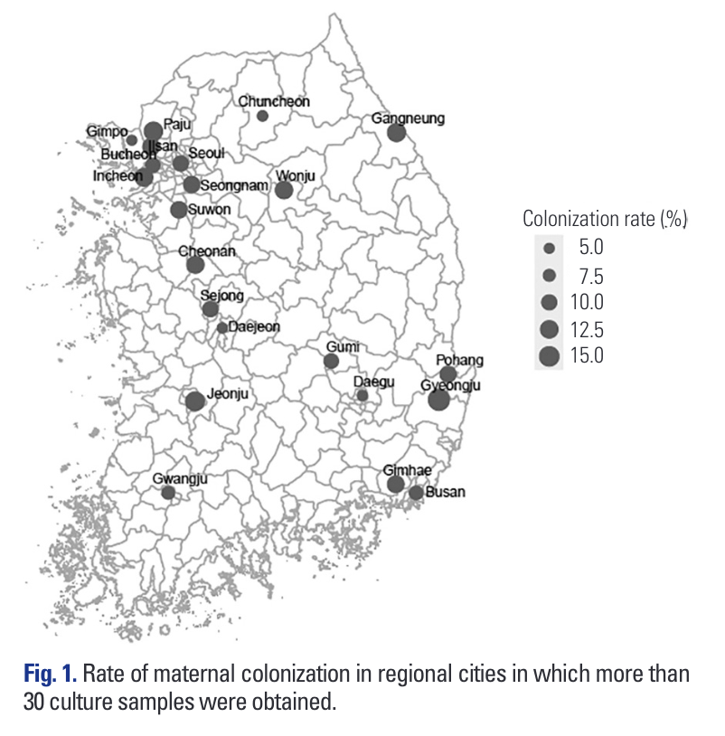{fig-alt="연도별 GBS 집락률" height="500"}

Figure 1. 2018–2020년 GBS 집락률 · Bae HG, et al. Yonsei Med J 2022;63:717-723

2018
10.8%

2019
10.5%

2020
10.5%

**연도별·지역별 비율 비교** · Chi-square test

**지역별 집락률 · 9.6%–13.2%**

경상도 9.6% ~ 전라도 13.2%

## 논문 3 · 항균제별 내성률 {.module-amr}

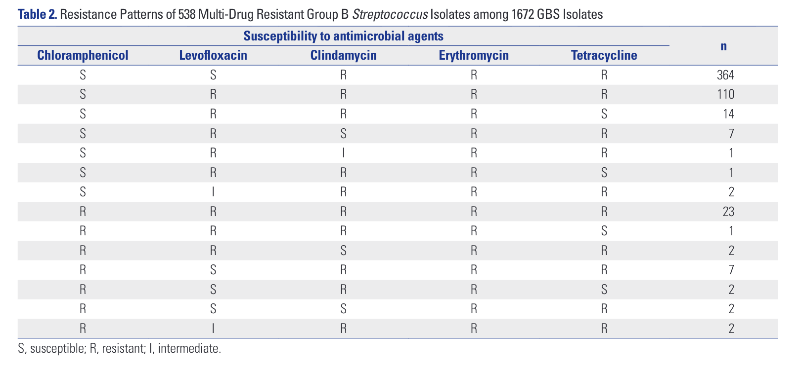{fig-alt="GBS 균주의 항균제 감수성 결과" height="510"}

Table 2. GBS 균주의 항균제별 감수성 결과 · Bae HG, et al. Yonsei Med J 2022;63:717-723

β-lactam·Vancomycin

연구 기간 동안 감수성 유지

비β-lactam 내성

Levofloxacin **18.2%–19.6%**  
Clindamycin **33.4%–35.7%**  
Erythromycin **35.6%–36.8%**  
Tetracycline **50.0%–53.3%**

**MDR 538/1,672 · 32.2%** · 분모는 chloramphenicol 감수성 검사가 시행된 균주

## 2×2 표 · Chi-square와 Fisher’s exact {.module-amr}

Pearson Chi-square test

**Asymptotic approximation**

X² 통계량을 카이제곱분포로 근사

표본이 크면 정확검정과 사실상 같은 결과

Fisher’s exact test

**Exact probability**

고정된 주변합에서 가능한 2×2 표를 직접 계산

기대 빈도가 작아도 Type I error가 α를 넘지 않음

논문 3

N = 33,721

근사가 충분 → Chi-square

vs

논문 5

37 vs 209

희소 셀 → Fisher’s exact

**표본이 크면 두 결과는 같다** · 기대 빈도가 작을 때만 차이가 난다

계산 부담이 없는 지금은 2×2에서 정확검정을 기본으로 두면 기대 빈도 규칙을 따로 외울 필요가 없음 · 다만 Fisher는 주변합을 고정하는 조건부 검정이라 다소 보수적 · Agresti (1992), Upton (1992)

## 미생물 다중결과 · 분석 층 + FDR {.section-break .module-microbiome}

04 · MULTIPLICITY

양성/음성 · Ct value · 상대 풍부도 · Alpha/Beta diversity

## 논문 4 · qPCR + 16S {.module-microbiome}

PAPER 4 · CRC MICROBIOME · Sci Rep 2020

qPCR

특정 세균의 **양성/음성**과 **Ct value**

Fisher’s exact test · Mann–Whitney U test

16S rRNA

전체 군집의 **상대 풍부도**와 **다양성**

Alpha/Beta diversity · OTU 비교 · FDR

**환자 38명 · 조직 39개** · 한 환자에 병변 2개

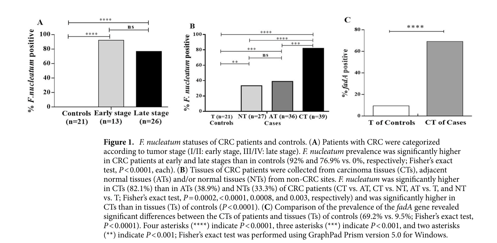{fig-alt="조직 유형별 F. nucleatum qPCR 결과" height="500"}

Figure 1. 조직 유형별 F. nucleatum qPCR 결과 · Kim M, et al. Sci Rep 2020;10:19915

## 논문 4 · 양성률 ≠ Ct value {.module-microbiome}

DETECTION RATE

32/39 · 82.1%

대장암 조직의 *F. nucleatum* 양성

CONTROL

0/21 · 0%

대조군 정상 조직의 양성

<strong>양성률</strong> Fisher’s exact test P &lt; 0.0001

<strong>Ct value</strong> Mann–Whitney U test P &lt; 0.001

<strong>조직 위치</strong> 종양 82.1% 인접 38.9% · 원거리 33.3%

**양성률 = 범주형** · **Ct value = 연속형**

## Beta diversity 그림을 읽는 법 {.module-microbiome .image-only}

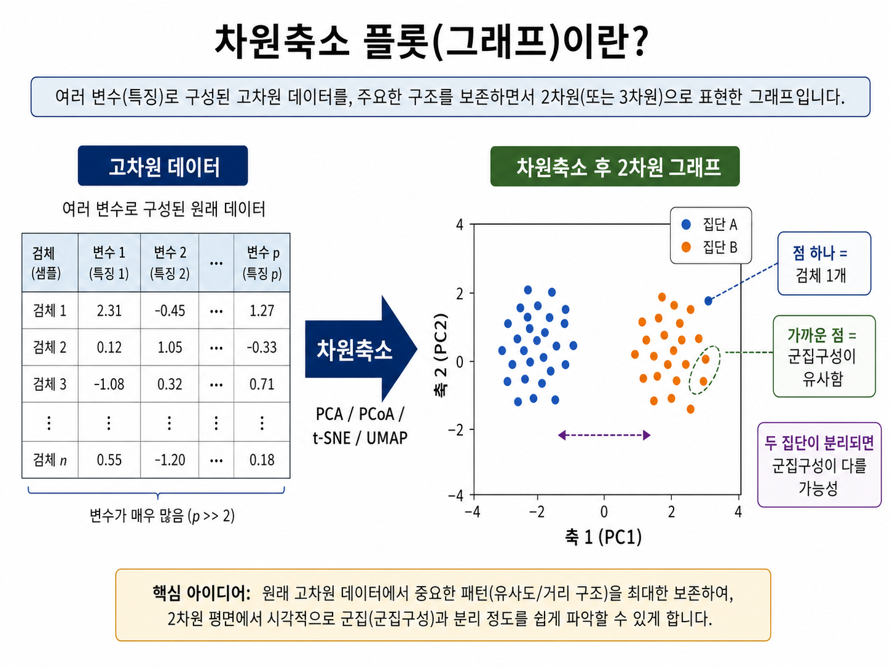{fig-alt="차원축소 플롯의 개념" height="620"}

**점 하나 = 검체 하나** · 두 집단이 분리되면 군집 구성이 다를 가능성

## 다중검정 → FDR {.module-microbiome}

검정을 1번 시행

P &lt; 0.05

우연한 양성 위험 5%

→

698개 OTU를 각각 검정

거짓 양성 누적

작은 P value가 우연히 늘어남

**원 P value**

OTU별 검정

**순위화**

작은 P부터 정렬

**FDR 보정**

기대 거짓 발견 비율 통제

**보정 결과 보고**

q value 또는 adjusted P

**FDR 보정 후 유의성** · 고차원 자료의 핵심

## 논문 4 · 전체 군집 vs 개별 OTU {.module-microbiome}

{fig-alt="16S rRNA 군집 분석과 FDR 보정 결과" height="510"}

Figure 3. 16S rRNA 군집 분석과 FDR 보정 결과 · Kim M, et al. Sci Rep 2020;10:19915

전체 군집

Alpha diversity와 Beta diversity 모두 **유의한 차이 없음**

개별 OTU

698개 중 FDR 보정 후 **6개 OTU**에서 차이 확인

**전체 군집 차이 없음 ≠ 개별 OTU 차이 없음**

## 논문 4 · 관련성 ≠ 인과성 {.module-microbiome}

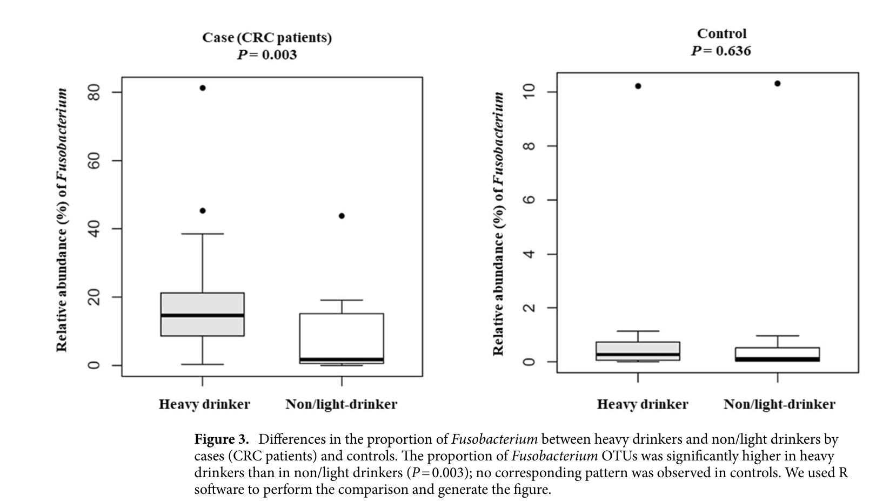{fig-alt="음주 여부와 Fusobacterium relative abundance" height="510"}

Figure 4. 음주 여부와 Fusobacterium relative abundance · Kim M, et al. Sci Rep 2020;10:19915

Heavy drinker
14/15 · 93.3%

*Fusobacterium* 검출

vs

Non/light drinker
6/17 · 35.3%

11/17은 비검출

**P = 0.003**

Heavy drinker에서 *Fusobacterium* relative abundance 증가

**관련성 ≠ 인과성** · 15명 vs 17명 · 인과 결론 불가

## WGS · 계통 + 내성 조합 {.section-break .module-amr}

05 · PROFILE

표현형 · ST/CC · cps · ARG · AMR profile · 시간 변화

## WGS 결과를 범주형 변수로 정리 {.module-amr .image-only}

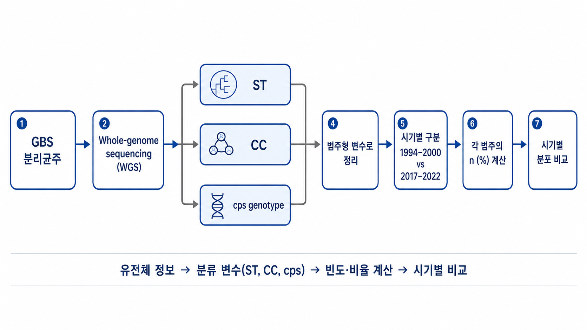{fig-alt="WGS 결과를 범주형 변수로 정리하는 흐름" height="600"}

**유전체 정보도 결국 n (%) 로 비교** · 분석 단위는 균주 하나

## 논문 5 · AST → WGS → ARG → Profile {.module-amr}

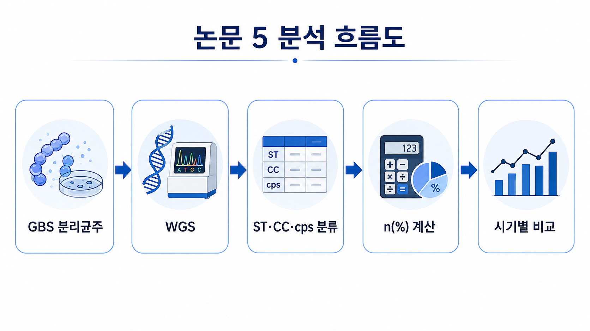{fig-alt="GBS 계통과 항균제 내성 분석 흐름도" height="505"}

분석 흐름도. GBS 감수성 검사와 WGS 기반 계통·내성 분석 · Ahn K, et al. Ann Lab Med 2025 기반

PAPER 5 · GBS WGS · Ann Lab Med 2025

**AST**

표현형 내성

**WGS**

ST · CC · cps

**ARG**

내성 유전자

**Profile**

내성 조합

**37 vs 209균주** · 백분율 + 실제 빈도를 함께 확인

## 논문 5 · 희소 범주 → Fisher’s exact {.module-amr}

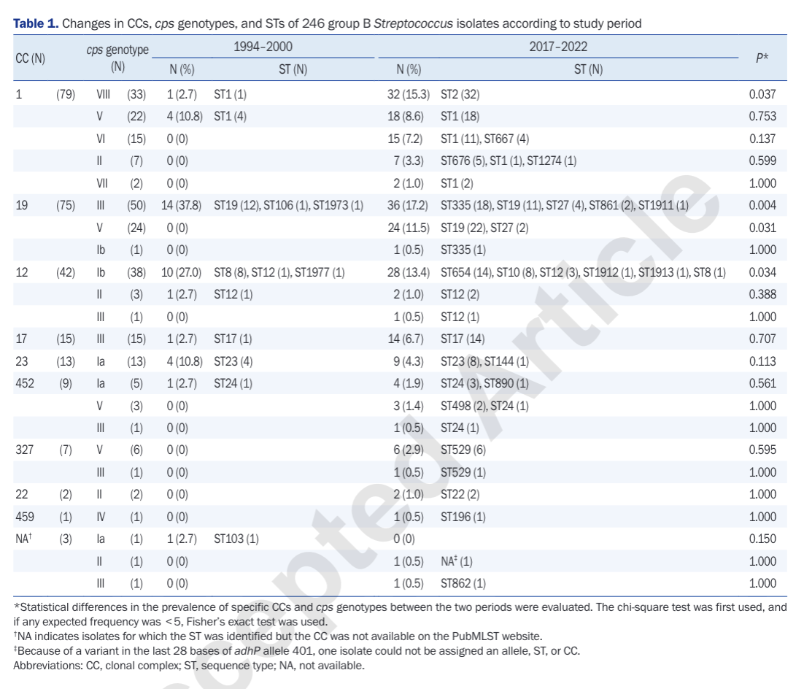{fig-alt="시기별 GBS 계통과 cps genotype 분포" height="515"}

Table 1. 1994–2000년과 2017–2022년의 ST·CC·cps genotype 분포 · Ahn K, et al. Ann Lab Med 2025

가장 흔한 CC

과거 **CC19 · 35.1%** (13/37)  
최근 **CC1 · 35.4%** (74/209)

cps genotype VIII

과거 1균주 → 최근 32균주  
**P = 0.037**

**앞의 그 상황** · 기대 빈도가 작은 칸 → 정확 검정

## 논문 5 · 표현형 내성 ≠ ARG {.module-amr}

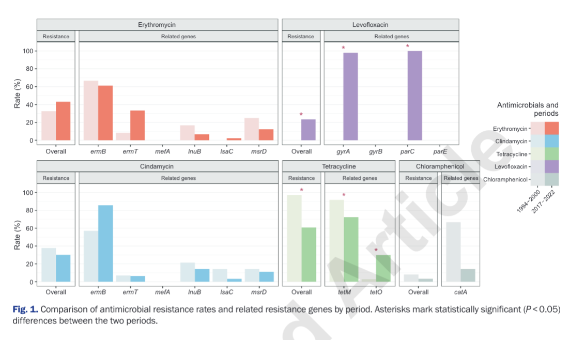{fig-alt="표현형 내성률과 내성 유전자 보유율 변화" height="500"}

Figure 1. 시기별 표현형 내성과 관련 내성 유전자 변화 · Ahn K, et al. Ann Lab Med 2025

TETRACYCLINE R
97.3% → 60.8%
P &lt; 0.001

tetO
2.8% → 29.9%
P = 0.017

LEVOFLOXACIN R
0% → 23.4%
P = 0.001

tetM
91.7% → 72.4%
P &lt; 0.001

**표현형과 유전자를 각각 시기 비교** · 둘의 일치도는 별개 질문

## Genotype–phenotype 일치도는 어떻게 보는가 {.module-amr}

시기별 비율 비교

표현형 내성률의 변화, ARG 보유율의 변화를 **각각** 검정

두 곡선이 반대로 움직여도 균주별로 어떻게 대응하는지는 알 수 없음

균주 단위 일치도

같은 균주에서 **ARG 보유 × 표현형 내성** 2×2 표를 만든 뒤

Sensitivity · Specificity · PPV · NPV · Cohen’s kappa를 95% CI와 함께 제시

유전자를 가지고 있다

열쇠 보유

≠

실제로 내성을 보인다

문이 열린다

**발현·기능 변이·breakpoint·다른 내성 기전**이 사이에 있다 · 이 논문은 일치도 분석을 별도로 하지 않음

## 논문 5 · AMR profile = 내성 조합 {.module-amr}

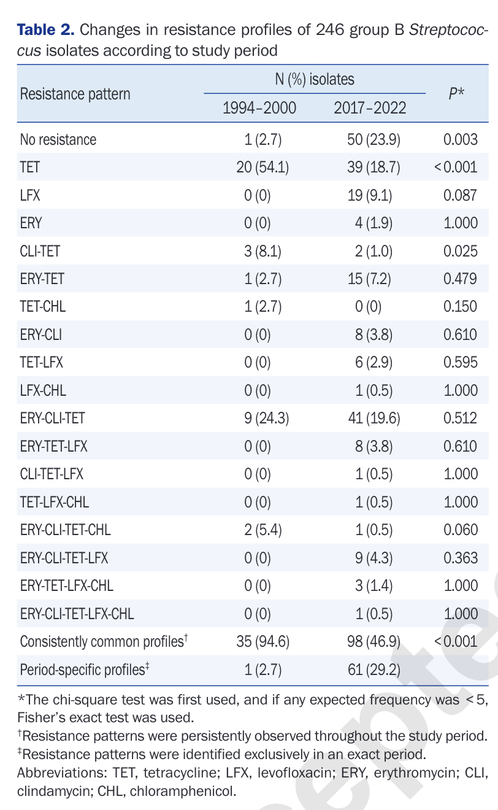{fig-alt="시기별 AMR profile 분포" height="515"}

Table 2. 1994–2000년과 2017–2022년의 AMR profile 분포 · Ahn K, et al. Ann Lab Med 2025

과거
6종

→

최근
16종

최근 새롭게 확인된 profile **11종**

Levofloxacin 내성 균주의 **81.8%**가 신규 profile에 포함

**개별 내성률 ≠ 내성 조합 다양성**

## 다음 논문을 읽을 때 · 7문항 {.module-overview}

01
**핵심 추정값** · 범위 / 차이 / 비율 / 군집

02
**분석 단위** · 사람 / 검체 / 균주

03
**비율** · 분자 / 분모

04
**자료 구조** · 독립 / Paired

05
**표본 수와 95% CI** · P value만 보지 않기

06
**다중검정** · FDR 보정

07
**해석 범위** · 관련성 / 인과성 · 참고집단과 검사 패널이 결론의 적용 범위를 정한다

## Take-home messages {.module-overview}

**01**

PTH 참고구간 · 집단 차이 검정 X · **검사값 분포 범위**

**02**

TG 검사법 비교 · **Correlation ≠ Agreement**

**03**

GBS 집락률 · **분모 + 분석 단위 먼저**

**04**

CRC 미생물 · **전체 군집 / 개별 feature / FDR**

**05**

GBS WGS · **계통 / ARG / 표현형 / profile**

**06**

논문 통계 · **연구 질문 → 분석 단위 → 방법**

**연구 질문 → 분석 단위 → 결과변수 → Figure/Table**

