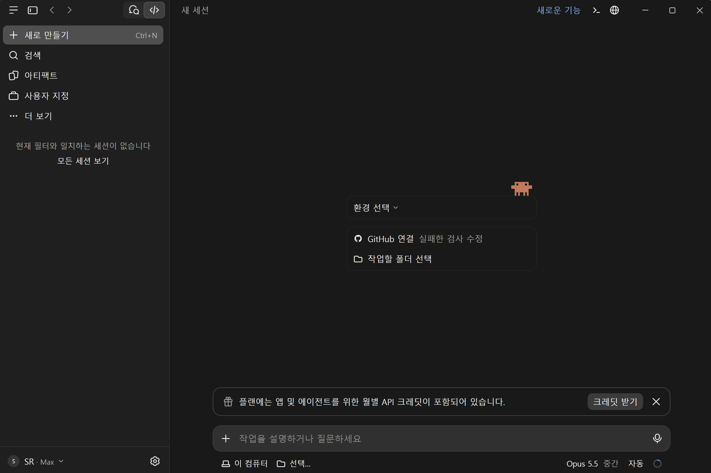
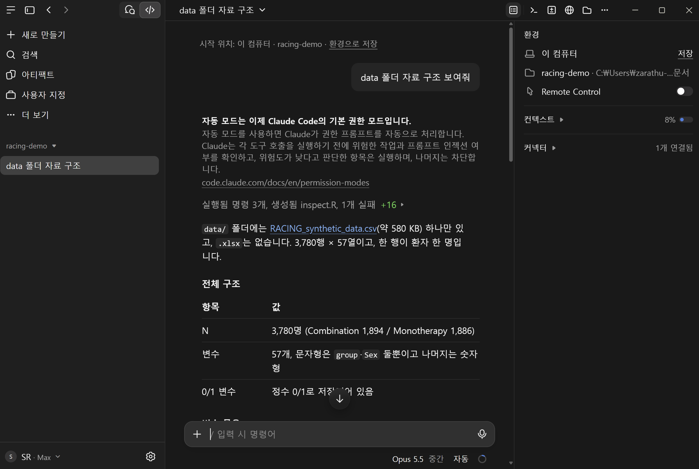
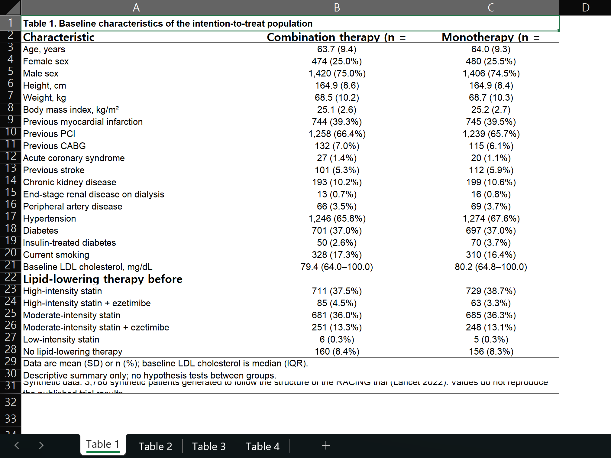
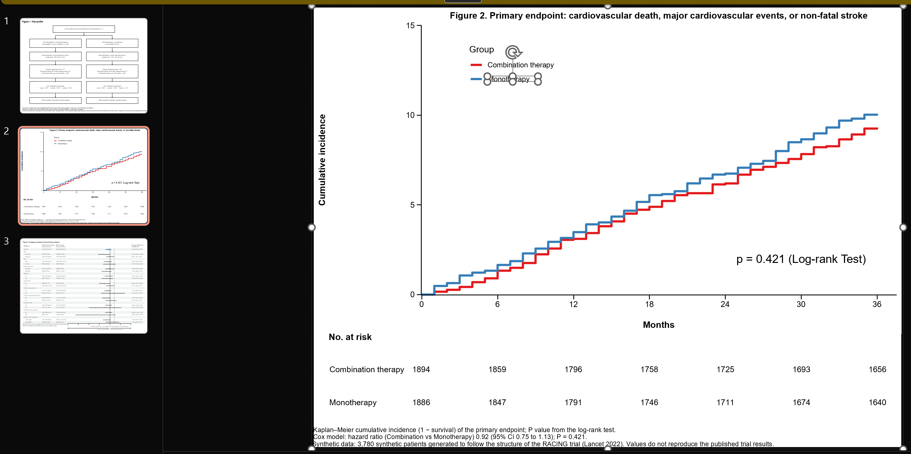
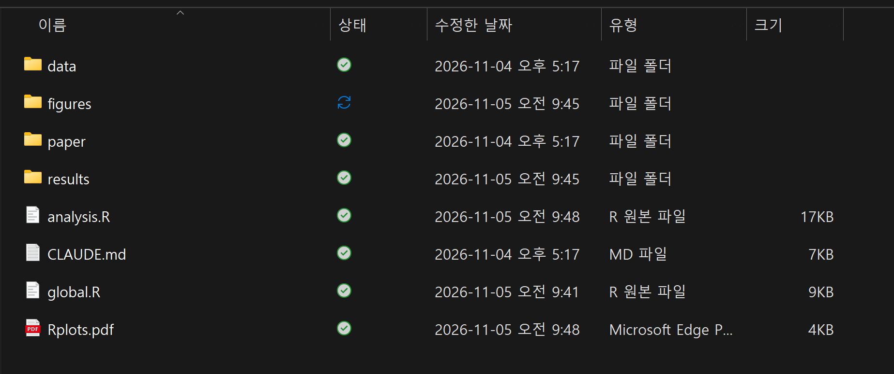
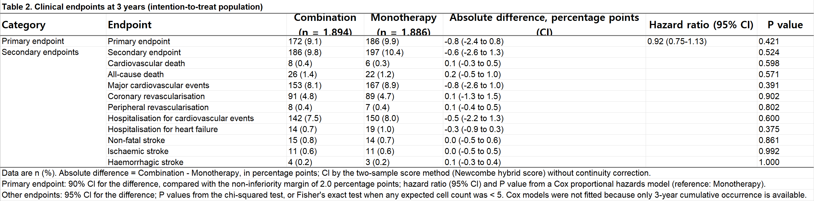

## 강의 순서

::::::: summary-grid-4
::: {.summary-item .si-green}
**1. 설치**

ChatGPT·Claude 데스크톱
:::

::: {.summary-item .si-blue}
**2. 세팅**

CLAUDE.md: 분석 스타일 고정
:::

::: {.summary-item .si-teal}
**3. 사용법**

자연어 지시 → 표·그림 파일
:::

::: {.summary-item .si-purple}
**4. 재현**

가상자료 RACING 논문 재현
:::
:::::::

::: highlight-box
목표: **내 연구에 AI agent 직접 활용**
:::

## AI agent가 하는 일

| 구분 | 일반 챗봇 | AI agent (Codex, Claude Code) |
|---|---|---|
| 작업 방식 | 답변 → 사람이 복사 | 파일 읽기·수정, 명령 실행 |
| 실행 위치 | 웹 브라우저 | 내 컴퓨터 작업 폴더 |
| 맥락 | 질문 하나 | 프로젝트 파일 + 이전 작업 |
| 결과물 | 코드 조각 | `.R`, 표(Excel), 그림(PPT) 파일 |

::: highlight-box
코드 알려주는 도구 X → 작업 폴더에서 코드 작성·실행·수정하는 도구 O
:::

## ChatGPT와 Claude

:::::: columns
::: {.column width="50%"}
**ChatGPT 데스크톱 · Codex**

- ChatGPT 계정 로그인
- 지시 파일: `AGENTS.md`
:::

::: {.column width="50%"}
**Claude 데스크톱 · Claude Code**

- Claude 계정 로그인 (Pro 이상)
- 지시 파일: `CLAUDE.md`
:::
::::::

::: highlight-box-gray
사용법 거의 동일 · 오늘은 Claude 기준
:::

# 의료데이터와 AI

## 데이터 전송·보관

| 플랜 | 모델 학습 | 서버 보관 |
|---|---|---|
| 개인용 (Free·Pro·Max) | 설정에 따라 (켜면 학습에 사용) | 켜짐 5년 · 꺼짐 30일 |
| 기업용 (Team·Enterprise·API) | 사용 안 함 | 30일 (Enterprise 일부 ZDR 가능) |

::: highlight-box
Claude가 읽은 파일 내용도 대화와 함께 서버로 전송
:::

::: highlight-box-gray
개인용 설정: claude.ai/settings/data-privacy-controls · 내 PC에도 대화 기록 저장 (`~/.claude/projects/`)
:::

::: small-source
출처: Claude Code Docs, Data usage
:::

## 보건의료데이터 활용 가이드라인

보건복지부·개인정보보호위원회 (2026.11) · LLM 활용 격리원칙

:::::: columns
::: {.column width="38%"}
::: large
1. **물리적 격리**<br>LLM 서버는 국내
2. **기능적 격리**<br>입력 데이터 저장·학습 금지
:::
:::

::: {.column width="62%"}
| 유형 | 예 | 의료데이터 |
|---|---|---|
| 1. 퍼블릭 웹서비스 | ChatGPT·Gemini·Claude 일반 구독 | **불가** |
| 2. 보안형 B2B | Enterprise, 학습 안 되는 API | 제한적 허용 (국내 서버) |
| 3. 폐쇄형 클라우드 | AWS Bedrock, Azure, GCP | 제한적 허용 (국내 서버) |
| 4. 의료기관 서버 | 기관이 국내에 구축 | 허용 |
:::
::::::

::: highlight-box
Claude Pro·Max 구독 = 유형 1 · 의료데이터 입력 전 기관 지침 확인
:::

# 설치와 세팅

## Claude 데스크톱 설치

:::::: columns
::: {.column width="40%"}
::: large
1. claude.ai/download
2. Claude 계정 로그인
3. 왼쪽 위 **Code** 탭
4. 작업 폴더 선택
:::
:::

::: {.column width="60%"}
{width="100%"}
:::
::::::

## 작업 폴더

{width="62%" fig-align="center"}

::: highlight-box
연구 하나 = 폴더 하나 · 데이터, `global.R`, `analysis.R`, 결과물 모두 한 폴더
:::

## CLAUDE.md

| 위치 | 적용 범위 | 내용 |
|---|---|---|
| `~/.claude/CLAUDE.md` | 모든 프로젝트 | 패키지, 코딩 스타일, 표·그림 저장 규칙 |
| `프로젝트/CLAUDE.md` | 해당 폴더 | 연구 설계, 변수 설명, 산출물 목록 |

```
my_study/
├── CLAUDE.md      ← 연구 지침
├── data/          ← 원본 자료
├── global.R       ← 전처리
├── analysis.R     ← 분석
└── results/       ← xlsx, pptx
```

::: highlight-box
한 번 작성 → "Table 1 만들어줘" 한 줄에도 같은 스타일
:::

## CLAUDE.md 내용

::::::: summary-grid-4
::: {.summary-item .si-green}
**코딩 스타일**

패키지, 파일 구성
:::

::: {.summary-item .si-blue}
**표 규칙**

제목, 주석, 95% CI, 라벨, Excel
:::

::: {.summary-item .si-teal}
**그림 규칙**

PPT 벡터그래픽, P value 표기
:::

::: {.summary-item .si-purple}
**자주 틀리는 것**

패키지별 에러, 주석·검정 불일치
:::
:::::::

::: highlight-box-gray
평소 분석 스타일·자주 겪는 에러 → 직접 작성, 쓰면서 계속 추가
:::

## 예시 1 · 코딩 스타일

```markdown
## 기본 원칙
- data.table을 메인으로, pipe는 %>%만
- 정리는 global.R, 분석은 analysis.R로 분리
- 파생변수는 out 만들기 전에 모두 만든다. out 이후 새 변수 금지

## global.R 순서
1. 데이터 읽기 → 2. 전처리·파생변수 → 3. varlist
4. out → 5. factor/numeric 지정 → 6. out.label (jstable::mk.lev) → 7. 라벨
- 생존분석이면 varlist$Event, varlist$Time 순서를 맞춘다
- 0/1 변수는 levels = c("0", "1")로 고정
```

::: highlight-box
매번 같은 구조의 `global.R` → 다른 연구 코드도 쉽게 파악
:::

## 예시 2 · 표와 그림

```markdown
## 표
- flextable + set_caption(표 제목) + add_footer_lines(통계방법)
- 표는 Excel로만 저장 (flexlsx + openxlsx2, 표마다 시트 하나)
- 같은 그룹명 반복 금지 → merge_v()
- raw 변수명 대신 라벨
- 모든 점추정에 95% CI, CI 산출법은 footer에

## 그림
- officer + rvg로 PPT 벡터그래픽, fullsize
- plot_list에 모은 뒤 for문으로 슬라이드 추가
- 그림 속 통계값은 직접 계산해서 annotate()
- P value는 소수 셋째 자리, 0.001 미만은 P < 0.001
```

## 예시 3 · 자주 틀리는 것

```markdown
## 주의사항
- survfit/coxph는 eval(substitute()) 패턴
  (formula를 변수로 넘기면 jskm, cox2.display가 실패)
- jskm(pval = TRUE)에는 data = dd 필요
- Table 1 nonnormal 지정하면 footer도 Wilcoxon으로,
  2군 비교면 testNonNormal = wilcox.test
- footer는 실제 사용한 검정과 일치시킬 것
- 보이는 텍스트는 ≥, ≤, kg/m²
```

::: highlight-box
겪은 에러 → 한 줄 추가 → 같은 실수 반복 X
:::

## 승인 방식

| 모드 | 동작 | 시기 |
|---|---|---|
| 자동 (기본) | 위험도 낮은 작업은 실행, 위험한 작업은 차단 | 기본값 |
| 매번 묻기 | 파일 수정·명령 실행 전 확인 | 작업 내용 직접 확인 |
| 수정 자동 승인 | 파일 수정 바로, 명령은 확인 | 익숙해진 뒤 |
| Plan mode | 계획만, 실행 X | 큰 분석 시작 전 |

::: highlight-box-blue
기본은 자동 · 처음엔 매번 묻기로 작업 내용 확인도 방법
:::

# Claude 사용법

## 자주 쓰는 기능

| 입력 | 기능 |
|---|---|
| `@global.R` | 파일 지정 |
| PDF·이미지 끌어넣기 | 논문 표 첨부 → "이 형식으로" |
| `Esc` | 작업 중단 |
| `/clear` | 새 대화 |
| `/compact` | 긴 대화 요약 후 계속 |

## 지시 방법

| 막연한 지시 | 구체적인 지시 |
|---|---|
| "분석해줘" | "group 기준 Table 1, Age는 nonnormal" |
| "그래프 그려" | "primary endpoint KM, cumulative incidence, months" |
| "저장해" | "PPT로 저장, fullsize 벡터그래픽" |

1. "data 폴더 자료 구조 보여줘"
2. "global.R 만들어줘"
3. "Table 1 만들어줘"
4. "Excel로 저장해줘"

## 주요 패키지

| 패키지 | 역할 |
|---|---|
| `data.table` | 읽기·전처리 |
| `jstable` | Table 1, 회귀분석 표 (`CreateTableOneJS`, `cox2.display`) |
| `jskm` | Kaplan–Meier 그림 |
| `flextable` | 논문용 표 서식 (제목, 주석, 병합) |
| `flexlsx` + `openxlsx2` | flextable → Excel 시트 |
| `officer` + `rvg` | 그림 → 편집 가능한 PPT |
| `forestploter` | subgroup forest plot |

## 표 저장: Excel

:::::: columns
::: {.column width="45%"}
```r
library(flextable); library(flexlsx)
library(openxlsx2)

ft_list <- list(
  "Table 1" = tb1 %>% flextable() %>%
    set_caption("Table 1. Baseline characteristics") %>%
    add_footer_lines("Values are mean (SD) or n (%).")
)

wb <- wb_workbook()
for (sn in names(ft_list)) {
  wb$add_worksheet(sn)
  wb <- wb_add_flextable(wb, sn, ft_list[[sn]])
}
wb$save("results/Tables.xlsx")
```
:::

::: {.column width="55%"}
{width="100%"}
:::
::::::

## 그림 저장: PPT

:::::: columns
::: {.column width="45%"}
```r
library(officer); library(rvg)

doc <- read_pptx()
for (nm in names(plot_list)) {
  doc <- doc %>%
    add_slide(layout = "Blank") %>%
    ph_with(dml(ggobj = plot_list[[nm]]),
            location = ph_location_fullsize())
}
print(doc, target = "figures/Figures.pptx")
```
:::

::: {.column width="55%"}
{width="100%"}
:::
::::::

::: highlight-box
벡터그래픽 · PPT에서 글자·색·선 바로 수정
:::

# 실전: RACING 논문 재현

## RACING trial

::: large
- Lancet 2022, documented ASCVD 3,780명
- **Combination** rosuvastatin 10 mg + ezetimibe 10 mg (n = 1,894)
- **Monotherapy** rosuvastatin 20 mg (n = 1,886)
- Primary: 3년 CV death, major CV event, non-fatal stroke
- Non-inferiority margin 2.0%p
:::

::: highlight-box-gray
원자료 대신 같은 구조의 **가상자료 (3,780명, 57변수)**
:::

## 준비물

```
racing-demo/
├── CLAUDE.md                     ← RACING 분석 지침
├── data/RACING_synthetic_data.csv
└── paper/RACING_Lancet2022.pdf
```

::: highlight-box
CLAUDE.md: 연구 설계, 변수, 표·그림별 방법 (CI 수준, 검정법)
:::

## 데모 지시

::: prompt-box
**지시 1.** data 폴더 자료 읽어서 CLAUDE.md 지침대로 global.R 만들어줘.
:::

::: prompt-box
**지시 2.** analysis.R 만들어서 Table 1–4, Figure 1–3 만들어줘. 표는 Excel, 그림은 PPT로 저장해줘.
:::

::: highlight-box-gray
실제 소요: analysis.R 약 8분 · 영상은 배속 재생
:::

## 데모 영상



## 생성된 파일

:::::: columns
::: {.column width="58%"}
{width="100%"}
:::

::: {.column width="42%"}
| 파일 | 내용 |
|---|---|
| `global.R` | 전처리, `out`, `out.label` |
| `analysis.R` | Table 1–4, Figure 1–3 |
| `results/` | Excel 표 |
| `figures/` | PPT 그림 |
:::
::::::

::: highlight-box-gray
직접 쓴 코드 0줄 · 지시 2줄
:::

## 결과 확인

{width="100%"}

| 항목 | 확인 내용 |
|---|---|
| 대상자 수 | 전체 3,780명, 군별 1,894 / 1,886 |
| CI 수준 | primary 90% CI (비열등성), 나머지 95% CI |
| 주석 | 실제 검정·CI 산출법과 일치 여부 |
| 분모 | LDL-C: 시점별 측정자만 |

# 내 연구에 적용하기

## 내 연구 적용 순서

::: large
1. Claude 데스크톱 설치, Code 탭
2. `~/.claude/CLAUDE.md`에 내 분석 스타일 작성
3. 연구 하나 = 폴더 하나, 비식별화 자료는 `data/`에
4. 연구 설계·변수 설명 → 폴더의 `CLAUDE.md`
5. "global.R 만들어줘" → "Table 1 만들어줘" → "Excel로 저장해줘"
6. 코드·주석 확인, 겪은 에러는 `CLAUDE.md`에 추가
:::

## 주의사항

1. **코드 검토** — 통계 방법, 변수 코딩, 분모
2. **환자 정보** — 실명·등록번호 X, 비식별화 후 사용
3. **주석과 실제 분석 일치** — CI 수준, 검정법
4. **재현성** — `CLAUDE.md` + `global.R` + `analysis.R` 함께 보관

::: highlight-box-gray
통계적 판단과 결과 해석은 연구자 몫
:::

## 감사합니다
